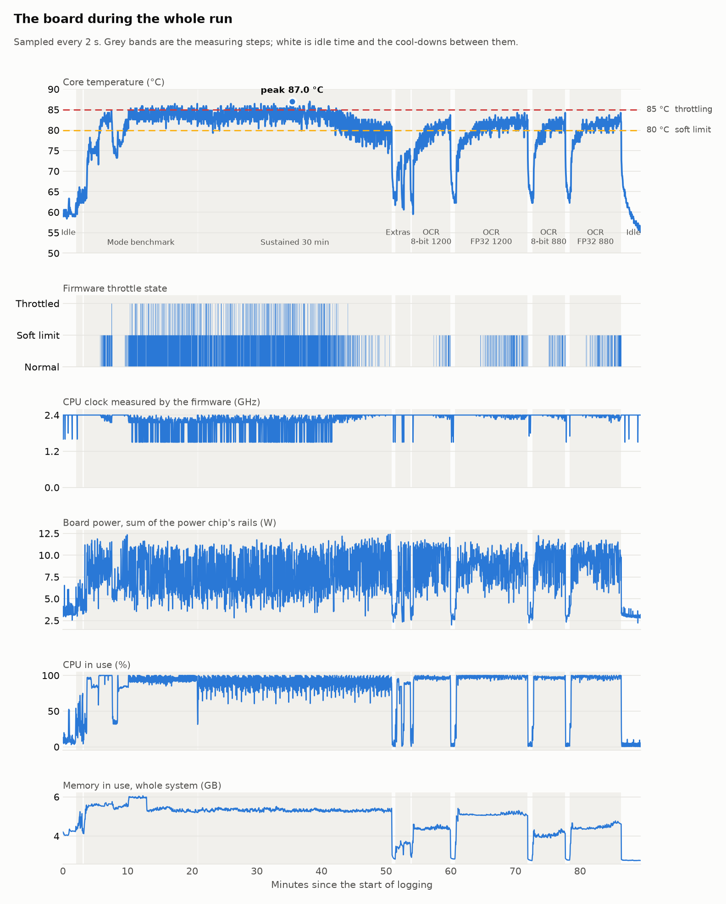
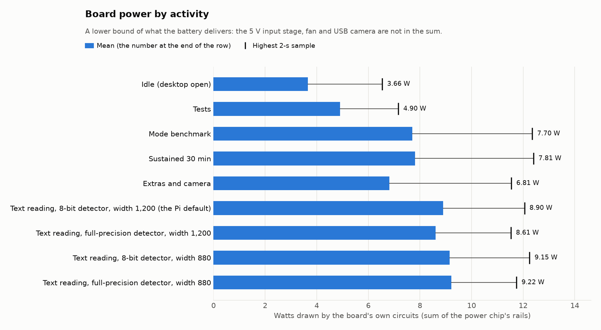
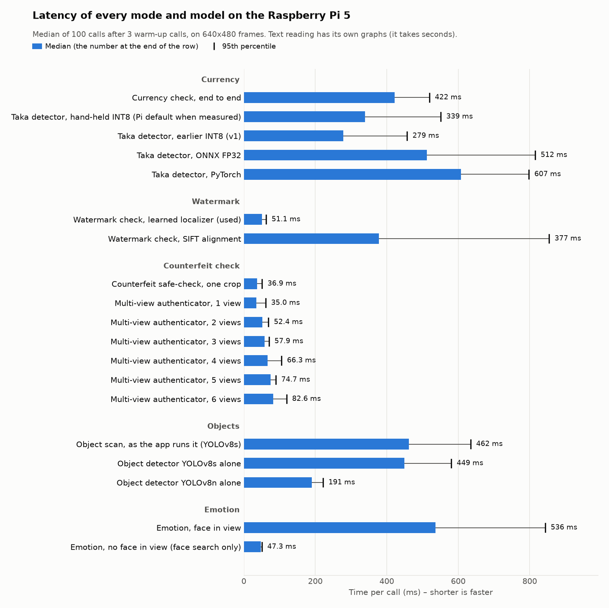
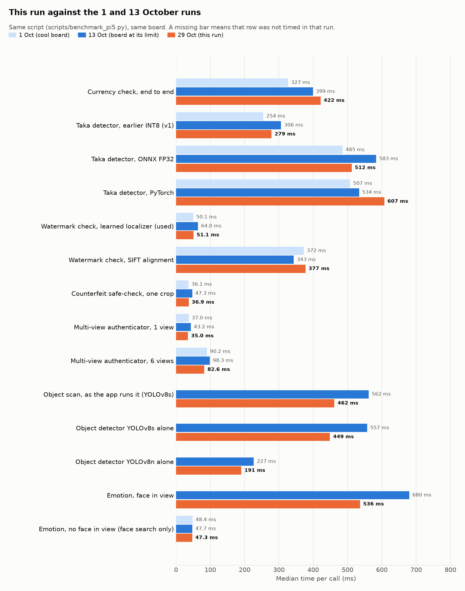
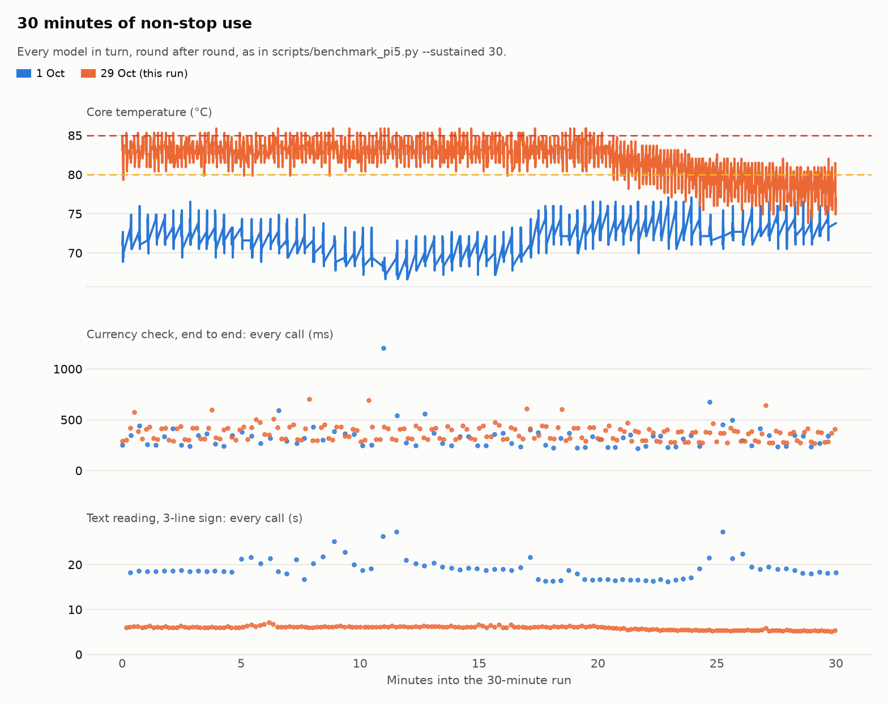
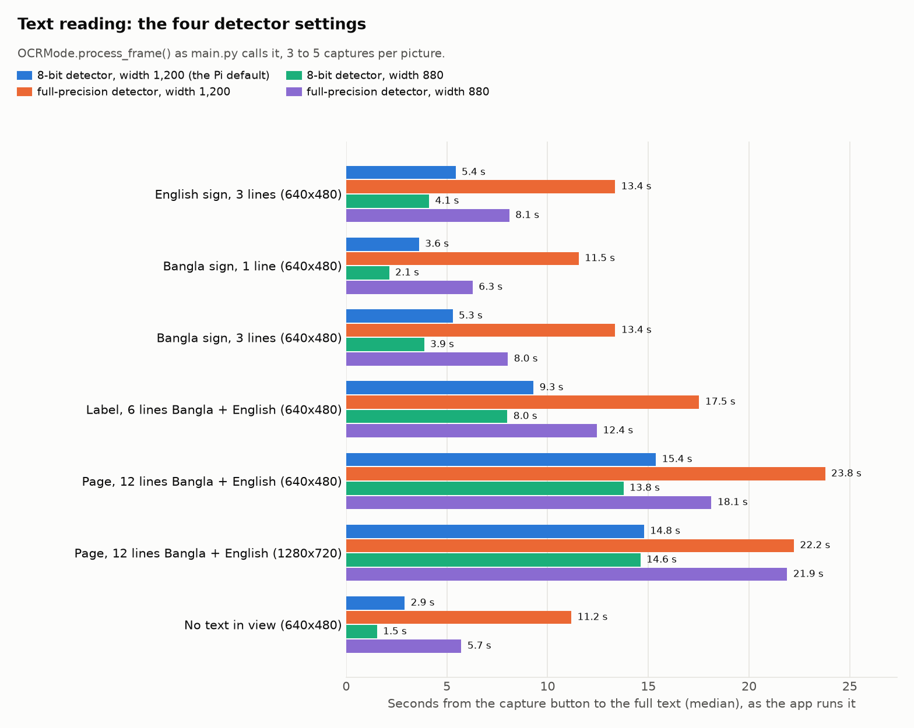
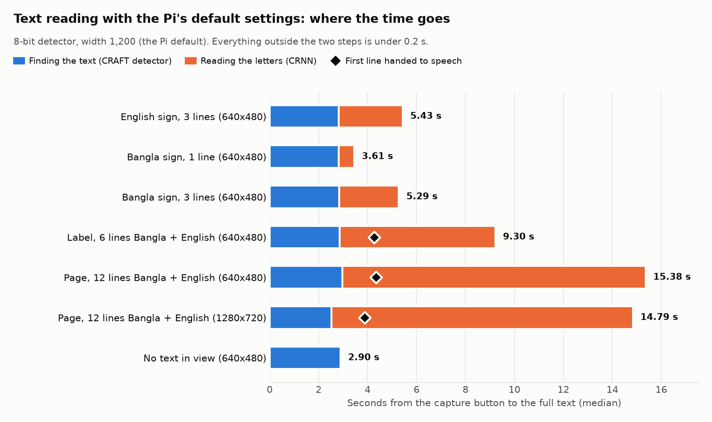
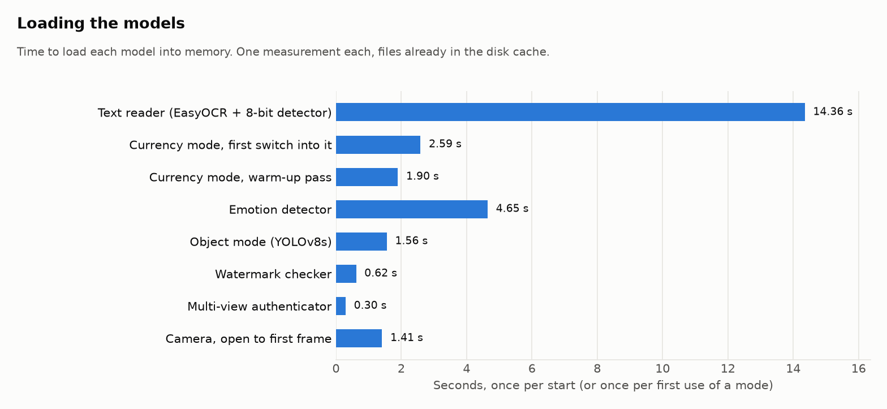

# SARA on the Raspberry Pi 5: benchmark report, 29 October 2026

Run on 29 October 2026 from 19:14 to 20:44 local time (89 minutes), on the glass's own board (Raspberry Pi 5 Model B Rev 1.0, 4 cores, Python 3.13.5, torch 2.14.1+cpu, ONNX Runtime 1.30.0, EasyOCR 1.7.2, Ultralytics 8.4.170). No GPU; everything runs on the CPU. Camera: C270 HD WEBCAM (USB webcam). Code: commit `413c5a0`, with the benchmark-script changes listed in `raw/environment.txt`.

## Headline numbers

| What | Median | 95th percentile |
|---|---:|---:|
| Currency check, end to end | 422 ms | 519 ms |
| Taka detector, hand-held INT8 (Pi default when measured) | 339 ms | 551 ms |
| Watermark check, learned localizer (used) | 51.1 ms | 62.5 ms |
| Counterfeit safe-check, one crop | 36.9 ms | 51.1 ms |
| Object scan, as the app runs it (YOLOv8s) | 462 ms | 635 ms |
| Emotion, face in view | 536 ms | 844 ms |
| Text reading, 3-line sign, 100 calls (`benchmark_pi5.py`) | 6.13 s | 6.71 s |
| Text reading, 3-line sign, as the app runs it | 5.43 s | slowest of 5: 5.74 s |
| Text reading, 12-line page: first line spoken | 4.35 s | – |
| Text reading, 12-line page: whole page | 15.38 s | slowest of 4: 15.43 s |

Core temperature 59.8 °C at idle, peak 87.0 °C, in the 30-minute sustained run; board power 3.7 W at idle and 7.8 W under sustained load. Throttle flag at the end of the mode benchmark: `0xe0000` (CPU clock capping has occurred; throttling has occurred; soft temperature limit has occurred).

### What stands out

- **Text reading is about 3× faster than on 1 October.** A 3-line sign takes 5.4 s from a cool start and 6.1 s on the hot board, against 18.7 s on 1 October. The 8-bit text detector, the Pi default whose speed `config.py` listed as unmeasured, is now measured. One detector pass takes 2.5–3.0 s, against 9.9–11.2 s for the full-precision detector, and it made no character errors on the test pictures. On speed it is clearly the right default; its accuracy is in the validation results in `config.py`.
- **Reading width 880 instead of 1,200** saves about 1.3 s on short signs (4.1 s against 5.4 s for the English sign) and on the blank picture. It made the only character error of the run (2.9% on the 3-line Bangla sign) and gains nothing on the 1280x720 page. The default stays at 1,200 unless the accuracy results say otherwise.
- **On long text, reading the letters is now the slow part.** On a 12-line page it takes 12.4 of the 15.4 s, but the first line is spoken after 4.35 s. A picture with no text gets "no text found" in 2.9 s; on 13 October it made up 48 letters.
- **The board runs hot under continuous load.** In the 30-minute run it averaged 82.8 °C and peaked at 87.0 °C. The soft temperature limit was active in 55% of the samples and the clock was under 2.3 GHz in 58%, with the fan at its top speed (about 10,300 rpm). On 1 October the same protocol peaked at 77.1 °C. Room temperature, case and board position were not logged on either day, so the cause is not known.
- **Something outside the run improved the cooling at minute 42 (about 19:56).** From then on the board ran 3–4 °C cooler and drew more power (8.4–8.7 W against 7.4 W) at the same CPU load, with the fan already at full speed. A change in the room or the board's position is the likely cause. As a result, the last 5 minutes of the sustained run were barely throttled. The negative "drift" in that table therefore comes from the cooler board, not from any speed-up over time.
- **Currency check: 422 ms end to end (2.4 a second).** About 60 ms of the increase since 1 October comes from the hand-held detector, which is slower than the earlier INT8 model (339 ms against 279 ms). The counterfeit safe-check also takes about 74 ms in the app's order, not the 31–37 ms its own row shows, because it runs straight after an ONNX Runtime model (see the 30-minute section). Stopping ONNX Runtime's threads from spinning after a run (`session.intra_op.allow_spinning` = 0) could recover most of those 40 ms. This was not tried here.
- **The Pi's currency settings changed while this run was going.** Commit `a349cfe` was pushed from the laptop at 19:19 and is not part of the measured code. It switches the Pi to the full-precision hand-held detector (`best_handheld.pt`, threshold 0.75), because the 8-bit copy lowered the confidence on close-ups. It also turns the guided watermark step off. The same model in PyTorch and 8-bit form takes 556 ms against 261 ms by that commit's own figures, and 607 ms against 279 ms in this run, for the earlier detector. So the new default should make the detector roughly 0.3 s slower per check, partly offset by the safe-check: after a PyTorch model it runs at its fast speed (36 ms in the test above). This run did not time `best_handheld.pt`.
- **Objects:** YOLOv8s takes 462 ms per scan. YOLOv8n would take 191 ms; its accuracy cost was not measured here. **Everything at once on real webcam frames** (currency, objects, and emotion every fifth frame): 748 ms a frame, 1.3 frames a second.
- **Power and memory.** The board's own circuits draw 3.7 W at idle, 7.8 W under the sustained load and about 9 W while reading text. That gives roughly 3 hours of non-stop heavy use on a 37 Wh bank (an estimate with stated assumptions). The benchmark process with every model loaded peaked at 2.55 GB and the app at 2.76 GB, well within the 8 GB board.
- **The error rates here are not field accuracy.** The rendered test pictures were read with no errors. A real photo of a printed rhyme, taken with the app earlier today, came back with letter errors ("Suton wall", "hod a great toll", "Jll the king s men"; see the app section).

## Temperature, clock and power

The board started at 63.4 °C with the throttle flag at `0x0` (nothing) before the first timing call.

| Step | Minutes | Mean °C | Peak °C | Soft limit active | Throttled or capped | Lowest clock | Clock under 2.3 GHz | Mean power | Peak power |
|---|---:|---:|---:|---:|---:|---:|---:|---:|---:|
| Idle before (desktop open) | 1.9 | 59.8 | 63.4 | 0% | 0% | 1.60 GHz | 9% | 3.66 W | 6.54 W |
| Tests | 1.0 | 63.0 | 66.1 | 0% | 0% | 1.60 GHz | 3% | 4.90 W | 7.16 W |
| Mode benchmark | 17.1 | 81.3 | 86.5 | 51% | 18% | 1.50 GHz | 56% | 7.70 W | 12.35 W |
| Sustained 30 min | 29.2 | 82.8 | 87.0 | 55% | 21% | 1.50 GHz | 58% | 7.81 W | 12.40 W |
| Extras and camera | 2.3 | 69.8 | 75.5 | 0% | 0% | 1.50 GHz | 4% | 6.81 W | 11.54 W |
| Text reading, 8-bit detector, width 1,200 (the Pi default) | 5.9 | 78.2 | 83.7 | 14% | 0% | 1.50 GHz | 2% | 8.90 W | 12.05 W |
| Text reading, full-precision detector, width 1,200 | 11.0 | 80.0 | 84.2 | 29% | 0% | 2.26 GHz | 4% | 8.61 W | 11.53 W |
| Text reading, 8-bit detector, width 880 | 5.0 | 79.2 | 84.2 | 23% | 0% | 2.20 GHz | 3% | 9.15 W | 12.25 W |
| Text reading, full-precision detector, width 880 | 7.8 | 80.2 | 84.2 | 30% | 0% | 1.70 GHz | 5% | 9.22 W | 11.74 W |
| Idle after | 2.9 | 60.5 | 72.7 | 0% | 0% | 1.50 GHz | 3% | 3.08 W | 4.04 W |

- Under-voltage was never reported, so the power supply kept up. The fan ran up to 10,341 rpm.
- The temperature is the SoC's own sensor (`thermal_zone0`), the hottest point of the board. A thermometer on the case or the board surface reads lower.
- The clock is what the firmware measures (`vcgencmd measure_clock arm`). At idle the governor drops it to 1.5 GHz by design; only a low clock under load means throttling.

**Battery estimate.** With the formula of `scripts/power_log.py` (rail sum + 30% for the input stage, fan and USB camera; a 37 Wh / 10,000 mAh power bank delivering 85% of its rating): about 3.1 h of non-stop use at the sustained-run power (7.81 W rail sum), and about 6.6 h at idle (3.66 W). The glass's real bank capacity is not recorded in the project, and the overhead is an allowance, not a measurement; a run on the bank itself with a USB power meter would replace this estimate.

## Full latency list

Each row is 100 timed calls after 3 warm-up calls, from `scripts/benchmark_pi5.py` unless marked. Frames are 640x480, the glass camera size.

| Group | Benchmark | Median | 95th pct | Mean | Calls/s | Load | Memory after | Temp after |
|---|---|---:|---:|---:|---:|---:|---:|---:|
| Currency | Currency check, end to end | 422 ms | 519 ms | 409 ms | 2.37 | 1,196 ms | 1.36 GB | 74.9 °C |
| Currency | Taka detector, hand-held INT8 (Pi default when measured) | 339 ms | 551 ms | 359 ms | 2.95 | 0.4 ms | 1.71 GB | 82.0 °C |
| Currency | Taka detector, earlier INT8 (v1) | 279 ms | 457 ms | 309 ms | 3.59 | 0.5 ms | 1.63 GB | 83.7 °C |
| Currency | Taka detector, ONNX FP32 | 512 ms | 815 ms | 560 ms | 1.95 | 11.2 ms | 1.53 GB | 83.7 °C |
| Currency | Taka detector, PyTorch | 607 ms | 798 ms | 633 ms | 1.65 | 666 ms | 1.41 GB | 76.0 °C |
| Watermark | Watermark check, learned localizer (used) | 51.1 ms | 62.5 ms | 51.7 ms | 19.58 | 618 ms | 1.74 GB | 79.3 °C |
| Watermark | Watermark check, SIFT alignment | 377 ms | 854 ms | 473 ms | 2.65 | 683 ms | 1.72 GB | 74.3 °C |
| Counterfeit check | Counterfeit safe-check, one crop | 36.9 ms | 51.1 ms | 39.0 ms | 27.10 | 228 ms | 1.72 GB | 74.9 °C |
| Counterfeit check | Multi-view authenticator, 1 view | 35.0 ms | 61.1 ms | 39.1 ms | 28.60 | 297 ms | 1.72 GB | 76.5 °C |
| Counterfeit check | Multi-view authenticator, 2 views | 52.4 ms | 68.9 ms | 57.7 ms | 19.10 | 295 ms | 1.72 GB | 76.0 °C |
| Counterfeit check | Multi-view authenticator, 3 views | 57.9 ms | 70.5 ms | 61.8 ms | 17.28 | 304 ms | 1.72 GB | 76.0 °C |
| Counterfeit check | Multi-view authenticator, 4 views | 66.3 ms | 106 ms | 74.6 ms | 15.07 | 315 ms | 1.73 GB | 75.5 °C |
| Counterfeit check | Multi-view authenticator, 5 views | 74.7 ms | 89.6 ms | 78.0 ms | 13.38 | 332 ms | 1.73 GB | 77.1 °C |
| Counterfeit check | Multi-view authenticator, 6 views | 82.6 ms | 120 ms | 89.5 ms | 12.11 | 318 ms | 1.74 GB | 76.5 °C |
| Objects | Object scan, as the app runs it (YOLOv8s) | 462 ms | 635 ms | 481 ms | 2.17 | 1,559 ms | 1.76 GB | 81.5 °C |
| Objects | Object detector YOLOv8s alone † | 449 ms | 580 ms | 462 ms | 2.23 | 569 ms | 0.79 GB | 73.2 °C |
| Objects | Object detector YOLOv8n alone † | 191 ms | 222 ms | 198 ms | 5.25 | 225 ms | 0.71 GB | 71.6 °C |
| Emotion | Emotion, face in view † | 536 ms | 844 ms | 578 ms | 1.86 | 4.65 s | 0.65 GB | 70.5 °C |
| Emotion | Emotion, no face in view (face search only) | 47.3 ms | 50.5 ms | 47.9 ms | 21.13 | 3.86 s | 2.49 GB | 81.5 °C |
| Text | Text reading, 3-line sign (benchmark frame) | 6.13 s | 6.71 s | 6.23 s | 0.16 | 12.15 s | 2.49 GB | 82.6 °C |

† from `benchmark_report/scripts/extras_bench.py` (30 calls), because the datasets the project script reads are not on the Pi. These rows ran in a separate process, so their memory column cannot be compared with the others.

Load is the time to build the model object in that process; the ONNX detectors are read from disk on their first call, so their load is near zero. Memory is the whole benchmark process after that row, not the size of one model.

- **Currency.** The note rows cycle through the 4 note pictures on the Pi (the 500 and 1,000 Taka templates and the two pictures in `samples/`). In the code measured here, currency mode on the Pi loads the hand-held 8-bit detector (`best_handheld_int8.onnx`, the Pi default from 15 to 29 October; since commit `a349cfe` the Pi loads `best_handheld.pt`, which this run did not time). The earlier INT8 detector is timed for comparison.
- **Emotion.** `benchmark_pi5.py` has no face pictures on the Pi, so its row is a frame with no face (47.3 ms, the face search alone). With a face in view (the astronaut test picture, classifier `rgb_mobilenet_blend`) one answer takes 536 ms.
- **Objects.** The app uses YOLOv8s (462 ms per scan as the app runs it); YOLOv8n would take 191 ms. No COCO pictures are on the Pi, so the scan is timed on the note pictures; the detector does the same work on any picture.

## Against the 1 and 13 October runs

| Benchmark | 1 Oct | 13 Oct | 29 Oct | Change from 1 Oct | Change from 13 Oct |
|---|---:|---:|---:|---:|---:|
| Currency check, end to end | 327 ms | 399 ms | **422 ms** | +29% | +6% |
| Taka detector, hand-held INT8 (Pi default when measured) | – | – | **339 ms** | – | – |
| Taka detector, earlier INT8 (v1) | 254 ms | 306 ms | **279 ms** | +9% | -9% |
| Taka detector, ONNX FP32 | 485 ms | 583 ms | **512 ms** | +6% | -12% |
| Taka detector, PyTorch | 507 ms | 534 ms | **607 ms** | +20% | +14% |
| Watermark check, learned localizer (used) | 50.1 ms | 64.0 ms | **51.1 ms** | +2% | -20% |
| Watermark check, SIFT alignment | 372 ms | 343 ms | **377 ms** | +1% | +10% |
| Counterfeit safe-check, one crop | 36.1 ms | 47.3 ms | **36.9 ms** | +2% | -22% |
| Multi-view authenticator, 1 view | 37.0 ms | 43.2 ms | **35.0 ms** | -5% | -19% |
| Multi-view authenticator, 2 views | 56.6 ms | 63.1 ms | **52.4 ms** | -7% | -17% |
| Multi-view authenticator, 3 views | 62.9 ms | 71.9 ms | **57.9 ms** | -8% | -20% |
| Multi-view authenticator, 4 views | 71.3 ms | 82.9 ms | **66.3 ms** | -7% | -20% |
| Multi-view authenticator, 5 views | 81.5 ms | 94.2 ms | **74.7 ms** | -8% | -21% |
| Multi-view authenticator, 6 views | 90.2 ms | 98.3 ms | **82.6 ms** | -8% | -16% |
| Object scan, as the app runs it (YOLOv8s) | – | 562 ms | **462 ms** | – | -18% |
| Object detector YOLOv8s alone | – | 557 ms | **449 ms** | – | -19% |
| Object detector YOLOv8n alone | – | 227 ms | **191 ms** | – | -16% |
| Emotion, face in view | – | 680 ms | **536 ms** | – | -21% |
| Emotion, no face in view (face search only) | 48.4 ms | 47.7 ms | **47.3 ms** | -2% | -1% |
| Text reading, 3-line sign (benchmark frame) | 18.73 s | – | **6.13 s** | -67% | – |

1 October: 100 calls a row, board cool (flag `0x0` at the end). 13 October: 30 calls a row, board at its temperature limit (flag `0xe0008`). This run: 100 calls a row. The code changed between the runs too (hand-held detector, OCR pipeline v2 with one detector pass, 8-bit text detector on the Pi, YOLOv8s), so a row whose model changed is not a like-for-like speed comparison.

## 30 minutes of non-stop use

`--sustained 30` ran every model in turn for 30 minutes: 3,193 calls. Core temperature, as the benchmark read it after each call, 73.8 to 85.9 °C (the 2-second sampler's peak is in the table above); throttle flags seen: `0xe0000`, `0xe0006`, `0xe0008`, together: CPU clock capped now; throttled now; soft temperature limit active now; CPU clock capping has occurred; throttling has occurred; soft temperature limit has occurred. On 1 October the same run made 1,229 calls and peaked at 77.1 °C.

| Model | Calls | Median, first 5 min | Median, last 5 min | Drift | Slowest call | Median in the timing pass |
|---|---:|---:|---:|---:|---:|---:|
| Currency check, end to end | 188 | 383 ms | 364 ms | -5% | 701 ms | 422 ms |
| Taka detector, hand-held INT8 (Pi default when measured) | 188 | 354 ms | 312 ms | -12% | 710 ms | 339 ms |
| Taka detector, earlier INT8 (v1) | 188 | 289 ms | 255 ms | -12% | 1,023 ms | 279 ms |
| Taka detector, ONNX FP32 | 188 | 514 ms | 461 ms | -10% | 840 ms | 512 ms |
| Taka detector, PyTorch | 188 | 490 ms | 453 ms | -8% | 706 ms | 607 ms |
| Watermark check, learned localizer (used) | 188 | 50.9 ms | 48.9 ms | -4% | 113 ms | 51.1 ms |
| Watermark check, SIFT alignment | 188 | 372 ms | 345 ms | -7% | 892 ms | 377 ms |
| Counterfeit safe-check, one crop | 188 | 86.3 ms | 82.5 ms | -4% | 205 ms | 36.9 ms |
| Multi-view authenticator, 1 view | 188 | 34.4 ms | 33.8 ms | -2% | 142 ms | 35.0 ms |
| Multi-view authenticator, 2 views | 188 | 50.4 ms | 49.5 ms | -2% | 198 ms | 52.4 ms |
| Multi-view authenticator, 3 views | 188 | 57.5 ms | 55.6 ms | -3% | 560 ms | 57.9 ms |
| Multi-view authenticator, 4 views | 188 | 65.3 ms | 64.5 ms | -1% | 257 ms | 66.3 ms |
| Multi-view authenticator, 5 views | 188 | 73.6 ms | 72.4 ms | -2% | 419 ms | 74.7 ms |
| Multi-view authenticator, 6 views | 188 | 80.5 ms | 79.2 ms | -2% | 308 ms | 82.6 ms |
| Object scan, as the app runs it (YOLOv8s) | 187 | 479 ms | 450 ms | -6% | 668 ms | 462 ms |
| Emotion, no face in view (face search only) | 187 | 49.0 ms | 46.6 ms | -5% | 70.5 ms | 47.3 ms |
| Text reading, 3-line sign (benchmark frame) | 187 | 6.05 s | 5.33 s | -12% | 7.11 s | 6.13 s |

Process memory over the 30 minutes: 2.49 GB at the start, 2.46 GB at the end, highest 2.55 GB.

**Why the safe-check is slower here.** In this loop the counterfeit safe-check always runs straight after the watermark localizer, an ONNX Runtime model, and its median is about twice its timing-pass median (the 1 October run shows the same). `benchmark_report/scripts/safecheck_after_onnx.py` timed it, after the run, in 60-call blocks:

| Order | Median | 95th pct |
|---|---:|---:|
| Safe-check alone, calls in a row | 31.4 ms | 47.8 ms |
| Straight after the hand-held note detector (ONNX), as in the app | 73.7 ms | 96.7 ms |
| The same with a 50 ms pause between the two | 37.3 ms | 47.4 ms |
| Straight after the PyTorch note detector | 36.1 ms | 47.1 ms |
| Alone again, at the end | 34.1 ms | 44.3 ms |

Right after an ONNX Runtime call the safe-check takes 42 ms longer; a short pause or a PyTorch model before it removes the extra time. The likely cause is ONNX Runtime's worker threads, which keep spinning on the four cores for a moment after a run and compete with PyTorch's. In the app the safe-check follows the ONNX note detector, so its real cost is the slower figure, not the timing-pass median. The end-to-end currency row includes it, since `process_frame` runs the safe-check on each note the detector finds.

## Text reading (OCR)

`OCRMode.process_frame()`, the call `main.py` makes when ACTION is pressed in text mode, on rendered signs and pages whose text is known; 3 to 5 captures per picture. Pipeline `v2`, decoder `greedy`, canvas 2560, 4 threads. `config.py` sets the 8-bit text detector as the Pi default and notes that its speed on the Pi had not been measured; this run times it against the full-precision detector, each at the two read widths (the four settings of `scripts/pi_check_all.sh`), with a cool-down before each.

| Capture | 8-bit detector, width 1,200 (the Pi default) | full-precision detector, width 1,200 | 8-bit detector, width 880 | full-precision detector, width 880 |
|---|---:|---:|---:|---:|
| English sign, 3 lines (640x480) — text found once, `benchmark_pi5.py` path | 5.37 s (0.0% err) | 13.49 s (0.0% err) | 4.03 s (0.0% err) | 8.17 s (0.0% err) |
| English sign, 3 lines (640x480) | 5.43 s (0.0% err) | 13.35 s (0.0% err) | 4.12 s (0.0% err) | 8.10 s (0.0% err) |
| Bangla sign, 1 line (640x480) — text found once, `benchmark_pi5.py` path | 3.58 s (0.0% err) | 11.55 s (0.0% err) | 2.13 s (0.0% err) | 6.34 s (0.0% err) |
| Bangla sign, 1 line (640x480) | 3.61 s (0.0% err) | 11.54 s (0.0% err) | 2.14 s (0.0% err) | 6.28 s (0.0% err) |
| Bangla sign, 3 lines (640x480) — text found once, `benchmark_pi5.py` path | 5.19 s (0.0% err) | 13.23 s (0.0% err) | 3.85 s (2.9% err) | 8.20 s (0.0% err) |
| Bangla sign, 3 lines (640x480) | 5.29 s (0.0% err) | 13.36 s (0.0% err) | 3.87 s (2.9% err) | 8.03 s (0.0% err) |
| Label, 6 lines Bangla + English (640x480) | 9.30 s (0.0% err) | 17.52 s (0.0% err) | 8.00 s (0.0% err) | 12.44 s (0.0% err) |
| Page, 12 lines Bangla + English (640x480) | 15.38 s (0.0% err) | 23.78 s (0.0% err) | 13.77 s (0.0% err) | 18.13 s (0.0% err) |
| Page, 12 lines Bangla + English (1280x720) | 14.79 s (0.0% err) | 22.23 s (0.0% err) | 14.61 s (0.0% err) | 21.89 s (0.0% err) |
| No text in view (640x480) | 2.90 s | 11.18 s | 1.52 s | 5.72 s |
| **Mean character error, app path** | 0.00% | 0.00% | 0.48% | 0.00% |
| One pass of the text detector | 2.5 – 3.0 s | 9.9 – 11.2 s | 1.5 – 2.4 s | 5.6 – 9.5 s |

The character errors are on clean rendered pictures, so they say mostly that the timed reads were real reads; the project's accuracy numbers for each setting are the validation results in `config.py`.

With the Pi's default settings (8-bit detector, width 1,200 (the Pi default)):

| Capture | Runs | Total | Range | Finding text | Reading letters | Rest | First line spoken | Detector passes | Character errors | 13 Oct total |
|---|---:|---:|---:|---:|---:|---:|---:|---:|---:|---:|
| English sign, 3 lines (640x480) | 5 | **5.43 s** | 5.42 s – 5.74 s | 2.83 s | 2.61 s | 0.01 s | – | 1 | 0.0% | 34.01 s |
| Bangla sign, 1 line (640x480) | 5 | **3.61 s** | 3.45 s – 3.72 s | 2.82 s | 0.64 s | 0.01 s | – | 1 | 0.0% | 35.40 s |
| Bangla sign, 3 lines (640x480) | 5 | **5.29 s** | 5.24 s – 5.40 s | 2.84 s | 2.44 s | 0.01 s | – | 1 | 0.0% | 38.55 s |
| Label, 6 lines Bangla + English (640x480) | 5 | **9.30 s** | 9.21 s – 9.47 s | 2.87 s | 6.35 s | 0.01 s | 4.27 s | 1 | 0.0% | 21.79 s |
| Page, 12 lines Bangla + English (640x480) | 4 | **15.38 s** | 15.31 s – 15.43 s | 2.96 s | 12.40 s | 0.01 s | 4.35 s | 1 | 0.0% | 36.48 s |
| Page, 12 lines Bangla + English (1280x720) | 5 | **14.79 s** | 14.68 s – 14.97 s | 2.52 s | 12.32 s | 0.00 s | 3.87 s | 1 | 0.0% | 28.01 s |
| No text in view (640x480) | 5 | **2.90 s** | 2.89 s – 3.04 s | 2.90 s | 0.00 s | 0.01 s | – | 1 | – | 27.52 s |

- **No text in view:** 2.90 s, answer empty (the glass says no text was found). On 13 October it returned 48 made-up letters here.
- Loading the text reader took 14.36 s; the first capture after loading took 5.35 s.

What the glass read (default settings, app path, last run of each capture):

| Capture | Text on the picture | Text the glass read |
|---|---|---|
| English sign, 3 lines (640x480) | EXIT 12 Bus Stop Main Entrance | EXIT 12 Bus Stop Main Entrance |
| Bangla sign, 1 line (640x480) | ধূমপান নিষেধ | ধূমপান নিষেধ |
| Bangla sign, 3 lines (640x480) | ধূমপান নিষেধ ডাকঘর নিরাপদ পানীয় জল | ধূমপান নিষেধ ডাকঘর নিরাপদ পানীয় জল |
| Label, 6 lines Bangla + English (640x480) | Paracetamol 500 mg মেয়াদ উত্তীর্ণের তারিখ Best Before 2027 দাম ৮৫ টাকা Price 120 Taka চিনি এক কেজি | Paracetamol 500 mg মেয়াদ উত্তীর্ণের তারিখ Best Before 2027 দাম ৮৫ টাকা Price 120 Taka চিনি এক কেজি |
| Page, 12 lines Bangla + English (640x480) | সরকারি প্রাথমিক বিদ্যালয় Emergency Room জুতা খুলে প্রবেশ করুন Closed on Monday ঢাকা মেডিকেল কলেজ Drinking Water রক্ত পরীক্ষা কেন্দ্র Electricity Bill শিশুদের খেলার মাঠ Train Schedule ভাড়া দেওয়া হবে Cash Counter | সরকারি প্রাথমিক বিদ্যালয় Emergency Room জুতা খুলে প্রবেশ করুন Closed on Monday ঢাকা মেডিকেল কলেজ Drinking Water রক্ত পরীক্ষা কেন্দ্র Electricity Bill শিশুদের খেলার মাঠ Train Schedule ভাড়া দেওয়া হবে Cash Counter |
| Page, 12 lines Bangla + English (1280x720) | সরকারি প্রাথমিক বিদ্যালয় Emergency Room জুতা খুলে প্রবেশ করুন Closed on Monday ঢাকা মেডিকেল কলেজ Drinking Water রক্ত পরীক্ষা কেন্দ্র Electricity Bill শিশুদের খেলার মাঠ Train Schedule ভাড়া দেওয়া হবে Cash Counter | সরকারি প্রাথমিক বিদ্যালয় Emergency Room জুতা খুলে প্রবেশ করুন Closed on Monday ঢাকা মেডিকেল কলেজ Drinking Water রক্ত পরীক্ষা কেন্দ্র Electricity Bill শিশুদের খেলার মাঠ Train Schedule ভাড়া দেওয়া হবে Cash Counter |

## Live camera loop

`scripts/test_live_camera.py --seconds 60`: real frames from the C270 webcam (640x480, mean brightness 108.1 of 255) through the glass's own currency and object modes, and every fifth frame through emotion. 77 frames in 60.2 s: 1.28 frames a second with all of it running.

| Stage | Calls | Median | 95th pct |
|---|---:|---:|---:|
| Camera read | 77 | 1.9 ms | 2.1 ms |
| Currency detection + safe check | 77 | 275 ms | 301 ms |
| Object scan | 77 | 464 ms | 643 ms |
| Emotion (every 5th frame) | 15 | 46.6 ms | 48.0 ms |
| Whole frame | 77 | 748 ms | 954 ms |

Notes seen: none; objects announced: {'সামনে আছে: ল্যাপটপ': 1}; faces: {'no_face': 15}. The run was unattended, so nothing was held up to the camera; this measures speed on real camera frames, not accuracy.

## The app itself, used earlier today

`python main.py` with the real camera and buttons, before this benchmark (`20261029_184909_memo`, 18:49–18:55). These are the latencies the app's own field log recorded, from button press to the spoken answer being queued.

| What | Times | Median | Range |
|---|---:|---:|---:|
| Text reading: one capture | 2 | 14.52 s | 13.57 s – 15.46 s |
| Object scan and announcement | 4 | 807 ms | 757 ms – 809 ms |
| Currency check | 6 | 651 ms | 499 ms – 749 ms |
| Watermark check (guided, several frames) | 3 | 10.34 s | 10.01 s – 10.70 s |

The app logged 59.0 to 76.0 °C. It held up to 2.76 GB of memory with all modes loaded and the camera open. The guided watermark check ended 3× timeout: the note was not held up to a light long enough (its frames were rejected as blurry or as having no note), so these are the time-out, not a watermark reading.

What those text captures read. They were photos of printed pages, longer than the 3-line sign, so their times compare with the 6-line label and the 12-line page in the text-reading section:

| Language | Characters read | Time | Text the glass read |
|---|---:|---:|---|
| English | 136 | 15.46 s | Humpty Dumpty Suton wall Humpty Dumpty hod a great toll AlI the king s horses and Jll the king s men couldn t put Humpty together againi |
| Bangla | 130 | 13.57 s | আয় ছেলেরা আয় মেয়েরা তুসিতে যাই. ফুলের মালা গলায় দিয়ে মামার বাড়ি যাই ঝড়ের দিনে মামার দেশে আম কুড়াতে সুখ পাকা জামের মধুর রসে |

## Loading, speech and camera

| What | Time |
|---|---:|
| Text reader (EasyOCR + 8-bit detector) | 14.36 s |
| Currency mode, first switch into it | 2.59 s |
| Currency mode, warm-up pass | 1.90 s |
| Emotion detector | 4.65 s |
| Object mode (YOLOv8s) | 1.56 s |
| Watermark checker | 0.62 s |
| Multi-view authenticator | 0.30 s |
| Camera, open to first frame | 1.41 s |
| Currency mode, first check after switching | 392 ms |
| Currency mode, later checks | 384 ms |
| Currency mode, switching back into it | 0.0 ms |
| Speech: short Bangla sentence (5.93 s of audio) | 14.0 ms |
| Speech: short English sentence (5.57 s of audio) | 13.6 ms |
| Speech: six Bangla lines (16.72 s of audio) | 27.5 ms |
| Camera: time between frames (640x480) | 132 ms (7.6 frames/s) |

Speech is espeak-ng rendering the audio to a pipe, not playing it: rendering adds almost nothing to the response time; the listener still has to hear the sentence out.

## Tests

The project's hardware-free test scripts, run on the Pi before the benchmark (`raw/tests/<name>.txt` holds each output).

| Test | Result | Time | Last line of output |
|---|---|---:|---|
| `test_thermal` | pass | 0 s | thermal governor: all checks pass |
| `test_multi_note` | pass | 2 s | multi-note: all checks pass |
| `test_capture_guide` | pass | 2 s | capture guide: all checks pass |
| `test_field_log` | pass | 1 s | field log: all checks pass. log() costs 4.7 µs per call in the app thread; 10008 rows, 3 system samples, 0 … |
| `test_tts_queue` | pass | 6 s | speech queue: all checks pass |
| `test_uv_check` | pass | 3 s | uv check: all checks pass |
| `test_voice_commands` | pass | 8 s | voice commands: a spoken command is recognised, an ordinary sentence is not; the wake word is required |
| `test_buttons_haptics` | FAIL (exit 1) | 2 s | IndexError: list index out of range |
| `test_live_diag` | FAIL (exit 134) | 14 s | terminate called without an active exception |
| `test_ocr_single_pass` | FAIL (exit 1) | 19 s | ModuleNotFoundError: No module named 'uharfbuzz' |
| `test_hooks` | FAIL (exit 1) | 0 s | ModuleNotFoundError: No module named 'research_results' |
| `test_results_db` | pass | 0 s | research evidence database: all checks pass (204 experiments in the real master file, largest record 2631 b… |
| `test_roboeye_modules` | FAIL (exit 1) | 5 s | AssertionError: JaalTaka missing |
| `test_print_capture` | pass | 0 s | print_capture: all rules hold |

No test failed because a check gave a wrong result. Nine passed in the run. Of the five that failed, one passed when run again, and four cannot run on the Pi as it is set up:

- **`test_live_diag`** ran all six algorithms and every one reported a result: note detector, safe-check, capture guide, watermark, objects and emotion. The process then aborted while Python was shutting down ("terminate called without an active exception", exit 134). This means a native thread was still running at exit. Run again after the benchmark, it passed (exit 0, `raw/tests/test_live_diag_rerun.txt`). So it is an intermittent crash at exit, one run in two. Whether the app can abort the same way when it closes was not checked.
- **`test_buttons_haptics`** reads the 31st BanglaTaka photo, and fewer than 31 are on the Pi. The data is missing; the code is not at fault.
- **`test_roboeye_modules`** needs the JaalTaka dataset, which is not on the Pi.
- **`test_ocr_single_pass`** first needed the `uharfbuzz` package, which draws its Bangla test pictures. The package is not in `savior_glass/requirements.txt`. After `uharfbuzz` 0.57.0 was installed into `~/.venvs/savior_glass`, the test needed the COCO 2017 validation photos for backgrounds (`data set/coco2017/val2017`), which are not on the Pi (`raw/tests/test_ocr_single_pass_rerun.txt`). The text reader itself was timed and checked in the text-reading section.
- **`test_hooks`** sets the repository to `E:\Final SP`, the Windows laptop's path, both for its import and for the result files it reads. It cannot run on the Pi from any folder (`raw/tests/test_hooks_pythonpath.txt`). Taking the path from the script's own location (`Path(__file__).resolve().parents[1]`) would fix it.

Preflight (`scripts/pi5_preflight.py`): exit 0, every model file present and the ONNX graphs ran a dummy input.

## How this was measured

All steps ran from one script, `benchmark_report/scripts/run_full_benchmark.sh`, while `benchmark_report/scripts/sys_sampler.py` logged temperature, throttle flags, measured clock, CPU, memory, fan and board power every 2 s (`raw/system_timeline.csv`). Between the heavy steps the script waited until the board was back under 63 °C (at most 10 minutes).

1. 2 minutes idle, then `scripts/pi5_preflight.py` and the test scripts.
2. `scripts/benchmark_pi5.py --iters 100 --warmup 3 --sustained 30`, the protocol in `HOW_TO_RUN.md` (`raw/pi5_benchmark_memo_20261029T133535Z.json` and the `.csv` of the sustained run; the script also keeps a copy in `savior_glass/results/`).
3. `scripts/measure_mode_switch.py`, `benchmark_report/scripts/extras_bench.py` (emotion with a face, both object detectors, speech, camera) and `scripts/test_live_camera.py --seconds 60` (real webcam frames).
4. `benchmark_report/scripts/ocr_response_bench.py` once for each of the four text-detector settings.
5. 3 minutes idle.
6. Afterwards, from a cool board: `benchmark_report/scripts/safecheck_after_onnx.py` (the safe-check after the ONNX detector, `raw/safecheck_after_onnx.json`) and the reruns of the tests in the Tests section.

Limits of this run:

- VS Code (with this Claude Code session), its language servers and a Chromium window stayed open on the Pi during the run; they use some CPU and memory (`raw/environment.txt` lists the top processes at the start).
- Only four note pictures are on the Pi; OCR and emotion pictures are rendered or stock pictures, not glass-camera photos.
- The live-camera loop was unattended: it measures speed on real frames, not what the glass says about a real note.
- Board power is the sum of the power chip's rails, a lower bound; the battery figure is an estimate with stated assumptions.

To rebuild this report from the raw files: `~/.venvs/savior_glass/bin/python benchmark_report/scripts/make_run_report.py benchmark_report/2026-10-29`.
