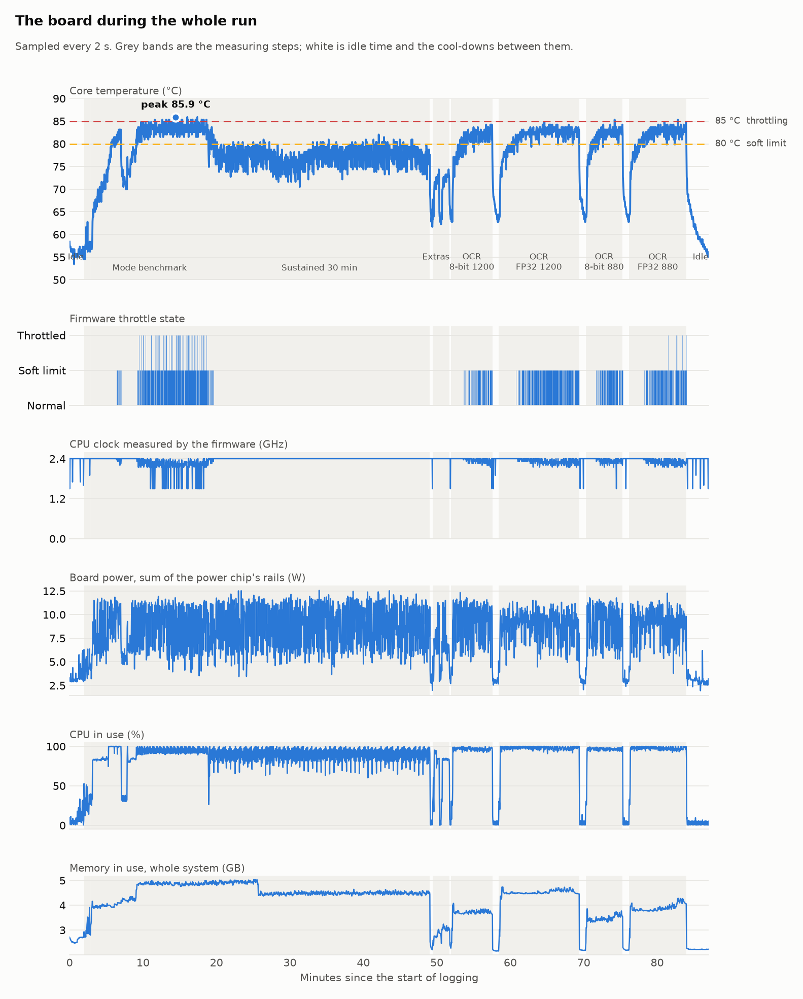
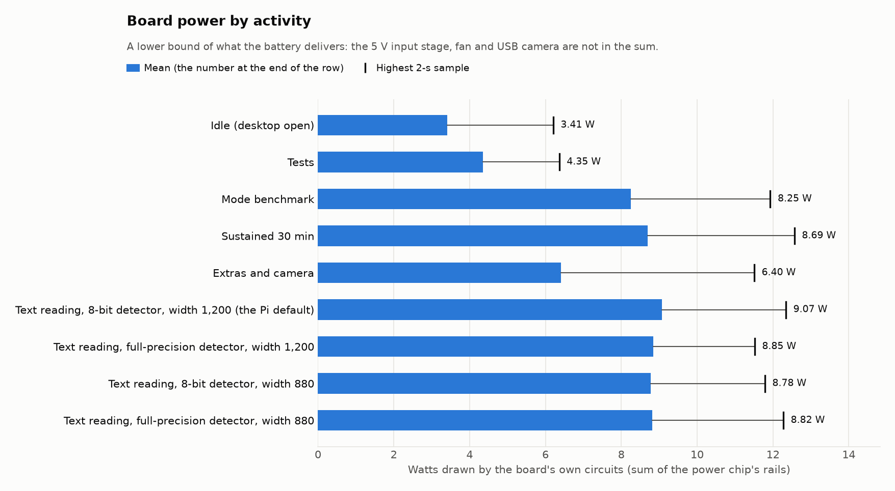
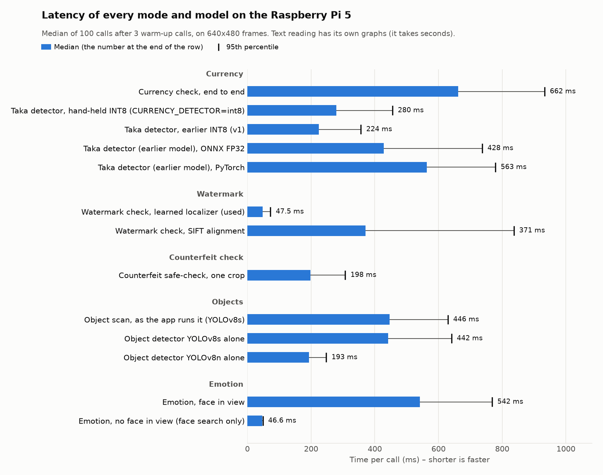
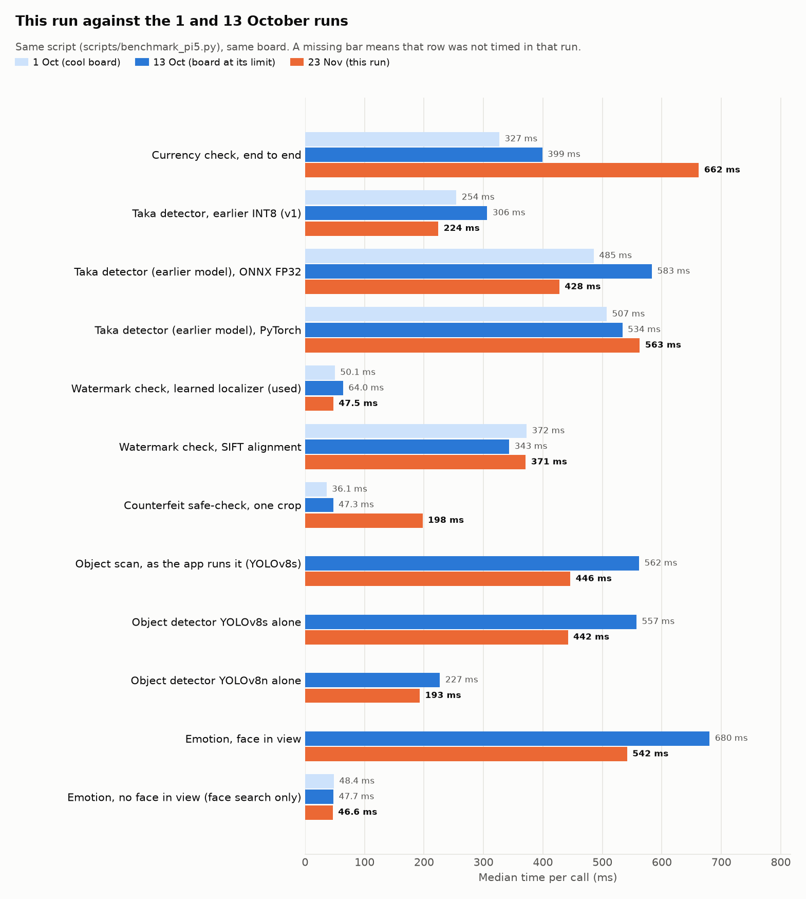
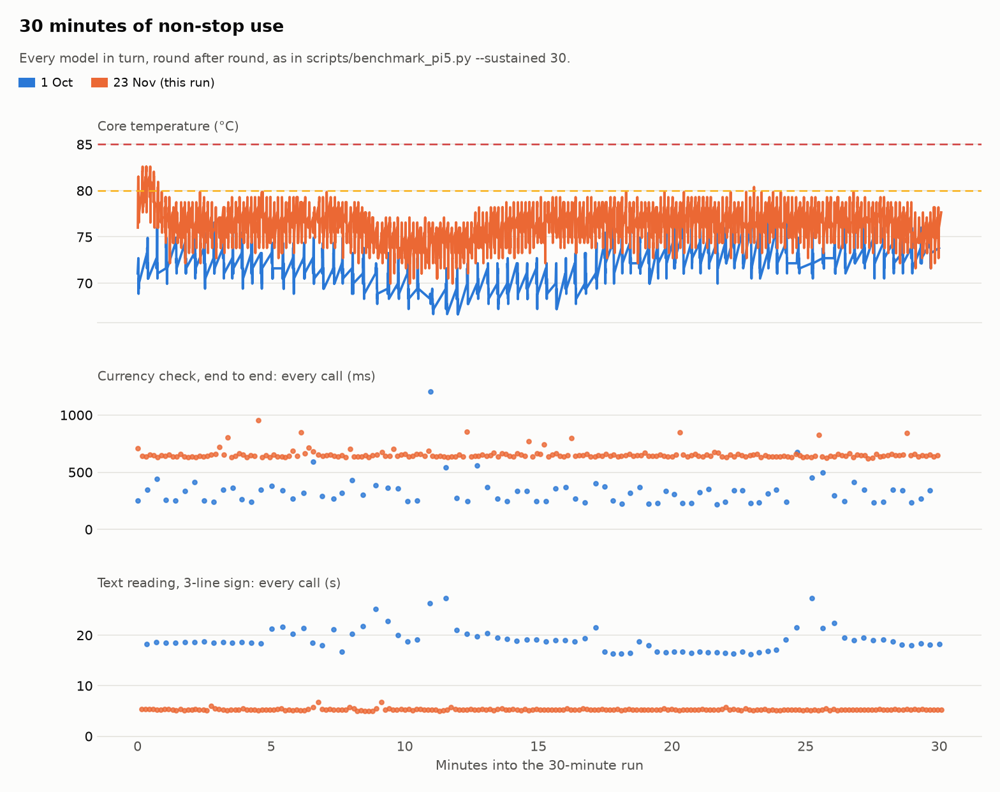
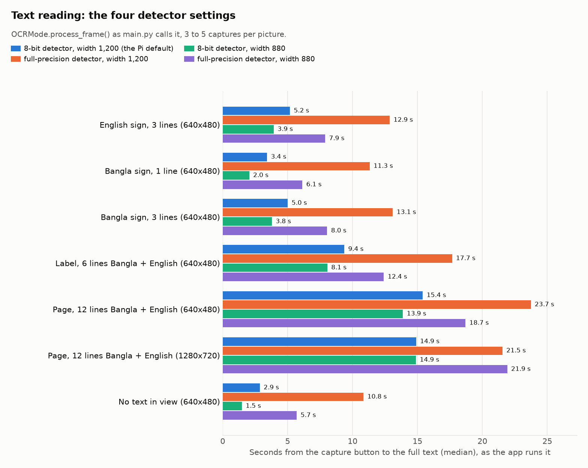
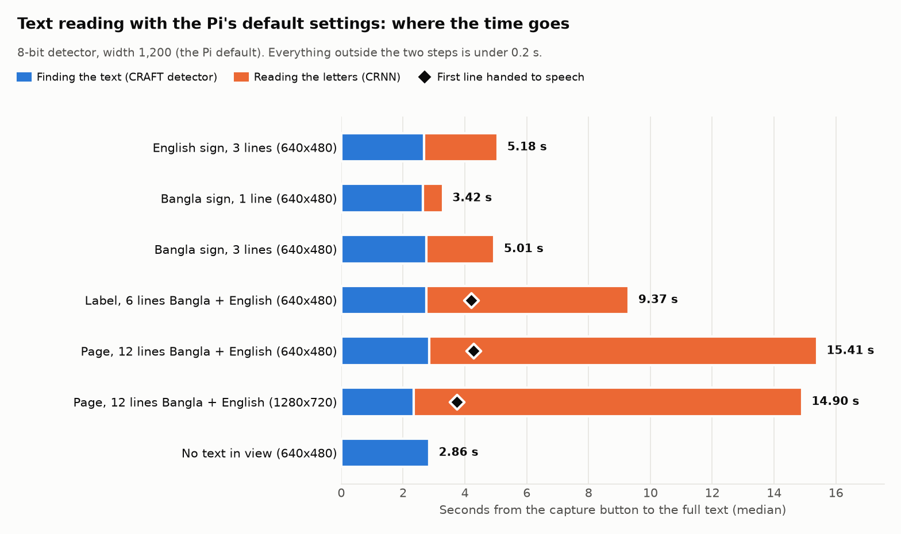
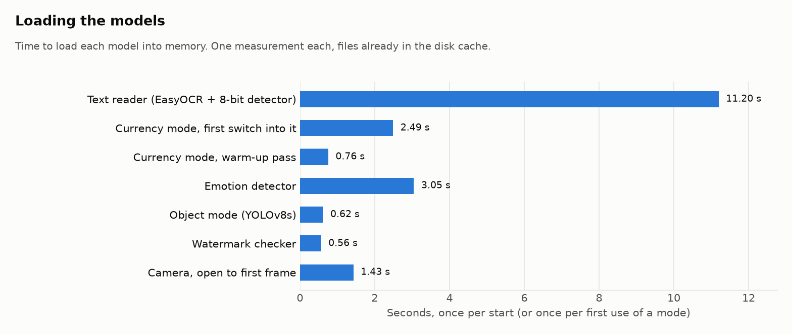

# SARA on the Raspberry Pi 5: benchmark report, 23 November 2026

Run on 23 November 2026 from 07:10 to 08:37 local time (87 minutes), on the glass's own board (Raspberry Pi 5 Model B Rev 1.0, 4 cores, Python 3.13.5, torch 2.14.1+cpu, ONNX Runtime 1.30.0, EasyOCR 1.7.2, Ultralytics 8.4.170). No GPU; everything runs on the CPU. Camera: C270 HD WEBCAM (USB webcam). Code: commit `6b5ad1e`, with the benchmark-script changes listed in `raw/environment.txt`.

## Headline numbers

| What | Median | 95th percentile |
|---|---:|---:|
| Currency check, end to end | 662 ms | 933 ms |
| Taka detector, hand-held INT8 (CURRENCY_DETECTOR=int8) | 280 ms | 456 ms |
| Watermark check, learned localizer (used) | 47.5 ms | 72.5 ms |
| Counterfeit safe-check, one crop | 198 ms | 307 ms |
| Object scan, as the app runs it (YOLOv8s) | 446 ms | 629 ms |
| Emotion, face in view | 542 ms | 768 ms |
| Text reading, 3-line sign, 100 calls (`benchmark_pi5.py`) | 5.74 s | 5.97 s |
| Text reading, 3-line sign, as the app runs it | 5.18 s | slowest of 5: 5.31 s |
| Text reading, 12-line page: first line spoken | 4.27 s | – |
| Text reading, 12-line page: whole page | 15.41 s | slowest of 4: 15.57 s |

Core temperature 56.0 °C at idle, peak 85.9 °C; board power 3.4 W at idle and 8.7 W under sustained load. Throttle flag at the end of the mode benchmark: `0xe0000` (CPU clock capping has occurred; throttling has occurred; soft temperature limit has occurred).

## Temperature, clock and power

The board started at 57.3 °C with the throttle flag at `0x0` (no throttling, clock capping or under-voltage) before the first timing call.

| Step | Minutes | Mean °C | Peak °C | Soft limit active | Throttled or capped | Lowest clock | Clock under 2.3 GHz | Mean power | Peak power |
|---|---:|---:|---:|---:|---:|---:|---:|---:|---:|
| Idle before (desktop open) | 1.9 | 56.0 | 58.4 | 0% | 0% | 1.50 GHz | 7% | 3.41 W | 6.21 W |
| Tests | 0.8 | 57.7 | 62.8 | 0% | 0% | 1.90 GHz | 4% | 4.35 W | 6.37 W |
| Mode benchmark | 15.8 | 79.4 | 85.9 | 45% | 11% | 1.50 GHz | 41% | 8.25 W | 11.93 W |
| Sustained 30 min | 29.3 | 77.3 | 83.7 | 1% | 0% | 2.26 GHz | 0% | 8.69 W | 12.57 W |
| Extras and camera | 2.3 | 69.9 | 74.3 | 0% | 0% | 2.40 GHz | 0% | 6.40 W | 11.51 W |
| Text reading, 8-bit detector, width 1,200 (the Pi default) | 5.5 | 80.0 | 84.2 | 41% | 0% | 1.50 GHz | 17% | 9.07 W | 12.34 W |
| Text reading, full-precision detector, width 1,200 | 10.7 | 81.3 | 84.8 | 62% | 0% | 2.15 GHz | 27% | 8.85 W | 11.52 W |
| Text reading, 8-bit detector, width 880 | 4.9 | 80.7 | 85.3 | 51% | 0% | 1.50 GHz | 21% | 8.78 W | 11.79 W |
| Text reading, full-precision detector, width 880 | 7.6 | 81.2 | 85.3 | 54% | 2% | 2.15 GHz | 30% | 8.82 W | 12.27 W |
| Idle after | 2.9 | 61.1 | 72.7 | 0% | 0% | 1.50 GHz | 7% | 3.03 W | 6.20 W |

- Under-voltage was never reported, so the power supply kept up. The fan ran up to 9,560 rpm.
- The temperature is the SoC's own sensor (`thermal_zone0`), the hottest point of the board. A thermometer on the case or the board surface reads lower.
- The clock is what the firmware measures (`vcgencmd measure_clock arm`). At idle the governor drops it to 1.5 GHz by design; only a low clock under load means throttling.

**Battery estimate.** With the formula of `scripts/power_log.py` (rail sum + 30% for the input stage, fan and USB camera; a 37 Wh / 10,000 mAh power bank delivering 85% of its rating): about 2.8 h of non-stop use at the sustained-run power (8.69 W rail sum), and about 7.1 h at idle (3.41 W). The glass's real bank capacity is not recorded in the project, and the overhead is an allowance, not a measurement; a run on the bank itself with a USB power meter would replace this estimate.

## Full latency list

Each row is 100 timed calls after 3 warm-up calls, from `scripts/benchmark_pi5.py` unless marked. Frames are 640x480, the glass camera size.

| Group | Benchmark | Median | 95th pct | Mean | Calls/s | Load | Memory after | Temp after |
|---|---|---:|---:|---:|---:|---:|---:|---:|
| Currency | Currency check, end to end | 662 ms | 933 ms | 687 ms | 1.51 | 587 ms | 1.28 GB | 68.3 °C |
| Currency | Taka detector, hand-held INT8 (CURRENCY_DETECTOR=int8) | 280 ms | 456 ms | 298 ms | 3.58 | 0.5 ms | 1.57 GB | 82.6 °C |
| Currency | Taka detector, earlier INT8 (v1) | 224 ms | 356 ms | 237 ms | 4.46 | 9.6 ms | 1.48 GB | 81.5 °C |
| Currency | Taka detector (earlier model), ONNX FP32 | 428 ms | 737 ms | 481 ms | 2.34 | 32.7 ms | 1.39 GB | 79.3 °C |
| Currency | Taka detector (earlier model), PyTorch | 563 ms | 779 ms | 571 ms | 1.78 | 282 ms | 1.30 GB | 73.2 °C |
| Watermark | Watermark check, learned localizer (used) | 47.5 ms | 72.5 ms | 49.0 ms | 21.04 | 563 ms | 1.60 GB | 77.1 °C |
| Watermark | Watermark check, SIFT alignment | 371 ms | 836 ms | 464 ms | 2.69 | 588 ms | 1.58 GB | 71.0 °C |
| Counterfeit check | Counterfeit safe-check, one crop | 198 ms | 307 ms | 209 ms | 5.06 | 216 ms | 1.60 GB | 72.7 °C |
| Objects | Object scan, as the app runs it (YOLOv8s) | 446 ms | 629 ms | 468 ms | 2.24 | 615 ms | 1.63 GB | 77.7 °C |
| Objects | Object detector YOLOv8s alone † | 442 ms | 641 ms | 458 ms | 2.26 | 220 ms | 0.80 GB | 74.3 °C |
| Objects | Object detector YOLOv8n alone † | 193 ms | 248 ms | 203 ms | 5.18 | 111 ms | 0.72 GB | 71.6 °C |
| Emotion | Emotion, face in view † | 542 ms | 768 ms | 582 ms | 1.85 | 3.05 s | 0.67 GB | 70.5 °C |
| Emotion | Emotion, no face in view (face search only) | 46.6 ms | 48.5 ms | 47.0 ms | 21.46 | 1,241 ms | 2.36 GB | 74.3 °C |
| Text | Text reading, 3-line sign (benchmark frame) | 5.74 s | 5.97 s | 5.74 s | 0.17 | 7.82 s | 2.36 GB | 82.6 °C |

† from `benchmark_report/scripts/extras_bench.py` (30 calls), because the datasets the project script reads are not on the Pi. These rows ran in a separate process, so their memory column cannot be compared with the others.

Load is the time to build the model object in that process; the ONNX detectors are read from disk on their first call, so their load is near zero. Memory is the whole benchmark process after that row, not the size of one model.

- **Currency.** The note rows cycle through the 4 note pictures on the Pi (the 500 and 1,000 Taka templates and the two pictures in `samples/`). In the code measured here, currency mode on the Pi loads the hand-held full-precision detector (`best_handheld.pt`, since commit `a349cfe`), so the end-to-end row times it; the hand-held 8-bit copy (`CURRENCY_DETECTOR=int8`) and the earlier detectors are timed alone for comparison.
- **Emotion.** `benchmark_pi5.py` has no face pictures on the Pi, so its row is a frame with no face (46.6 ms, the face search alone). With a face in view (the astronaut test picture, classifier `rgb_mobilenet_blend`) one answer takes 542 ms.
- **Objects.** The app uses YOLOv8s (446 ms per scan as the app runs it); YOLOv8n would take 193 ms. No COCO pictures are on the Pi, so the scan is timed on the note pictures; the detector does the same work on any picture.

## Against the 1 and 13 October runs

| Benchmark | 1 Oct | 13 Oct | 23 Nov | Change from 1 Oct | Change from 13 Oct |
|---|---:|---:|---:|---:|---:|
| Currency check, end to end | 327 ms | 399 ms | **662 ms** | +103% | +66% |
| Taka detector, hand-held INT8 (CURRENCY_DETECTOR=int8) | – | – | **280 ms** | – | – |
| Taka detector, earlier INT8 (v1) | 254 ms | 306 ms | **224 ms** | -12% | -27% |
| Taka detector (earlier model), ONNX FP32 | 485 ms | 583 ms | **428 ms** | -12% | -27% |
| Taka detector (earlier model), PyTorch | 507 ms | 534 ms | **563 ms** | +11% | +5% |
| Watermark check, learned localizer (used) | 50.1 ms | 64.0 ms | **47.5 ms** | -5% | -26% |
| Watermark check, SIFT alignment | 372 ms | 343 ms | **371 ms** | -0% | +8% |
| Counterfeit safe-check, one crop | 36.1 ms | 47.3 ms | **198 ms** | +447% | +317% |
| Object scan, as the app runs it (YOLOv8s) | – | 562 ms | **446 ms** | – | -21% |
| Object detector YOLOv8s alone | – | 557 ms | **442 ms** | – | -21% |
| Object detector YOLOv8n alone | – | 227 ms | **193 ms** | – | -15% |
| Emotion, face in view | – | 680 ms | **542 ms** | – | -20% |
| Emotion, no face in view (face search only) | 48.4 ms | 47.7 ms | **46.6 ms** | -4% | -2% |
| Text reading, 3-line sign (benchmark frame) | 18.73 s | – | **5.74 s** | -69% | – |

1 October: 100 calls a row, board cool (flag `0x0` at the end). 13 October: 30 calls a row, board at its temperature limit (flag `0xe0008`). This run: 100 calls a row. The code changed between the runs too (hand-held detector, OCR pipeline v2 with one detector pass, 8-bit text detector on the Pi, YOLOv8s), so a row whose model changed is not a like-for-like speed comparison.

## 30 minutes of non-stop use

`--sustained 30` ran every model in turn for 30 minutes: 2,276 calls. Core temperature, as the benchmark read it after each call, 70.0 to 82.6 °C (the 2-second sampler's peak is in the table above); throttle flags seen: `0xe0000`, `0xe0008`, together: soft temperature limit active now; CPU clock capping has occurred; throttling has occurred; soft temperature limit has occurred. On 1 October the same run made 1,229 calls and peaked at 77.1 °C.

| Model | Calls | Median, first 5 min | Median, last 5 min | Drift | Slowest call | Median in the timing pass |
|---|---:|---:|---:|---:|---:|---:|
| Currency check, end to end | 207 | 644 ms | 646 ms | +0% | 953 ms | 662 ms |
| Taka detector, hand-held INT8 (CURRENCY_DETECTOR=int8) | 207 | 281 ms | 277 ms | -1% | 607 ms | 280 ms |
| Taka detector, earlier INT8 (v1) | 207 | 223 ms | 226 ms | +1% | 559 ms | 224 ms |
| Taka detector (earlier model), ONNX FP32 | 207 | 417 ms | 418 ms | +0% | 841 ms | 428 ms |
| Taka detector (earlier model), PyTorch | 207 | 444 ms | 444 ms | +0% | 843 ms | 563 ms |
| Watermark check, learned localizer (used) | 207 | 47.3 ms | 47.7 ms | +1% | 107 ms | 47.5 ms |
| Watermark check, SIFT alignment | 207 | 378 ms | 376 ms | -0% | 929 ms | 371 ms |
| Counterfeit safe-check, one crop | 207 | 234 ms | 231 ms | -2% | 563 ms | 198 ms |
| Object scan, as the app runs it (YOLOv8s) | 207 | 452 ms | 449 ms | -1% | 735 ms | 446 ms |
| Emotion, no face in view (face search only) | 206 | 46.6 ms | 46.5 ms | -0% | 53.7 ms | 46.6 ms |
| Text reading, 3-line sign (benchmark frame) | 207 | 5.24 s | 5.25 s | +0% | 6.76 s | 5.74 s |

Process memory over the 30 minutes: 2.39 GB at the start, 2.39 GB at the end, highest 2.41 GB.

## Text reading (OCR)

`OCRMode.process_frame()`, the call `main.py` makes when ACTION is pressed in text mode, on rendered signs and pages whose text is known; 3 to 5 captures per picture. Pipeline `v2`, decoder `greedy`, canvas 2560, 4 threads. `config.py` sets the 8-bit text detector as the Pi default and notes that its speed on the Pi had not been measured; this run times it against the full-precision detector, each at the two read widths (the four settings of `scripts/pi_check_all.sh`), with a cool-down before each.

| Capture | 8-bit detector, width 1,200 (the Pi default) | full-precision detector, width 1,200 | 8-bit detector, width 880 | full-precision detector, width 880 |
|---|---:|---:|---:|---:|
| English sign, 3 lines (640x480) — text found once, `benchmark_pi5.py` path | 5.23 s (0.0% err) | 12.98 s (0.0% err) | 3.99 s (0.0% err) | 7.83 s (0.0% err) |
| English sign, 3 lines (640x480) | 5.18 s (0.0% err) | 12.86 s (0.0% err) | 3.93 s (0.0% err) | 7.90 s (0.0% err) |
| Bangla sign, 1 line (640x480) — text found once, `benchmark_pi5.py` path | 3.38 s (0.0% err) | 11.24 s (0.0% err) | 2.04 s (0.0% err) | 6.12 s (0.0% err) |
| Bangla sign, 1 line (640x480) | 3.42 s (0.0% err) | 11.32 s (0.0% err) | 2.05 s (0.0% err) | 6.14 s (0.0% err) |
| Bangla sign, 3 lines (640x480) — text found once, `benchmark_pi5.py` path | 5.11 s (0.0% err) | 13.01 s (0.0% err) | 3.82 s (2.9% err) | 7.80 s (0.0% err) |
| Bangla sign, 3 lines (640x480) | 5.01 s (0.0% err) | 13.10 s (0.0% err) | 3.79 s (2.9% err) | 8.05 s (0.0% err) |
| Label, 6 lines Bangla + English (640x480) | 9.37 s (0.0% err) | 17.67 s (0.0% err) | 8.06 s (0.0% err) | 12.41 s (0.0% err) |
| Page, 12 lines Bangla + English (640x480) | 15.41 s (0.0% err) | 23.73 s (0.0% err) | 13.88 s (0.0% err) | 18.70 s (0.0% err) |
| Page, 12 lines Bangla + English (1280x720) | 14.90 s (0.0% err) | 21.55 s (0.0% err) | 14.88 s (0.0% err) | 21.92 s (0.0% err) |
| No text in view (640x480) | 2.86 s | 10.84 s | 1.47 s | 5.70 s |
| **Mean character error, app path** | 0.00% | 0.00% | 0.48% | 0.00% |
| One pass of the text detector | 2.3 – 2.8 s | 9.0 – 10.8 s | 1.4 – 2.4 s | 5.4 – 9.2 s |

The character errors are on clean rendered pictures, so they say mostly that the timed reads were real reads; the project's accuracy numbers for each setting are the validation results in `config.py`.

With the Pi's default settings (8-bit detector, width 1,200 (the Pi default)):

| Capture | Runs | Total | Range | Finding text | Reading letters | Rest | First line spoken | Detector passes | Character errors | 13 Oct total |
|---|---:|---:|---:|---:|---:|---:|---:|---:|---:|---:|
| English sign, 3 lines (640x480) | 5 | **5.18 s** | 5.00 s – 5.31 s | 2.68 s | 2.38 s | 0.01 s | – | 1 | 0.0% | 34.01 s |
| Bangla sign, 1 line (640x480) | 5 | **3.42 s** | 3.27 s – 3.59 s | 2.64 s | 0.64 s | 0.01 s | – | 1 | 0.0% | 35.40 s |
| Bangla sign, 3 lines (640x480) | 5 | **5.01 s** | 4.86 s – 5.20 s | 2.76 s | 2.19 s | 0.01 s | – | 1 | 0.0% | 38.55 s |
| Label, 6 lines Bangla + English (640x480) | 5 | **9.37 s** | 9.19 s – 9.63 s | 2.76 s | 6.54 s | 0.01 s | 4.21 s | 1 | 0.0% | 21.79 s |
| Page, 12 lines Bangla + English (640x480) | 4 | **15.41 s** | 15.38 s – 15.57 s | 2.85 s | 12.54 s | 0.01 s | 4.27 s | 1 | 0.0% | 36.48 s |
| Page, 12 lines Bangla + English (1280x720) | 4 | **14.90 s** | 14.52 s – 15.75 s | 2.34 s | 12.57 s | 0.00 s | 3.75 s | 1 | 0.0% | 28.01 s |
| No text in view (640x480) | 5 | **2.86 s** | 2.75 s – 2.96 s | 2.85 s | 0.00 s | 0.01 s | – | 1 | – | 27.52 s |

- **No text in view:** 2.86 s, answer empty (the glass says no text was found). On 13 October it returned 48 made-up letters here.
- Loading the text reader took 11.20 s; the first capture after loading took 5.31 s.

What the glass read (default settings, app path, last run of each capture):

| Capture | Text on the picture | Text the glass read |
|---|---|---|
| English sign, 3 lines (640x480) | EXIT 12 Bus Stop Main Entrance | EXIT 12 Bus Stop Main Entrance |
| Bangla sign, 1 line (640x480) | ধূমপান নিষেধ | ধূমপান নিষেধ |
| Bangla sign, 3 lines (640x480) | ধূমপান নিষেধ ডাকঘর নিরাপদ পানীয় জল | ধূমপান নিষেধ ডাকঘর নিরাপদ পানীয় জল |
| Label, 6 lines Bangla + English (640x480) | Paracetamol 500 mg মেয়াদ উত্তীর্ণের তারিখ Best Before 2027 দাম ৮৫ টাকা Price 120 Taka চিনি এক কেজি | Paracetamol 500 mg মেয়াদ উত্তীর্ণের তারিখ Best Before 2027 দাম ৮৫ টাকা Price 120 Taka চিনি এক কেজি |
| Page, 12 lines Bangla + English (640x480) | সরকারি প্রাথমিক বিদ্যালয় Emergency Room জুতা খুলে প্রবেশ করুন Closed on Monday ঢাকা মেডিকেল কলেজ Drinking Water রক্ত পরীক্ষা কেন্দ্র Electricity Bill শিশুদের খেলার মাঠ Train Schedule ভাড়া দেওয়া হবে Cash Counter | সরকারি প্রাথমিক বিদ্যালয় Emergency Room জুতা খুলে প্রবেশ করুন Closed on Monday ঢাকা মেডিকেল কলেজ Drinking Water রক্ত পরীক্ষা কেন্দ্র Electricity Bill শিশুদের খেলার মাঠ Train Schedule ভাড়া দেওয়া হবে Cash Counter |
| Page, 12 lines Bangla + English (1280x720) | সরকারি প্রাথমিক বিদ্যালয় Emergency Room জুতা খুলে প্রবেশ করুন Closed on Monday ঢাকা মেডিকেল কলেজ Drinking Water রক্ত পরীক্ষা কেন্দ্র Electricity Bill শিশুদের খেলার মাঠ Train Schedule ভাড়া দেওয়া হবে Cash Counter | সরকারি প্রাথমিক বিদ্যালয় Emergency Room জুতা খুলে প্রবেশ করুন Closed on Monday ঢাকা মেডিকেল কলেজ Drinking Water রক্ত পরীক্ষা কেন্দ্র Electricity Bill শিশুদের খেলার মাঠ Train Schedule ভাড়া দেওয়া হবে Cash Counter |

## Live camera loop

`scripts/test_live_camera.py --seconds 60`: real frames from the C270 webcam (640x480, mean brightness 55.8 of 255) through the glass's own currency and object modes, and every fifth frame through emotion. 41 frames in 60.1 s: 0.68 frames a second with all of it running.

| Stage | Calls | Median | 95th pct |
|---|---:|---:|---:|
| Camera read | 41 | 1.7 ms | 1.8 ms |
| Currency detection + safe check | 41 | 904 ms | 1,116 ms |
| Object scan | 41 | 450 ms | 539 ms |
| Emotion (every 5th frame) | 8 | 47.2 ms | 568 ms |
| Whole frame | 41 | 1,383 ms | 1,903 ms |

Notes seen: none; objects announced: {'সামনে আছে: মানুষ': 9, 'সামনে আছে: মোবাইল ফোন': 1, 'সামনে আছে: মানুষ, মোবাইল ফোন': 1, 'সামনে আছে: কুকুর': 2}; faces: {'no_face': 5, 'rgb_mobilenet_blend': 3}. The run was unattended, so nothing was held up to the camera; this measures speed on real camera frames, not accuracy.

## The app after the run

`python main.py` with the real camera and buttons, after this benchmark, on the code checked out then (`20261123_092211_memo`, 09:22–09:23, `20261123_092445_memo`, 09:24–09:28; currency threshold 0.75, watermark step off). These are the latencies the app's own field log recorded, from button press to the spoken answer being queued.

| What | Times | Median | Range |
|---|---:|---:|---:|
| Text reading: one capture | 3 | 17.79 s | 13.75 s – 22.38 s |
| Object scan and announcement | 1 | 722 ms | – |
| Currency check | 1 | 1,474 ms | – |

The glass named the note on 1 of 1 currency presses (detector confidence at or above the threshold); on the others it asked for the note to be held closer, or found none. The app logged 52.4 to 66.1 °C. It held up to 2.73 GB of memory with all modes loaded and the camera open.

What those text captures read. They were photos of printed pages, longer than the 3-line sign, so their times compare with the label and page rows of the text-reading section:

| Language | Characters read | Time | Text the glass read |
|---|---:|---:|---|
| Bangla | 140 | 13.75 s | আায় ছেলেরা আয় মেয়েরা তুলিতে যাই ফুলের মালা গলায় দিয়ে মামার বাড়ি যাই ঝড়ের দিনে মামার দেশে আম কুড়াতে সুখ. ভামের মধুর রসে রপতিন করি মুখ |
| Bangla | 17 | 22.38 s | ববববববববববববববববব |
| English | 13 | 17.79 s | Mompty Oumpty |

## Loading, speech and camera

| What | Time |
|---|---:|
| Text reader (EasyOCR + 8-bit detector) | 11.20 s |
| Currency mode, first switch into it | 2.49 s |
| Currency mode, warm-up pass | 0.76 s |
| Emotion detector | 3.05 s |
| Object mode (YOLOv8s) | 0.62 s |
| Watermark checker | 0.56 s |
| Camera, open to first frame | 1.43 s |
| Currency mode, first check after switching | 473 ms |
| Currency mode, later checks | 458 ms |
| Currency mode, switching back into it | 0.0 ms |
| Speech: short Bangla sentence (5.93 s of audio) | 14.0 ms |
| Speech: short English sentence (5.57 s of audio) | 13.6 ms |
| Speech: six Bangla lines (16.72 s of audio) | 27.4 ms |
| Camera: time between frames (640x480) | 132 ms (7.6 frames/s) |

Speech is espeak-ng rendering the audio to a pipe, not playing it: rendering adds almost nothing to the response time; the listener still has to hear the sentence out.

## Tests

The project's hardware-free test scripts, run on the Pi before the benchmark (`raw/tests/<name>.txt` holds each output).

| Test | Result | Time | Last line of output |
|---|---|---:|---|
| `test_thermal` | pass | 0 s | thermal governor: all checks pass |
| `test_multi_note` | pass | 2 s | multi-note: all checks pass |
| `test_capture_guide` | pass | 2 s | capture guide: all checks pass |
| `test_field_log` | pass | 1 s | field log: all checks pass. log() costs 5.3 µs per call in the app thread; 10008 rows, 3 system samples, 0 … |
| `test_tts_queue` | pass | 5 s | speech queue: all checks pass |
| `test_uv_check` | pass | 3 s | uv check: all checks pass |
| `test_voice_commands` | pass | 5 s | voice commands: a spoken command is recognised, an ordinary sentence is not; the wake word is required |
| `test_buttons_haptics` | SKIP | 0 s | SKIP: the 100 Taka test photo is not on this machine: /media/memo/7250-9755/Senior_project_wearable_glass_f… |
| `test_live_diag` | pass | 13 s | live panel: every algorithm ran; saved results/live_diag_check.png |
| `test_ocr_single_pass` | SKIP | 14 s | SKIP: val_seed0.npz is not in /media/memo/7250-9755/Senior_project_wearable_glass_for_blind_people_using_oc… |
| `test_hooks` | pass | 0 s | hooks: all checks pass; real master untouched: True |
| `test_results_db` | pass | 0 s | research evidence database: all checks pass (204 experiments in the real master file, largest record 2631 b… |
| `test_roboeye_modules` | SKIP | 4 s | SKIP: the JaalTaka dataset is not installed at /media/memo/7250-9755/Senior_project_wearable_glass_for_blin… |
| `test_print_capture` | pass | 0 s | print_capture: all rules hold |

Preflight (`scripts/pi5_preflight.py`): exit 0, every model file present and the ONNX graphs ran a dummy input.

## How this was measured

All steps ran from one script, `benchmark_report/scripts/run_full_benchmark.sh`, while `benchmark_report/scripts/sys_sampler.py` logged temperature, throttle flags, measured clock, CPU, memory, fan and board power every 2 s (`raw/system_timeline.csv`). Between the heavy steps the script waited until the board was back under 63 °C (at most 10 minutes).

1. 2 minutes idle, then `scripts/pi5_preflight.py` and the test scripts.
2. `scripts/benchmark_pi5.py --iters 100 --warmup 3 --sustained 30`, the protocol in `HOW_TO_RUN.md` (`raw/pi5_benchmark_memo_20261123T012923Z.json` and the `.csv` of the sustained run; the script also keeps a copy in `savior_glass/results/`).
3. `scripts/measure_mode_switch.py`, `benchmark_report/scripts/extras_bench.py` (emotion with a face, both object detectors, speech, camera) and `scripts/test_live_camera.py --seconds 60` (real webcam frames).
4. `benchmark_report/scripts/ocr_response_bench.py` once for each of the four text-detector settings.
5. 3 minutes idle.

Limits of this run:

- VS Code (with this Claude Code session), its language servers and a Chromium window stayed open on the Pi during the run; they use some CPU and memory (`raw/environment.txt` lists the top processes at the start).
- Only four note pictures are on the Pi; OCR and emotion pictures are rendered or stock pictures, not glass-camera photos.
- The live-camera loop was unattended: it measures speed on real frames, not what the glass says about a real note.
- Board power is the sum of the power chip's rails, a lower bound; the battery figure is an estimate with stated assumptions.
- Skipped: `prmvt_1view`: RuntimeError: PRMVT (Q-DUIG) checkpoint not found
- Skipped: `prmvt_2view`: RuntimeError: PRMVT (Q-DUIG) checkpoint not found
- Skipped: `prmvt_3view`: RuntimeError: PRMVT (Q-DUIG) checkpoint not found
- Skipped: `prmvt_4view`: RuntimeError: PRMVT (Q-DUIG) checkpoint not found
- Skipped: `prmvt_5view`: RuntimeError: PRMVT (Q-DUIG) checkpoint not found
- Skipped: `prmvt_6view`: RuntimeError: PRMVT (Q-DUIG) checkpoint not found

To rebuild this report from the raw files: `~/.venvs/savior_glass/bin/python benchmark_report/scripts/make_run_report.py benchmark_report/2026-11-23`.
