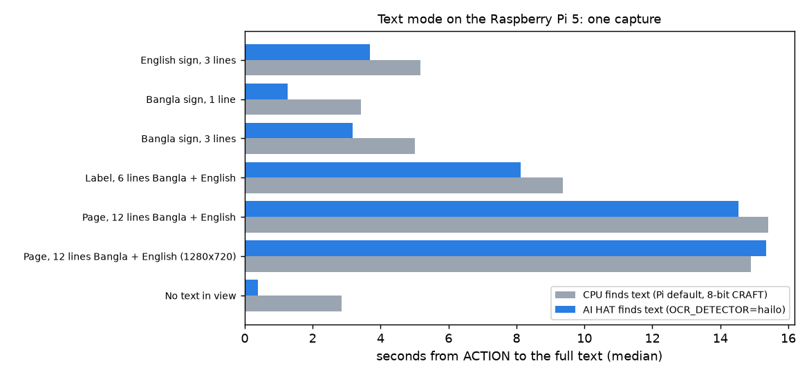

# SARA on the Raspberry Pi AI HAT (Hailo-8): what moved to the chip and what it gained

Run on 23 and 24 November 2026 on the glass's own board (Raspberry Pi 5, 4 cores) with the Raspberry Pi AI HAT+
(Hailo-8, 26 TOPS, HailoRT 4.23.0). Code: branch `pi5-benchmark-2026-11-23` on `112c574` plus the AI HAT changes listed
at the end. Everything is **opt-in**: without `AI_HAT=1` the app runs exactly as before on the CPU.

## Summary

| Feature | What runs on the AI HAT | Before (CPU) | With the AI HAT | Accuracy |
|---|---|---:|---:|---|
| Objects | the whole YOLOv8s detector | 583 ms a picture | **13 ms** | same objects on 20 of 20 pictures |
| Text (signs, labels) | finding the text | 5.6 s a sign | **2.4 s** | character error 5.2 % → **1.1 %** (60 signs) |
| Text (pages) | finding the text | 4.27 s to the first line spoken | **1.95 s** | 0.0 % on the rendered pages (0.1 % at 1280x720); on real book-page photos see below |
| Currency | nothing yet | – | – | needs a model compile (below) |
| Emotion | nothing yet | – | – | needs a model compile (below) |

## Objects

`OBJECT_BACKEND=hailo` (or `AI_HAT=1`): Hailo's own compile of the same COCO YOLOv8s that object mode uses
(`/usr/share/hailo-models/yolov8s_h8.hef`), box filtering on the chip. 20 pictures (2 Ultralytics test pictures,
the 23 November note pictures and live frames from the glass webcam):

| | CPU (`yolov8s.pt`) | AI HAT |
|---|---:|---:|
| Detector, median | 583 ms | **12.7 ms** |
| Detector, 95th percentile | 669 ms | 13.9 ms |
| Same object list as the CPU | – | 20 of 20 (other runs 18 of 20: objects at the confidence threshold in fresh webcam frames) |

With `AI_HAT` off, object mode gives the same boxes and announcement as the committed code on 20 of 20 pictures.
In a live app session (23 November) object scans took a median 14 ms on the chip against 772 ms on the CPU.

## Text reading (OCR)

`OCR_DETECTOR=hailo` (or `AI_HAT=1`): the step that **finds** the text runs on the chip with Hailo's stock compile of
the PaddleOCR PP-OCRv5 mobile text detector (`models/hailo/paddle_ocr_v5_mobile_detection.hef`; it finds text in any
language). SARA's own Bangla + English letter recogniser still **reads** the text on the CPU, and everything after it is
unchanged. The detector's boxes go through EasyOCR's own grouping, so the recogniser gets boxes of the usual kind.



Same captures and script as the 23 November run (`ocr_response_bench.py`, app path with line-by-line speech on pages):

| Capture | CPU total | AI HAT total | change | finding text CPU → AI HAT | reading letters CPU → AI HAT | first line spoken CPU → AI HAT | character errors CPU / AI HAT |
|---|---:|---:|---:|---:|---:|---:|---:|
| English sign, 3 lines (640x480) | 5.18 s | **3.69 s** | -29% | 2.68 s → 0.37 s | 2.38 s → 3.31 s | – → – | 0.0% / 0.0% |
| Bangla sign, 1 line (640x480) | 3.42 s | **1.25 s** | -63% | 2.64 s → 0.37 s | 0.64 s → 0.87 s | – → – | 0.0% / 0.0% |
| Bangla sign, 3 lines (640x480) | 5.01 s | **3.17 s** | -37% | 2.76 s → 0.37 s | 2.19 s → 2.78 s | – → – | 0.0% / 0.0% |
| Label, 6 lines Bangla + English (640x480) | 9.37 s | **8.13 s** | -13% | 2.76 s → 0.38 s | 6.54 s → 7.74 s | 4.21 s → 2.17 s | 0.0% / 0.0% |
| Page, 12 lines Bangla + English (640x480) | 15.41 s | **14.53 s** | -6% | 2.85 s → 0.38 s | 12.54 s → 14.14 s | 4.27 s → 1.95 s | 0.0% / 0.0% |
| Page, 12 lines Bangla + English (1280x720) | 14.90 s | **15.34 s** | +3% | 2.34 s → 0.38 s | 12.57 s → 14.96 s | 3.75 s → 1.71 s | 0.0% / 0.1% |
| No text in view (640x480) | 2.86 s | **0.38 s** | -87% | 2.85 s → 0.37 s | 0.00 s → 0.00 s | – → – | – / – |

Finding the text drops from 2.3–2.8 s to **0.37 s** on every capture. Reading the letters (CPU) is unchanged in kind but
not in amount: the chip detector draws fewer, longer boxes, which takes the recogniser a little longer on some captures
(the 12-line page at 1280x720 ended 0.4 s slower overall).

### Accuracy on signs and labels (60 pictures)

`hailo_ocr_sign_eval.py`: 60 pictures at 640x480 made with a fixed seed: 1–4 lines of common Bangla and English words,
nine Bangla fonts, dark-on-light and light-on-dark, tilted up to 4°, blur, uneven light and noise
(`raw/sign_eval_pictures/`). Same app code, only the detector switched:

| | CPU finds text | AI HAT finds text |
|---|---:|---:|
| Mean character error | 5.16 % | **1.09 %** |
| Read without any error | 47 / 60 | **51 / 60** |
| Median time per sign | 5.59 s | **2.40 s** |
| Better than the other | 4 signs | 9 signs |

### Real glass-camera photos of book pages

`hailo_ocr_glass_eval.py` on `~/Desktop/glass_ocr/glass_set` (50 photos of 7 printed pages, typed reference text),
at the camera width text mode gets (640 px):

| | CPU | AI HAT |
|---|---:|---:|
| Finding text, all 50 photos, median (95th pct.) | 2,779 ms (3,028) | **382 ms** (394) |
| Full read of a page, median (7 pages) | 85 s | **46 s** |
| Mean character error (7 pages) | 87.7 % | 88.6 % |

At 640 px these dense book pages are beyond SARA's reader with either detector (most pages near 100 % error for both), so this
set does not separate the two on accuracy. On the one page both could read (page 1) the CPU detector did better
(20.2 % against 33.8 %).

## What is not on the chip yet, and why

A model runs on the Hailo-8 only after it is compiled into a `.hef` file by Hailo's Dataflow Compiler, which runs only
on an x86-64 Linux PC (not on the Pi) and is downloaded from the Hailo Developer Zone with a free account. Hailo has
compiled the standard models (that is how objects and text-finding run on the chip today); SARA's own trained models
have no compile yet:

| Feature | Model(s) | CPU time on the Pi (23 Nov) |
|---|---|---:|
| Currency | hand-held Taka detector (YOLOv8s, own classes) | 280 ms |
| Currency | counterfeit safe-check (EfficientNet) | 198 ms a crop |
| Emotion | expression classifiers (MobileNet + FER+) | ~500 ms with a face |
| Text | Bangla + English letter recogniser (CRNN with LSTM) | 0.6–12.5 s a capture |

Once compiled on any x86 PC (once per model), these `.hef` files are copied to the Pi and run on the AI HAT like the two above.

## How to use it

```
cd savior_glass && source ~/.venvs/savior_glass/bin/activate
AI_HAT=1 python main.py          # objects + text-finding on the AI HAT
python main.py                   # as before, everything on the CPU
```
Each feature can also be set alone (`OBJECT_BACKEND=hailo`, `OCR_DETECTOR=hailo`). If the chip or a `.hef` file is
missing, or the chip fails while running, that feature goes back to its CPU model by itself. The app's tests give the
same results with and without `AI_HAT=1` (11 pass, 3 skip for data that is not on the Pi, as on 23 November).

## Changes

- `savior_glass/hailo_device.py` (new): one shared handle on the chip with HailoRT's scheduler, so several models can use it.
- `savior_glass/hailo_yolo.py` (new): YOLOv8s on the chip for object mode.
- `savior_glass/hailo_text_detector.py` (new): PP-OCRv5 text detector on the chip, installed in front of EasyOCR's `detect`.
- `savior_glass/config.py`: `AI_HAT`, `OBJECT_BACKEND`, `HAILO_YOLO_HEF`, `HAILO_OCR_DET_HEF`, `OCR_HAILO_MODE`, `OCR_HAILO_CPU_FALLBACK`; defaults unchanged.
- `savior_glass/modes/object_mode.py`, `modes/ocr_mode.py`, `ocr_detector_onnx.py`, `live_diag.py`: use the chip when asked, CPU otherwise.
- `savior_glass/models/hailo/paddle_ocr_v5_mobile_detection.hef`: Hailo Model Zoo v2.19 stock file (sha256 `1daaca8700b49a48…`).
- `benchmark_report/scripts/hailo_object_eval.py`, `hailo_ocr_sign_eval.py`, `hailo_ocr_glass_eval.py`, `make_ai_hat_report.py` (new).
