# SARA on the Raspberry Pi 5: benchmark report, 24 November 2026

Run on 24 November 2026 from 00:53 to 02:26 local time (93 minutes), on the glass's own board (Raspberry Pi 5 Model B Rev 1.0, 4 cores, Python 3.13.5, torch 2.14.1+cpu, ONNX Runtime 1.30.0, EasyOCR 1.7.2, Ultralytics 8.4.170). No GPU. Run with `AI_HAT=1`: the object detector and the step that finds text ran on the Raspberry Pi AI HAT+ (Hailo-8, 26 TOPS); every other model on the CPU. Camera: C270 HD WEBCAM (USB webcam). Code: commit `25cf53d`, with the benchmark-script changes listed in `raw/environment.txt`.

## Headline numbers

| What | Median | 95th percentile |
|---|---:|---:|
| Currency check, end to end | 1,251 ms | 1,491 ms |
| Taka detector, NSTU INT8 (cascade step 1, Pi default) | 301 ms | 341 ms |
| Watermark check, learned localizer (used) | 48.6 ms | 60.1 ms |
| Counterfeit safe-check, one crop | 208 ms | 234 ms |
| Object scan, as the app runs it (YOLOv8s on the AI HAT) | 12.4 ms | 12.7 ms |
| Emotion, face in view | 586 ms | 742 ms |
| Text reading, 3-line sign, 100 calls (`benchmark_pi5.py`) | 2.85 s | 3.00 s |
| Text reading, 3-line sign, as the app runs it | 2.85 s | slowest of 5: 2.88 s |
| Text reading, 12-line page: first line spoken | 1.52 s | – |
| Text reading, 12-line page: whole page | 10.67 s | slowest of 5: 10.69 s |

Core temperature 51.4 °C at idle, peak 80.4 °C; board power 3.5 W at idle and 7.7 W under sustained load. Throttle flag at the end of the mode benchmark: `0xe0000` (CPU clock capping has occurred; throttling has occurred; soft temperature limit has occurred).

### What this run found

- **Objects are 38 times faster on the AI HAT.** One picture takes 12.4 ms on the chip against 472 ms for the same YOLOv8s on the CPU in this run. In the live-camera loop an object scan took 12.6 ms (450 ms on 23 November), and in the app session after the run 12.9 ms from button to answer.
- **Text: finding the text takes 0.37 s on the AI HAT against 2.7 s on the CPU**, on every capture. A whole capture is 1.3 to 3.3 times faster: a one-line Bangla sign 1.02 s (CPU 3.35 s), a 3-line English sign 2.85 s (CPU 5.20 s), a 12-line page 10.7 s (CPU 15.1 s). On pages the first line is spoken after 1.4 to 1.7 s. Reading the letters still runs on the CPU, so long pages gain least.
- **Text accuracy is mixed, not uniformly better.** On these rendered test pictures the AI HAT path read 1.96 % of characters wrong against 0.16 % for the CPU detector: it dropped one line of the 12-line page at 1280x720 ("শিশুদের খেলার মাঠ") and one letter of a Bangla sign. On 60 varied signs and labels (`benchmark_report/2026-11-23_ai_hat/`) it was better than the CPU detector (1.1 % against 5.2 %), and on one real glass-camera book page worse (34 % against 20 %). The AI HAT detector stays opt-in (`AI_HAT=1`).
- **No text in view:** 1.08 s with the AI HAT against 3.38 s on the CPU. It is longer than the 0.38 s measured before the merge because OCR v4's second look (half size, for large blurred letters) runs on the CPU detector when the first look finds nothing.
- **Currency is slower than on 23 November (1,251 ms against 662 ms end to end), and not because of the AI HAT.** First, the merged code runs the detector cascade: a second detector looks again when the first is unsure. Second, in this run's benchmark process the CPU ONNX models were 30 to 50 % slower than on 23 November; the unchanged earlier INT8 detector, for example, took 334 ms against 224 ms. The same model timed in a fresh process took 228 to 232 ms with the AI HAT models closed, open, just used and closed again (`raw/ai_hat_cpu_effect.json`), so the chip does not slow the CPU. The slowdown lies in the benchmark process itself, which holds more models since the merge; its exact cause was not established. In the live loop a currency check took 770 ms, and in the app session 898 ms.
- **In the 30-minute run the object scan took 34 ms instead of 12 ms**, steady from start to end. There the object and text models take turns on the one chip, and switching between them most likely costs the extra time (not measured separately). In the app only one mode is active at a time.
- **The board ran cooler and used less power with the AI HAT.** The AI HAT text setting averaged 71.9 °C and 7.95 W, against 74.2 °C and 8.75 W for the CPU detector at the same width. The peak, 80.4 °C, came during a CPU text setting. The board never throttled under load, and the clock stayed at 2.4 GHz.
- **Still on the CPU:** currency (both detectors, classifier, counterfeit and watermark checks) and emotion (586 ms with a face). These are SARA's own models; each needs one compile with Hailo's Dataflow Compiler on an x86 PC before it can run on the chip.
- **Tests:** 11 of the 14 test scripts pass and 3 skip for data that is not on the Pi, as on 23 November. Preflight passed. The app ran every mode with the AI HAT in a session driven through its own buttons after the run.

## The Raspberry Pi AI HAT

This run used the app's AI HAT paths (`AI_HAT=1`): the board reported **Hailo-8**, firmware 4.23.0. Two steps run on the chip with models Hailo compiled itself: the object detector (COCO YOLOv8s, the same network object mode uses on the CPU) and the step that finds text (PaddleOCR PP-OCRv5 mobile detector; SARA's own Bangla + English recogniser still reads the letters on the CPU). Currency, counterfeit, watermark and emotion models are SARA's own and run on the CPU: they need Hailo's Dataflow Compiler (x86 PC only) before they can run on the chip. Both sides of every comparison below were measured in this run.

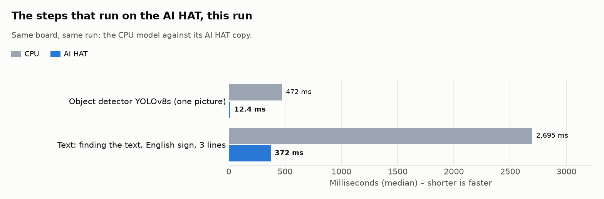

| Step | CPU | AI HAT | Faster by |
|---|---:|---:|---:|
| Object detector YOLOv8s, one picture | 472 ms | **12.4 ms** | 38× |
| Object scan as the app runs it (AI HAT) | – | **12.4 ms** | – |
| Text: English sign, 3 lines (640x480), whole capture | 5.20 s | **2.85 s** | 1.8× |
| Text: Bangla sign, 1 line (640x480), whole capture | 3.35 s | **1.02 s** | 3.3× |
| Text: Bangla sign, 3 lines (640x480), whole capture | 5.00 s | **2.39 s** | 2.1× |
| Text: Label, 6 lines Bangla + English (640x480), whole capture | 9.23 s | **6.03 s** | 1.5× |
| Text: Page, 12 lines Bangla + English (640x480), whole capture | 15.14 s | **10.67 s** | 1.4× |
| Text: Page, 12 lines Bangla + English (1280x720), whole capture | 14.55 s | **11.32 s** | 1.3× |
| Text: No text in view (640x480), whole capture | 3.38 s | **1.08 s** | 3.1× |
| Text: finding the text, median over the captures | 2.69 s | **0.37 s** | 7.2× |

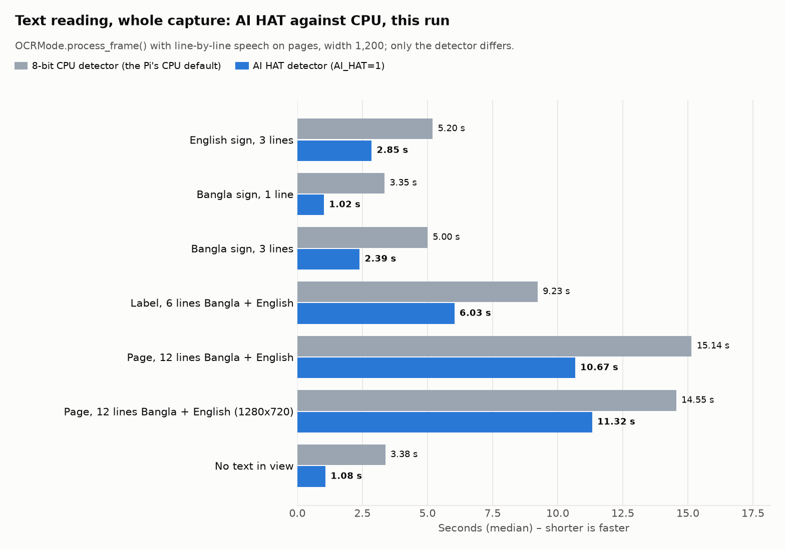

Reading the letters stays on the CPU, so long pages gain least; short signs and 'no text in view' gain most. Accuracy of the AI HAT text detector, measured before this run on 60 signs and labels: 1.1 % character error against 5.2 % with the CPU detector (`benchmark_report/2026-11-23_ai_hat/`).

## Temperature, clock and power

The board started at 55.6 °C with the throttle flag at `0xe0000` (CPU clock capping has occurred; throttling has occurred; soft temperature limit has occurred) before the first timing call.

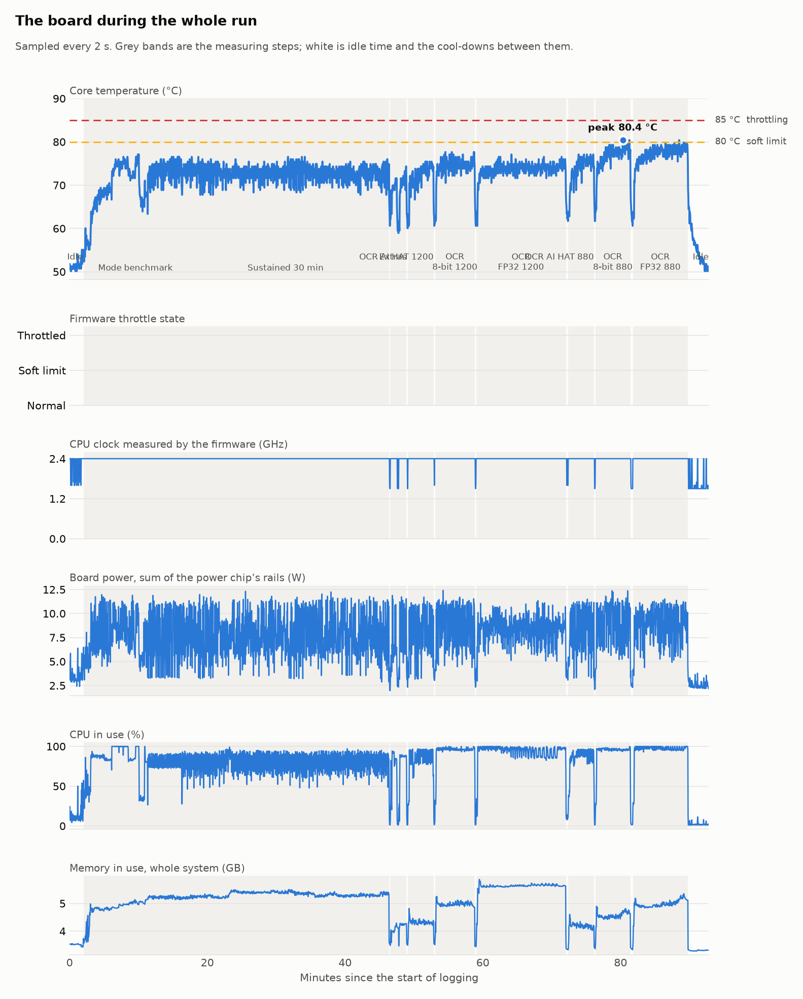

| Step | Minutes | Mean °C | Peak °C | Soft limit active | Throttled or capped | Lowest clock | Clock under 2.3 GHz | Mean power | Peak power |
|---|---:|---:|---:|---:|---:|---:|---:|---:|---:|
| Idle before (desktop open) | 1.9 | 51.4 | 55.1 | 0% | 0% | 1.60 GHz | 36% | 3.49 W | 6.39 W |
| Tests | 0.7 | 55.8 | 60.0 | 0% | 0% | 2.40 GHz | 0% | 4.99 W | 8.05 W |
| Mode benchmark | 13.2 | 71.3 | 77.1 | 0% | 0% | 2.40 GHz | 0% | 7.83 W | 11.97 W |
| Sustained 30 min | 29.2 | 73.0 | 76.5 | 0% | 0% | 2.40 GHz | 0% | 7.72 W | 12.31 W |
| Extras and camera | 2.3 | 68.3 | 74.3 | 0% | 0% | 1.50 GHz | 6% | 6.67 W | 11.88 W |
| Text reading, AI HAT detector, width 1,200 (AI_HAT=1) | 3.7 | 71.9 | 75.5 | 0% | 0% | 2.40 GHz | 0% | 7.95 W | 11.72 W |
| Text reading, 8-bit CPU detector, width 1,200 (the Pi's CPU default) | 5.6 | 74.2 | 77.7 | 0% | 0% | 2.40 GHz | 0% | 8.75 W | 12.41 W |
| Text reading, full-precision CPU detector, width 1,200 | 12.7 | 73.6 | 77.1 | 0% | 0% | 2.40 GHz | 0% | 8.32 W | 11.34 W |
| Text reading, AI HAT detector, width 880 | 3.7 | 73.6 | 77.1 | 0% | 0% | 2.40 GHz | 0% | 7.94 W | 11.50 W |
| Text reading, 8-bit CPU detector, width 880 | 5.0 | 76.5 | 80.4 | 0% | 0% | 2.40 GHz | 0% | 8.85 W | 12.37 W |
| Text reading, full-precision CPU detector, width 880 | 7.8 | 76.9 | 80.4 | 0% | 0% | 2.40 GHz | 0% | 8.76 W | 11.53 W |
| Idle after | 2.9 | 55.5 | 68.8 | 0% | 0% | 1.50 GHz | 83% | 2.60 W | 3.79 W |

- Under-voltage was never reported, so the power supply kept up. The fan ran up to 9,404 rpm.
- The temperature is the SoC's own sensor (`thermal_zone0`), the hottest point of the board. A thermometer on the case or the board surface reads lower.
- The clock is what the firmware measures (`vcgencmd measure_clock arm`). At idle the governor drops it to 1.5 GHz by design; only a low clock under load means throttling.

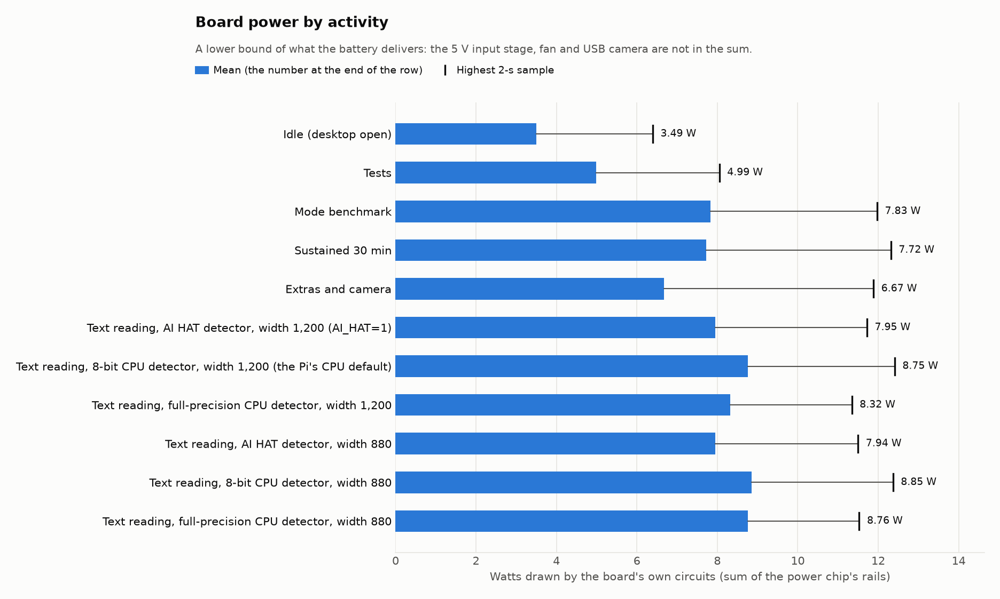

**Battery estimate.** With the formula of `scripts/power_log.py` (rail sum + 30% for the input stage, fan and USB camera; a 37 Wh / 10,000 mAh power bank delivering 85% of its rating): about 3.1 h of non-stop use at the sustained-run power (7.72 W rail sum), and about 6.9 h at idle (3.49 W). The glass's real bank capacity is not recorded in the project, and the overhead is an allowance, not a measurement; a run on the bank itself with a USB power meter would replace this estimate.

## Full latency list

Each row is 100 timed calls after 3 warm-up calls, from `scripts/benchmark_pi5.py` unless marked. Frames are 640x480, the glass camera size.

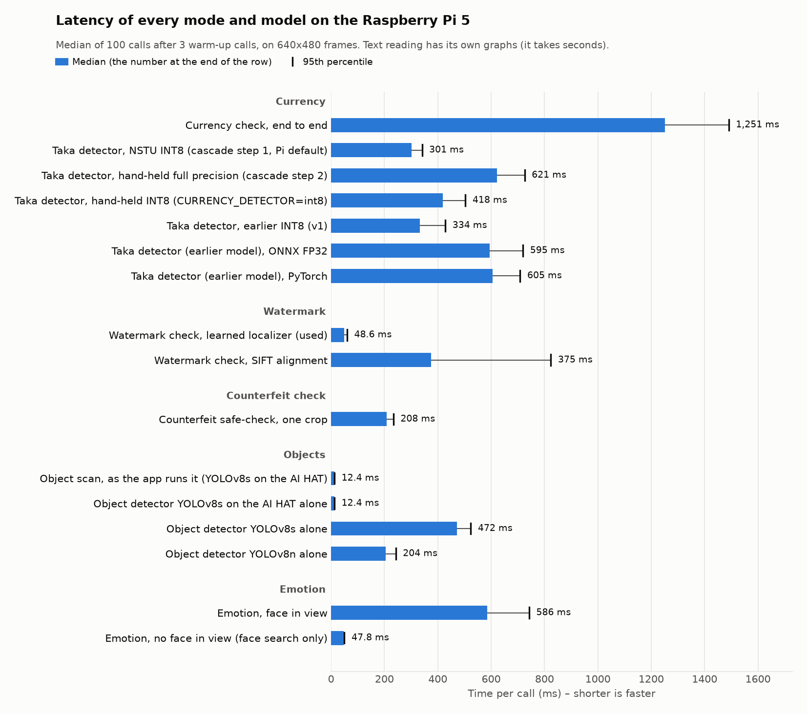

| Group | Benchmark | Median | 95th pct | Mean | Calls/s | Load | Memory after | Temp after |
|---|---|---:|---:|---:|---:|---:|---:|---:|
| Currency | Currency check, end to end | 1,251 ms | 1,491 ms | 1,159 ms | 0.80 | 538 ms | 1.39 GB | 66.7 °C |
| Currency | Taka detector, NSTU INT8 (cascade step 1, Pi default) | 301 ms | 341 ms | 305 ms | 3.32 | 0.6 ms | 1.87 GB | 77.1 °C |
| Currency | Taka detector, hand-held full precision (cascade step 2) | 621 ms | 725 ms | 601 ms | 1.61 | 63.6 ms | 1.80 GB | 73.2 °C |
| Currency | Taka detector, hand-held INT8 (CURRENCY_DETECTOR=int8) | 418 ms | 504 ms | 434 ms | 2.39 | 26.9 ms | 1.77 GB | 76.0 °C |
| Currency | Taka detector, earlier INT8 (v1) | 334 ms | 428 ms | 344 ms | 3.00 | 35.6 ms | 1.68 GB | 76.0 °C |
| Currency | Taka detector (earlier model), ONNX FP32 | 595 ms | 719 ms | 612 ms | 1.68 | 30.9 ms | 1.59 GB | 74.9 °C |
| Currency | Taka detector (earlier model), PyTorch | 605 ms | 709 ms | 621 ms | 1.65 | 269 ms | 1.46 GB | 70.5 °C |
| Watermark | Watermark check, learned localizer (used) | 48.6 ms | 60.1 ms | 49.4 ms | 20.58 | 594 ms | 1.91 GB | 70.5 °C |
| Watermark | Watermark check, SIFT alignment | 375 ms | 824 ms | 463 ms | 2.66 | 622 ms | 1.89 GB | 63.9 °C |
| Counterfeit check | Counterfeit safe-check, one crop | 208 ms | 234 ms | 212 ms | 4.81 | 364 ms | 1.93 GB | 67.8 °C |
| Objects | Object scan, as the app runs it (YOLOv8s on the AI HAT) | 12.4 ms | 12.7 ms | 12.4 ms | 80.85 | 302 ms | 1.93 GB | 63.9 °C |
| Objects | Object detector YOLOv8s on the AI HAT alone † | 12.4 ms | 12.5 ms | 12.4 ms | 80.73 | 329 ms | 0.83 GB | 66.1 °C |
| Objects | Object detector YOLOv8s alone † | 472 ms | 524 ms | 481 ms | 2.12 | 122 ms | 0.79 GB | 71.6 °C |
| Objects | Object detector YOLOv8n alone † | 204 ms | 242 ms | 209 ms | 4.89 | 123 ms | 0.72 GB | 70.5 °C |
| Emotion | Emotion, face in view † | 586 ms | 742 ms | 600 ms | 1.71 | 2.97 s | 0.67 GB | 68.8 °C |
| Emotion | Emotion, no face in view (face search only) | 47.8 ms | 50.0 ms | 48.0 ms | 20.93 | 1,336 ms | 1.97 GB | 67.2 °C |
| Text | Text reading, 3-line sign (benchmark frame) | 2.85 s | 3.00 s | 2.87 s | 0.35 | 7.57 s | 1.97 GB | 74.3 °C |

† from `benchmark_report/scripts/extras_bench.py` (30 calls), because the datasets the project script reads are not on the Pi. These rows ran in a separate process, so their memory column cannot be compared with the others.

Load is the time to build the model object in that process; the ONNX detectors are read from disk on their first call, so their load is near zero. Memory is the whole benchmark process after that row, not the size of one model.

- **Currency.** The note rows cycle through the 4 note pictures on the Pi (the 500 and 1,000 Taka templates and the two pictures in `samples/`). In the code measured here, currency mode on the Pi runs the detector cascade (master `634afff`): the NSTU re-trained 8-bit detector (`best_nstu_int8.onnx`) answers when it is sure (0.90), otherwise the hand-held full-precision detector (`best_handheld.pt`) looks again. The end-to-end row includes both steps where the first is unsure; the two detectors are timed alone above it, the earlier detectors for comparison. Both run on the CPU: they are SARA's own models and have no AI HAT compile.
- **Emotion.** `benchmark_pi5.py` has no face pictures on the Pi, so its row is a frame with no face (47.8 ms, the face search alone). With a face in view (the astronaut test picture, classifier `rgb_mobilenet_blend`) one answer takes 586 ms.
- **Objects.** The app uses YOLOv8s (12.4 ms per scan as the app runs it, on the AI HAT; the same detector on the CPU takes 472 ms); YOLOv8n on the CPU would take 204 ms. No COCO pictures are on the Pi, so the scan is timed on the note pictures; the detector does the same work on any picture.

## 30 minutes of non-stop use

`--sustained 30` ran every model in turn for 30 minutes: 2,755 calls. Core temperature, as the benchmark read it after each call, 68.3 to 76.5 °C (the 2-second sampler's peak is in the table above); throttle flags seen: `0xe0000`, together: CPU clock capping has occurred; throttling has occurred; soft temperature limit has occurred. On 1 October the same run made 1,229 calls and peaked at 77.1 °C.

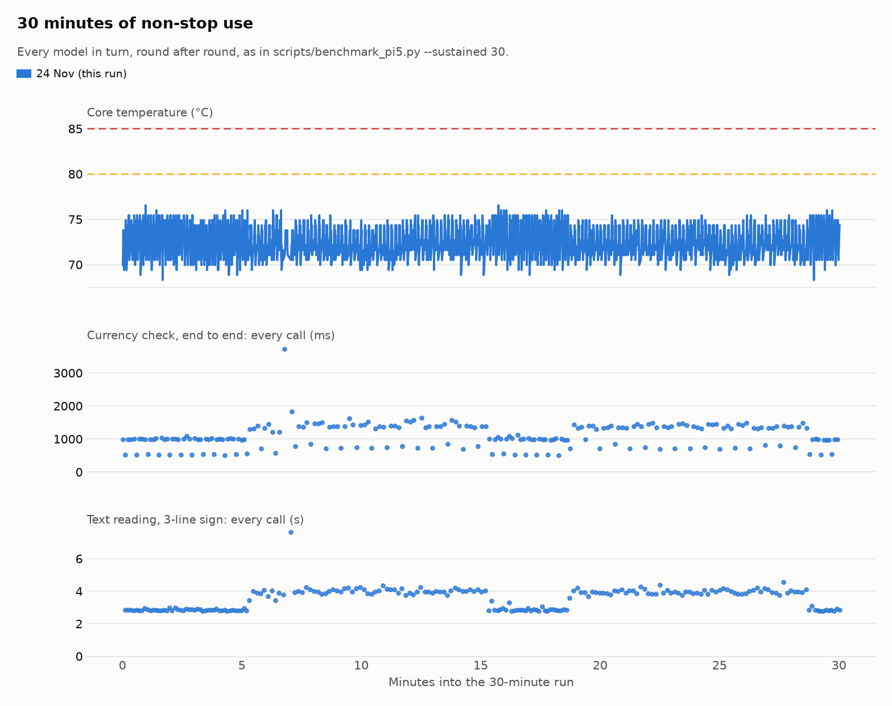

| Model | Calls | Median, first 5 min | Median, last 5 min | Drift | Slowest call | Median in the timing pass |
|---|---:|---:|---:|---:|---:|---:|
| Currency check, end to end | 212 | 992 ms | 1,317 ms | +33% | 3.72 s | 1,251 ms |
| Taka detector, NSTU INT8 (cascade step 1, Pi default) | 212 | 299 ms | 394 ms | +32% | 689 ms | 301 ms |
| Taka detector, hand-held full precision (cascade step 2) | 212 | 490 ms | 636 ms | +30% | 1,972 ms | 621 ms |
| Taka detector, hand-held INT8 (CURRENCY_DETECTOR=int8) | 212 | 315 ms | 414 ms | +31% | 881 ms | 418 ms |
| Taka detector, earlier INT8 (v1) | 212 | 250 ms | 332 ms | +33% | 949 ms | 334 ms |
| Taka detector (earlier model), ONNX FP32 | 212 | 448 ms | 594 ms | +33% | 1,243 ms | 595 ms |
| Taka detector (earlier model), PyTorch | 212 | 477 ms | 634 ms | +33% | 1,170 ms | 605 ms |
| Watermark check, learned localizer (used) | 212 | 51.9 ms | 57.3 ms | +10% | 130 ms | 48.6 ms |
| Watermark check, SIFT alignment | 212 | 383 ms | 383 ms | -0% | 962 ms | 375 ms |
| Counterfeit safe-check, one crop | 212 | 237 ms | 315 ms | +33% | 773 ms | 208 ms |
| Object scan, as the app runs it (YOLOv8s on the AI HAT) | 212 | 33.5 ms | 33.6 ms | +0% | 38.2 ms | 12.4 ms |
| Emotion, no face in view (face search only) | 211 | 47.4 ms | 52.4 ms | +10% | 70.4 ms | 47.8 ms |
| Text reading, 3-line sign (benchmark frame) | 212 | 2.84 s | 3.90 s | +37% | 7.63 s | 2.85 s |

Process memory over the 30 minutes: 1.98 GB at the start, 1.87 GB at the end, highest 2.01 GB.

## Text reading (OCR)

`OCRMode.process_frame()`, the call `main.py` makes when ACTION is pressed in text mode, on rendered signs and pages whose text is known; 3 to 5 captures per picture. Pipeline `v2`, decoder `greedy`, canvas 2560, 4 threads. The text detector is timed in every setting the glass can use: on the AI HAT (`AI_HAT=1`), the 8-bit CPU detector (the Pi's default without the AI HAT) and the full-precision CPU detector, each at the two read widths, with a cool-down before each. The letter recogniser is the same in all of them.

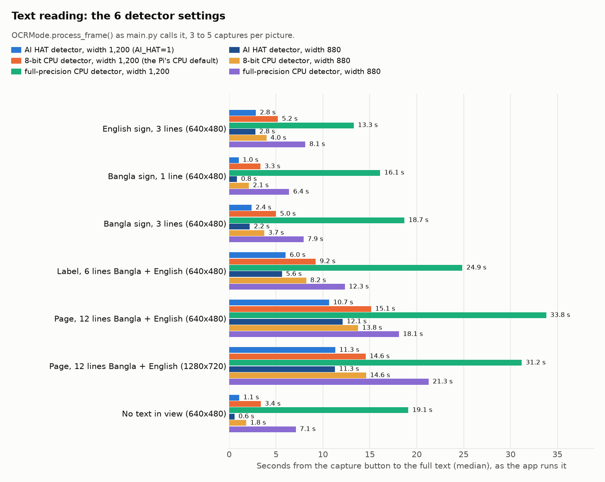

| Capture | AI HAT detector, width 1,200 (AI_HAT=1) | 8-bit CPU detector, width 1,200 (the Pi's CPU default) | full-precision CPU detector, width 1,200 | AI HAT detector, width 880 | 8-bit CPU detector, width 880 | full-precision CPU detector, width 880 |
|---|---:|---:|---:|---:|---:|---:|
| English sign, 3 lines (640x480) — text found once, `benchmark_pi5.py` path | 2.84 s (0.0% err) | 5.12 s (0.0% err) | 13.45 s (0.0% err) | 3.57 s (0.0% err) | 3.93 s (0.0% err) | 8.22 s (0.0% err) |
| English sign, 3 lines (640x480) | 2.85 s (0.0% err) | 5.20 s (0.0% err) | 13.29 s (0.0% err) | 2.79 s (0.0% err) | 3.98 s (0.0% err) | 8.12 s (0.0% err) |
| Bangla sign, 1 line (640x480) — text found once, `benchmark_pi5.py` path | 1.02 s (0.0% err) | 3.39 s (0.0% err) | 11.90 s (0.0% err) | 0.84 s (0.0% err) | 2.12 s (0.0% err) | 6.37 s (0.0% err) |
| Bangla sign, 1 line (640x480) | 1.02 s (0.0% err) | 3.35 s (0.0% err) | 16.11 s (0.0% err) | 0.85 s (0.0% err) | 2.11 s (0.0% err) | 6.40 s (0.0% err) |
| Bangla sign, 3 lines (640x480) — text found once, `benchmark_pi5.py` path | 2.36 s (2.9% err) | 5.00 s (0.0% err) | 18.47 s (0.0% err) | 2.20 s (0.0% err) | 3.76 s (0.0% err) | 7.99 s (0.0% err) |
| Bangla sign, 3 lines (640x480) | 2.39 s (2.9% err) | 5.00 s (0.0% err) | 18.70 s (0.0% err) | 2.21 s (0.0% err) | 3.74 s (0.0% err) | 7.93 s (0.0% err) |
| Label, 6 lines Bangla + English (640x480) | 6.03 s (0.0% err) | 9.23 s (0.0% err) | 24.87 s (0.0% err) | 5.63 s (0.0% err) | 8.22 s (0.0% err) | 12.33 s (0.0% err) |
| Page, 12 lines Bangla + English (640x480) | 10.67 s (0.0% err) | 15.14 s (0.5% err) | 33.81 s (0.5% err) | 12.11 s (0.5% err) | 13.75 s (0.5% err) | 18.11 s (0.5% err) |
| Page, 12 lines Bangla + English (1280x720) | 11.32 s (8.9% err) | 14.55 s (0.5% err) | 31.19 s (0.5% err) | 11.30 s (8.9% err) | 14.60 s (0.5% err) | 21.28 s (0.5% err) |
| No text in view (640x480) | 1.08 s | 3.38 s | 19.11 s | 0.57 s | 1.82 s | 7.11 s |
| **Mean character error, app path** | 1.96% | 0.16% | 0.16% | 1.57% | 0.16% | 0.16% |
| One pass of the text detector | 0.4 – 0.5 s | 1.7 – 2.7 s | 9.5 – 15.3 s | 0.2 – 0.4 s | 0.9 – 2.3 s | 3.5 – 9.0 s |

The character errors are on clean rendered pictures, so they say mostly that the timed reads were real reads; the project's accuracy numbers for each setting are the validation results in `config.py`.

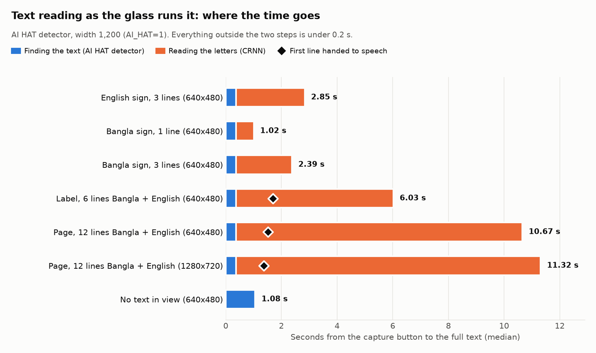

As the glass runs it in this run (AI HAT detector, width 1,200 (AI_HAT=1)):

| Capture | Runs | Total | Range | Finding text | Reading letters | Rest | First line spoken | Detector passes | Character errors |
|---|---:|---:|---:|---:|---:|---:|---:|---:|---:|
| English sign, 3 lines (640x480) | 5 | **2.85 s** | 2.79 s – 2.88 s | 0.37 s | 2.47 s | 0.01 s | – | 1 | 0.0% |
| Bangla sign, 1 line (640x480) | 5 | **1.02 s** | 1.00 s – 1.14 s | 0.37 s | 0.64 s | 0.01 s | – | 1 | 0.0% |
| Bangla sign, 3 lines (640x480) | 5 | **2.39 s** | 2.32 s – 2.50 s | 0.37 s | 2.01 s | 0.01 s | – | 1 | 2.9% |
| Label, 6 lines Bangla + English (640x480) | 5 | **6.03 s** | 5.99 s – 6.13 s | 0.37 s | 5.65 s | 0.01 s | 1.70 s | 1 | 0.0% |
| Page, 12 lines Bangla + English (640x480) | 5 | **10.67 s** | 10.63 s – 10.69 s | 0.38 s | 10.28 s | 0.01 s | 1.52 s | 1 | 0.0% |
| Page, 12 lines Bangla + English (1280x720) | 5 | **11.32 s** | 11.17 s – 13.01 s | 0.38 s | 10.94 s | 0.00 s | 1.37 s | 1 | 8.9% |
| No text in view (640x480) | 5 | **1.08 s** | 1.05 s – 1.09 s | 1.06 s | 0.00 s | 0.02 s | – | 2 | – |

- **No text in view:** 1.08 s, answer empty (the glass says no text was found).
- Loading the text reader took 9.55 s; the first capture after loading took 2.82 s.

What the glass read (AI HAT detector, width 1,200 (AI_HAT=1), app path, last run of each capture):

| Capture | Text on the picture | Text the glass read |
|---|---|---|
| English sign, 3 lines (640x480) | EXIT 12 Bus Stop Main Entrance | EXIT 12 Bus Stop Main Entrance |
| Bangla sign, 1 line (640x480) | ধূমপান নিষেধ | ধূমপান নিষেধ |
| Bangla sign, 3 lines (640x480) | ধূমপান নিষেধ ডাকঘর নিরাপদ পানীয় জল | ধূমপান নিষেধ ডাকঘর নিরাপদ পানীয জল |
| Label, 6 lines Bangla + English (640x480) | Paracetamol 500 mg মেয়াদ উত্তীর্ণের তারিখ Best Before 2027 দাম ৮৫ টাকা Price 120 Taka চিনি এক কেজি | Paracetamol 500 mg মেয়াদ উত্তীর্ণের তারিখ Best Before 2027 দাম ৮৫ টাকা Price 120 Taka চিনি এক কেজি |
| Page, 12 lines Bangla + English (640x480) | সরকারি প্রাথমিক বিদ্যালয় Emergency Room জুতা খুলে প্রবেশ করুন Closed on Monday ঢাকা মেডিকেল কলেজ Drinking Water রক্ত পরীক্ষা কেন্দ্র Electricity Bill শিশুদের খেলার মাঠ Train Schedule ভাড়া দেওয়া হবে Cash Counter | সরকারি প্রাথমিক বিদ্যালয় Emergency Room জুতা খুলে প্রবেশ করুন Closed on Monday ঢাকা মেডিকেল কলেজ Drinking Water রক্ত পরীক্ষা কেন্দ্র Electricity Bill শিশুদের খেলার মাঠ Train Schedule ভাড়া দেওয়া হবে Cash Counter |
| Page, 12 lines Bangla + English (1280x720) | সরকারি প্রাথমিক বিদ্যালয় Emergency Room জুতা খুলে প্রবেশ করুন Closed on Monday ঢাকা মেডিকেল কলেজ Drinking Water রক্ত পরীক্ষা কেন্দ্র Electricity Bill শিশুদের খেলার মাঠ Train Schedule ভাড়া দেওয়া হবে Cash Counter | সরকারি প্রাথমিক বিদ্যালয় Emergency Room জুতা খুলে প্রবেশ করুন Closed on Monday ঢাকা মেডিকেল কলেজ Drinking Water রক্ত পরীক্ষা কেন্দ্র Electricity Bill Train Schedule ভাড়়া দেওয়া হবে Cash Counter |

## Live camera loop

`scripts/test_live_camera.py --seconds 60`: real frames from the C270 webcam (640x480, mean brightness 99.4 of 255) through the glass's own currency and object modes, and every fifth frame through emotion. 75 frames in 60.7 s: 1.23 frames a second with all of it running.

| Stage | Calls | Median | 95th pct |
|---|---:|---:|---:|
| Camera read | 75 | 1.8 ms | 1.9 ms |
| Currency detection + safe check | 75 | 770 ms | 837 ms |
| Object scan | 75 | 12.6 ms | 12.9 ms |
| Emotion (every 5th frame) | 15 | 47.3 ms | 49.0 ms |
| Whole frame | 75 | 788 ms | 898 ms |

Notes seen: none; objects announced: {'সামনে আছে: পাখি': 10}; faces: {'no_face': 15}. The run was unattended, so nothing was held up to the camera; this measures speed on real camera frames, not accuracy.

## The app itself, used earlier today

`python main.py` with the real camera and buttons, before this benchmark (`20261124_003001_memo`, 00:30–00:39; currency threshold 0.75, watermark step off). These are the latencies the app's own field log recorded, from button press to the spoken answer being queued.

| What | Times | Median | Range |
|---|---:|---:|---:|
| Text reading: one capture | 3 | 11.53 s | 9.36 s – 11.61 s |
| Object scan and announcement | 9 | 23.0 ms | 13.3 ms – 31.2 ms |
| Currency check | 6 | 1.61 s | 1.21 s – 3.81 s |
| Emotion | 6 | 1,307 ms | 51.6 ms – 1,375 ms |

The glass named the note on 4 of 6 currency presses (detector confidence at or above the threshold); on the others it asked for the note to be held closer, or found none. The app logged 54.0 to 65.5 °C. It held up to 2.22 GB of memory with all modes loaded and the camera open.

What those text captures read. They were photos of printed pages, longer than the 3-line sign, so their times compare with the label and page rows of the text-reading section:

| Language | Characters read | Time | Text the glass read |
|---|---:|---:|---|
| Bangla | 146 | 9.36 s | আয় ছেলেরা আয় মেয়েরা ফুল তুলিতে যাই ফুলের মালা গলায় দিয়ে মামার বাড়ি যাই ঝড়ের দিনে মামার দেশে আম কুড়াতে সুখ পাকা জামের মধুর রসে রঙিন করি মুখ |
| English | 82 | 11.61 s | Humpty Dumpty sat on a wall Humpty Dumpty had a great fall Huinpty rogether againi |
| English | 139 | 11.53 s | Humpty Dumpty sat on a wall Humpty Dumpty All the king s horses and all had a great fall. therking s men couldnt put Humpty together againi |

## The app after the run

The app itself (`main.SmartGlass`, headless as on the glass, `AI_HAT=1`), after this benchmark, on the code checked out then (`20261124_022631_memo`, 02:26–02:28; currency threshold 0.75, watermark step off). These are the latencies the app's own field log recorded, from button press to the spoken answer being queued. The buttons were pressed by `benchmark_report/scripts/app_session_driver.py` through the app's own MODE and ACTION handlers (4 presses in each mode). Nobody was at the glass, so the camera saw the room: no note, no text and no face, which is why those answers are quick and empty (`raw/app_session.txt`).

| What | Times | Median | Range |
|---|---:|---:|---:|
| Text reading: one capture | 4 | 1,107 ms | 1,097 ms – 1,175 ms |
| Object scan and announcement | 10 | 12.9 ms | 12.8 ms – 15.0 ms |
| Currency check | 4 | 898 ms | 817 ms – 995 ms |
| Emotion | 4 | 47.2 ms | 46.3 ms – 51.5 ms |

The glass named the note on 0 of 4 currency presses (detector confidence at or above the threshold); on the others it asked for the note to be held closer, or found none. The app logged 50.7 to 60.0 °C. It held up to 2.27 GB of memory with all modes loaded and the camera open.

## Loading, speech and camera

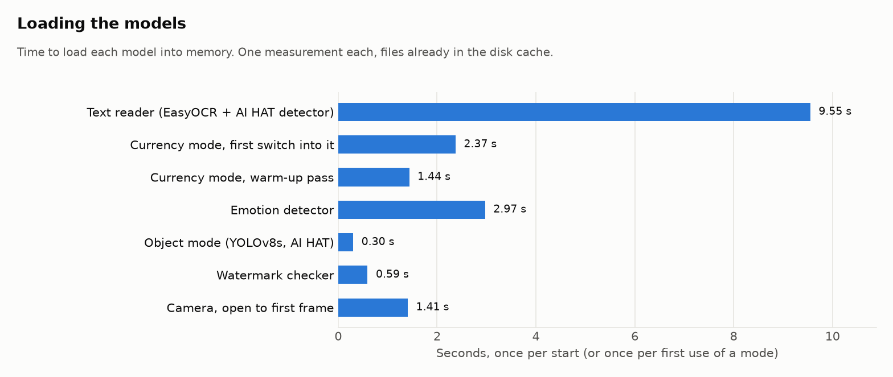

| What | Time |
|---|---:|
| Text reader (EasyOCR + AI HAT detector) | 9.55 s |
| Currency mode, first switch into it | 2.37 s |
| Currency mode, warm-up pass | 1.44 s |
| Emotion detector | 2.97 s |
| Object mode (YOLOv8s, AI HAT) | 0.30 s |
| Watermark checker | 0.59 s |
| Camera, open to first frame | 1.41 s |
| Currency mode, first check after switching | 843 ms |
| Currency mode, later checks | 782 ms |
| Currency mode, switching back into it | 0.0 ms |
| Speech: short Bangla sentence (5.93 s of audio) | 14.1 ms |
| Speech: short English sentence (5.57 s of audio) | 13.8 ms |
| Speech: six Bangla lines (16.72 s of audio) | 27.5 ms |
| Camera: time between frames (640x480) | 132 ms (7.6 frames/s) |

Speech is espeak-ng rendering the audio to a pipe, not playing it: rendering adds almost nothing to the response time; the listener still has to hear the sentence out.

# Comparison with the earlier benchmarks

Everything above is this run alone. This part sets it against the earlier runs on the same board.

## Against 23 November (the last run before the AI HAT)

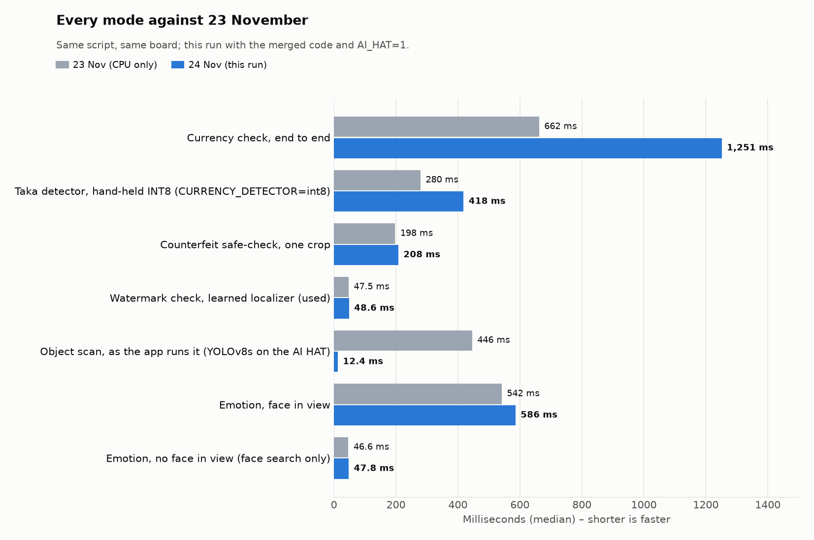

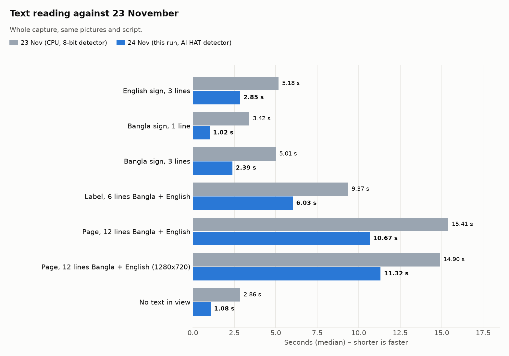

| Capture | 23 Nov (CPU) | 24 Nov | Change | First line spoken, 23 Nov → 24 Nov |
|---|---:|---:|---:|---:|
| English sign, 3 lines (640x480) | 5.18 s | **2.85 s** | -45% | – → – |
| Bangla sign, 1 line (640x480) | 3.42 s | **1.02 s** | -70% | – → – |
| Bangla sign, 3 lines (640x480) | 5.01 s | **2.39 s** | -52% | – → – |
| Label, 6 lines Bangla + English (640x480) | 9.37 s | **6.03 s** | -36% | 4.21 s → 1.70 s |
| Page, 12 lines Bangla + English (640x480) | 15.41 s | **10.67 s** | -31% | 4.27 s → 1.52 s |
| Page, 12 lines Bangla + English (1280x720) | 14.90 s | **11.32 s** | -24% | 3.75 s → 1.37 s |
| No text in view (640x480) | 2.86 s | **1.08 s** | -62% | – → – |

## Every row against the earlier runs

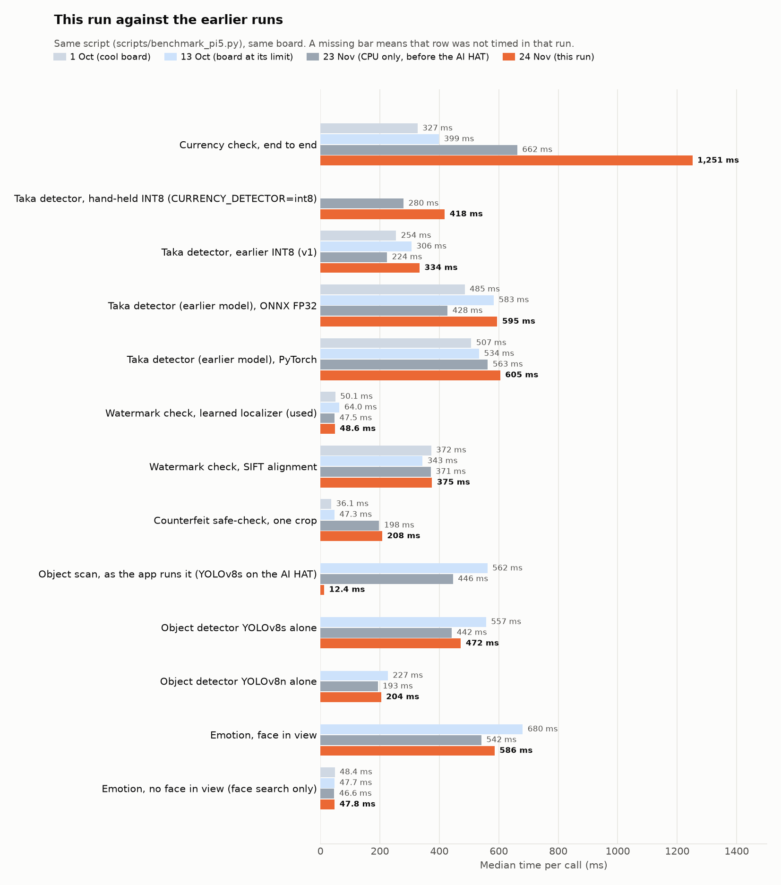

| Benchmark | 1 Oct | 13 Oct | 23 Nov | 24 Nov | Change from 1 Oct | Change from 23 Nov |
|---|---:|---:|---:|---:|---:|---:|
| Currency check, end to end | 327 ms | 399 ms | 662 ms | **1,251 ms** | +283% | +89% |
| Taka detector, NSTU INT8 (cascade step 1, Pi default) | – | – | – | **301 ms** | – | – |
| Taka detector, hand-held full precision (cascade step 2) | – | – | – | **621 ms** | – | – |
| Taka detector, hand-held INT8 (CURRENCY_DETECTOR=int8) | – | – | 280 ms | **418 ms** | – | +50% |
| Taka detector, earlier INT8 (v1) | 254 ms | 306 ms | 224 ms | **334 ms** | +31% | +49% |
| Taka detector (earlier model), ONNX FP32 | 485 ms | 583 ms | 428 ms | **595 ms** | +23% | +39% |
| Taka detector (earlier model), PyTorch | 507 ms | 534 ms | 563 ms | **605 ms** | +19% | +7% |
| Watermark check, learned localizer (used) | 50.1 ms | 64.0 ms | 47.5 ms | **48.6 ms** | -3% | +2% |
| Watermark check, SIFT alignment | 372 ms | 343 ms | 371 ms | **375 ms** | +1% | +1% |
| Counterfeit safe-check, one crop | 36.1 ms | 47.3 ms | 198 ms | **208 ms** | +476% | +5% |
| Object scan, as the app runs it (YOLOv8s on the AI HAT) | – | 562 ms | 446 ms | **12.4 ms** | – | -97% |
| Object detector YOLOv8s on the AI HAT alone | – | – | – | **12.4 ms** | – | – |
| Object detector YOLOv8s alone | – | 557 ms | 442 ms | **472 ms** | – | +7% |
| Object detector YOLOv8n alone | – | 227 ms | 193 ms | **204 ms** | – | +6% |
| Emotion, face in view | – | 680 ms | 542 ms | **586 ms** | – | +8% |
| Emotion, no face in view (face search only) | 48.4 ms | 47.7 ms | 46.6 ms | **47.8 ms** | -1% | +3% |
| Text reading, 3-line sign (benchmark frame) | 18.73 s | – | 5.74 s | **2.85 s** | -85% | -50% |

1 October: 100 calls a row, board cool (flag `0x0` at the end). 13 October: 30 calls a row, board at its temperature limit (flag `0xe0008`). 23 November: 100 calls a row, everything on the CPU. This run: 100 calls a row, with the AI HAT. The code changed between the runs too (hand-held detector, OCR pipeline v2, 8-bit text detector on the Pi, YOLOv8s; since 23 November the detector cascade, OCR v4 and the AI HAT), so a row whose model or hardware changed is not a like-for-like comparison.

## 30 minutes of non-stop use against 1 October

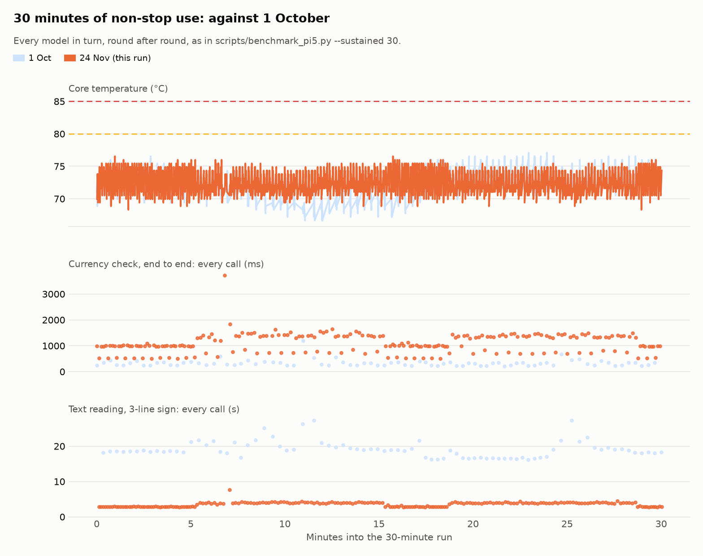

## Tests

The project's hardware-free test scripts, run on the Pi before the benchmark (`raw/tests/<name>.txt` holds each output).

| Test | Result | Time | Last line of output |
|---|---|---:|---|
| `test_thermal` | pass | 0 s | thermal governor: all checks pass |
| `test_multi_note` | pass | 2 s | multi-note: all checks pass |
| `test_capture_guide` | pass | 2 s | capture guide: all checks pass |
| `test_field_log` | pass | 1 s | field log: all checks pass. log() costs 5.3 µs per call in the app thread; 10008 rows, 3 system samples, 0 … |
| `test_tts_queue` | pass | 4 s | speech queue: all checks pass |
| `test_uv_check` | pass | 3 s | uv check: all checks pass |
| `test_voice_commands` | pass | 6 s | voice commands: a spoken command is recognised, an ordinary sentence is not; the wake word is required |
| `test_buttons_haptics` | SKIP | 0 s | SKIP: the 100 Taka test photo is not on this machine: /media/memo/7250-9755/Senior_project_wearable_glass_f… |
| `test_live_diag` | pass | 10 s | live panel: every algorithm ran; saved results/live_diag_check.png |
| `test_ocr_single_pass` | SKIP | 12 s | SKIP: val_seed0.npz is not in /media/memo/7250-9755/Senior_project_wearable_glass_for_blind_people_using_oc… |
| `test_hooks` | pass | 0 s | hooks: all checks pass; real master untouched: True |
| `test_results_db` | pass | 0 s | research evidence database: all checks pass (204 experiments in the real master file, largest record 2631 b… |
| `test_roboeye_modules` | SKIP | 4 s | SKIP: the JaalTaka dataset is not installed at /media/memo/7250-9755/Senior_project_wearable_glass_for_blin… |
| `test_print_capture` | pass | 0 s | print_capture: all rules hold |

Preflight (`scripts/pi5_preflight.py`): exit 0, every model file present and the ONNX graphs ran a dummy input.

## How this was measured

All steps ran from one script, `benchmark_report/scripts/run_full_benchmark.sh`, while `benchmark_report/scripts/sys_sampler.py` logged temperature, throttle flags, measured clock, CPU, memory, fan and board power every 2 s (`raw/system_timeline.csv`). Between the heavy steps the script waited until the board was back under 63 °C (at most 10 minutes).

The whole script ran with `AI_HAT=1` exported, so every app path that can use the AI HAT did.

1. 2 minutes idle, then `scripts/pi5_preflight.py` and the test scripts.
2. `scripts/benchmark_pi5.py --iters 100 --warmup 3 --sustained 30`, the protocol in `HOW_TO_RUN.md` (`raw/pi5_benchmark_memo_20261123T190952Z.json` and the `.csv` of the sustained run; the script also keeps a copy in `savior_glass/results/`).
3. `scripts/measure_mode_switch.py`, `benchmark_report/scripts/extras_bench.py` (emotion with a face, both object detectors on the CPU and YOLOv8s on the AI HAT, speech, camera) and `scripts/test_live_camera.py --seconds 60` (real webcam frames).
4. `benchmark_report/scripts/ocr_response_bench.py` once for each of the 6 text-detector settings.
5. 3 minutes idle.

Limits of this run:

- VS Code (with this Claude Code session), its language servers and a Chromium window stayed open on the Pi during the run; they use some CPU and memory (`raw/environment.txt` lists the top processes at the start).
- Only four note pictures are on the Pi; OCR and emotion pictures are rendered or stock pictures, not glass-camera photos.
- The live-camera loop was unattended: it measures speed on real frames, not what the glass says about a real note.
- Board power is the sum of the power chip's rails, a lower bound; the battery figure is an estimate with stated assumptions.
- Skipped: `prmvt_1view`: RuntimeError: PRMVT (Q-DUIG) checkpoint not found
- Skipped: `prmvt_2view`: RuntimeError: PRMVT (Q-DUIG) checkpoint not found
- Skipped: `prmvt_3view`: RuntimeError: PRMVT (Q-DUIG) checkpoint not found
- Skipped: `prmvt_4view`: RuntimeError: PRMVT (Q-DUIG) checkpoint not found
- Skipped: `prmvt_5view`: RuntimeError: PRMVT (Q-DUIG) checkpoint not found
- Skipped: `prmvt_6view`: RuntimeError: PRMVT (Q-DUIG) checkpoint not found

To rebuild this report from the raw files: `~/.venvs/savior_glass/bin/python benchmark_report/scripts/make_run_report.py benchmark_report/2026-11-24`.
