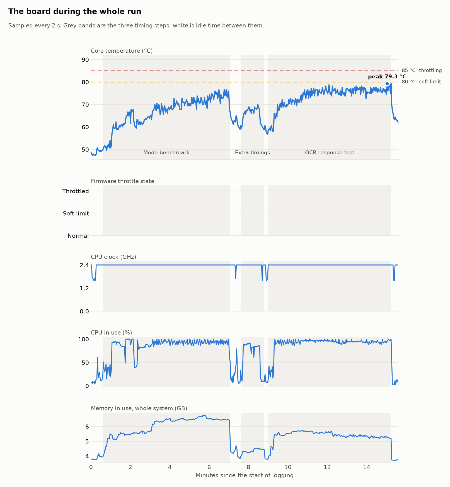
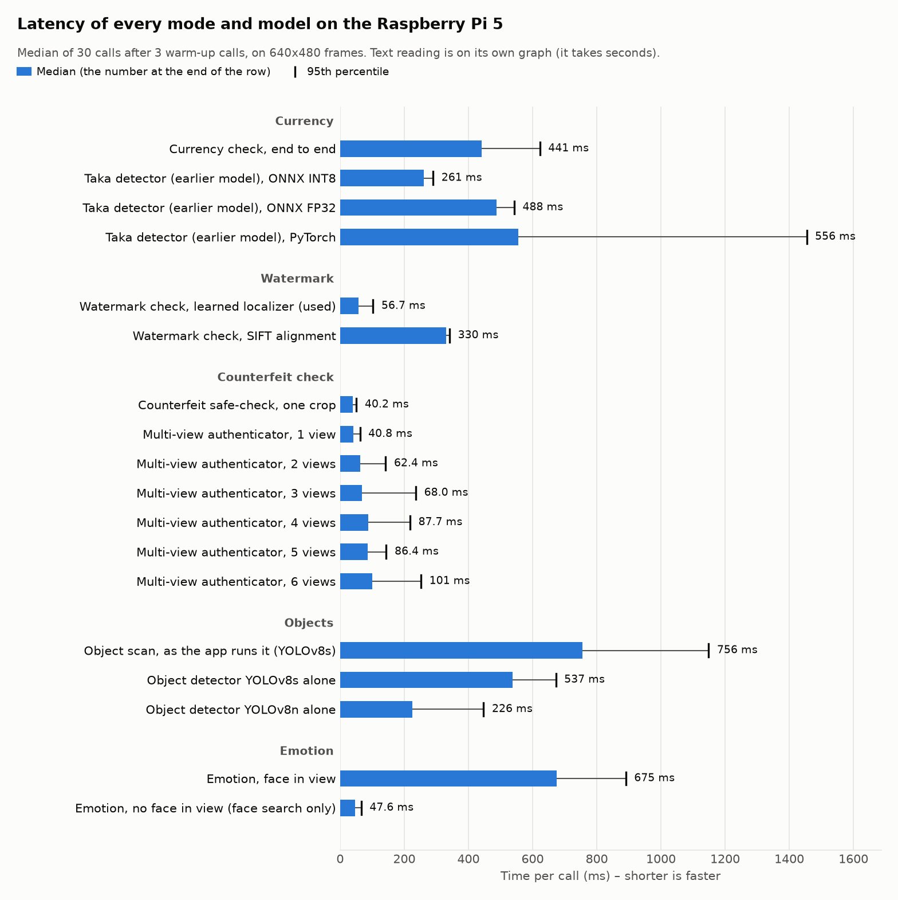
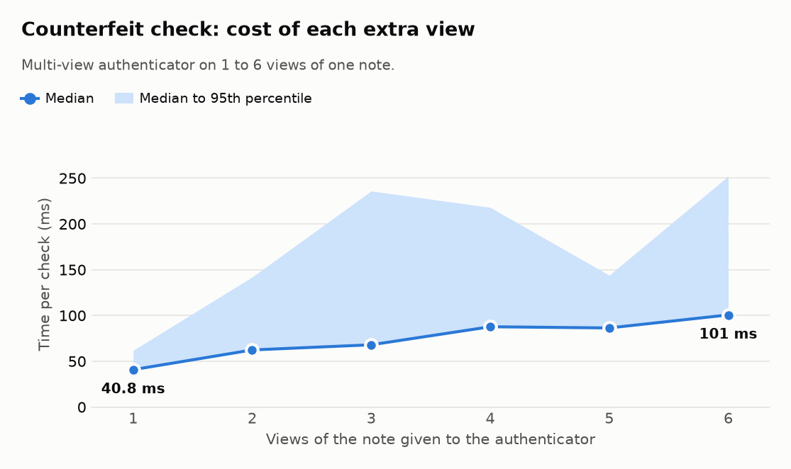
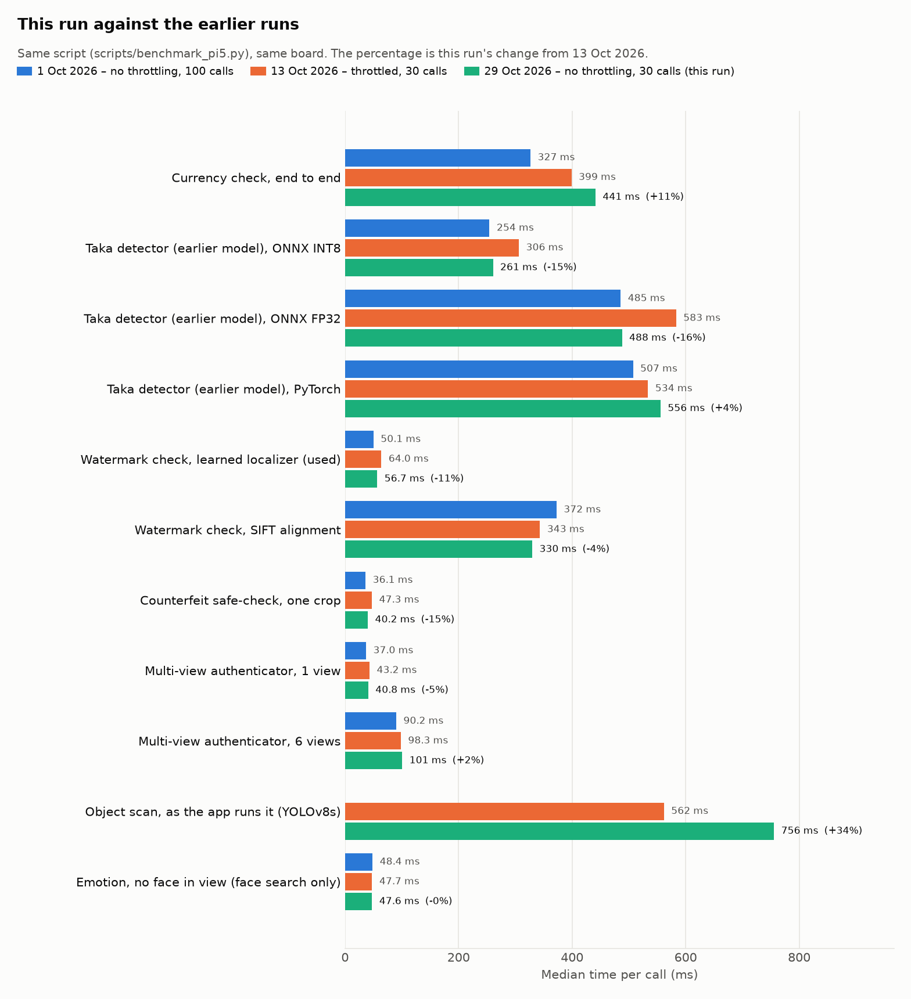
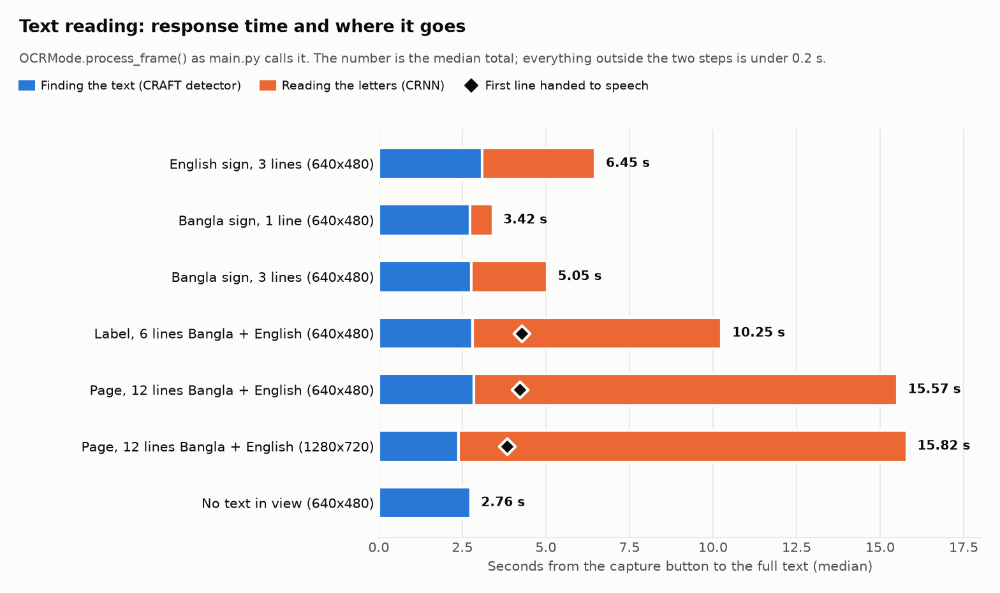
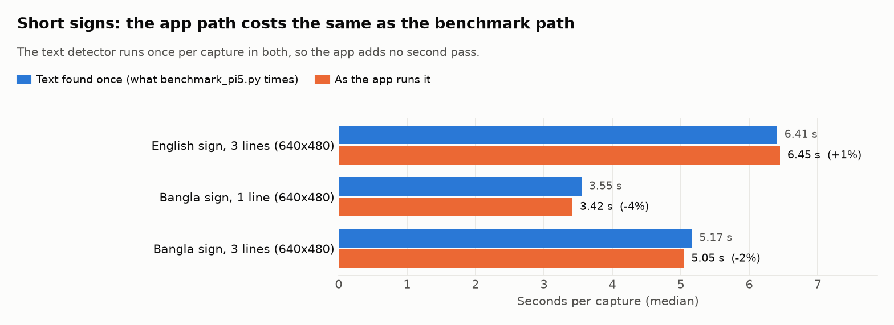
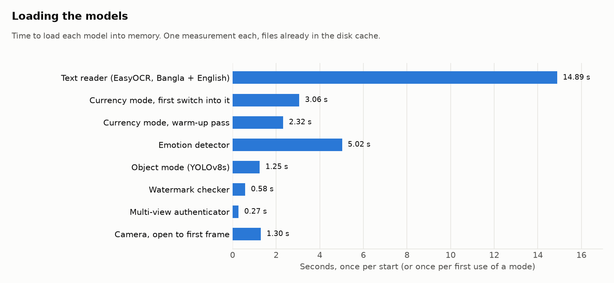
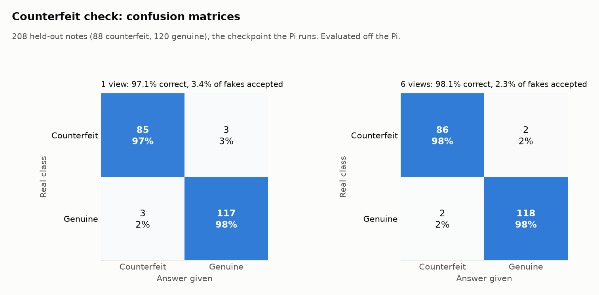
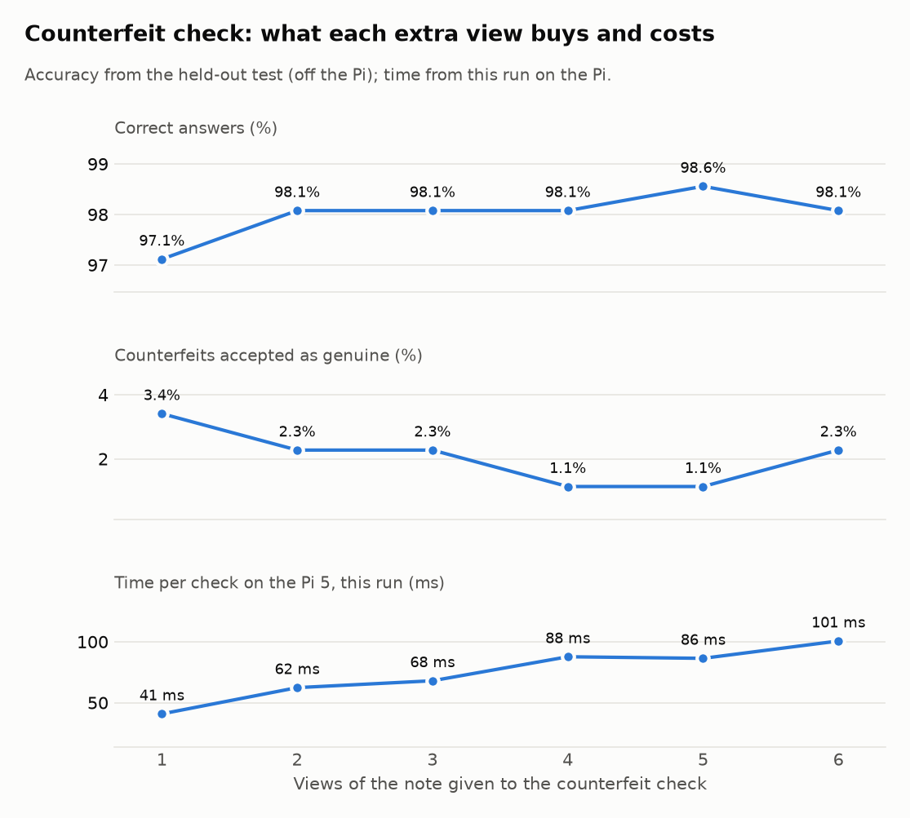

# SARA on the Raspberry Pi 5: benchmark report

Run on 29 October 2026, starting 17:02 local time, on the glass's own board (Raspberry Pi 5 Model B Rev 1.0, 4 cores, Python 3.13.5, torch 2.14.1+cpu, ONNX Runtime 1.30.0, EasyOCR 1.7.2). No GPU; everything runs on the CPU.

## Headline numbers

| What | Median | 95th percentile |
|---|---:|---:|
| Currency check, end to end | 441 ms | 623 ms |
| Taka detector (earlier model), ONNX INT8 | 261 ms | 290 ms |
| Watermark check, learned localizer (used) | 56.7 ms | 103 ms |
| Counterfeit safe-check, one crop | 40.2 ms | 50.9 ms |
| Object scan, as the app runs it (YOLOv8s) | 756 ms | 1,149 ms |
| Emotion, face in view | 675 ms | 891 ms |
| Text reading, 3-line sign, text found once (the README's measure) | 6.41 s | slowest of 5: 9.18 s |
| Text reading, 3-line sign, as the app runs it | 6.45 s | slowest of 5: 9.24 s |
| Text reading, 12-line page: first line spoken | 4.22 s | – |
| Text reading, 12-line page: whole page | 15.57 s | slowest of 4: 15.79 s |

Peak core temperature 79.3 °C. Memory held by the mode benchmark at its end: 2.33 GB; by the text-reading test: 1.60 GB.

What stands out:

- The board never reached its temperature limit: peak 79.3 °C, and the firmware flag still read `0x0` at the end (no throttling, clock capping or under-voltage since the Pi started).
- Against the throttled 13 October run, the currency check went from 399 ms to 441 ms (+11%). Code changed in between as well; see "Against the earlier runs".
- Emotion takes 675 ms when there is a face to classify; the 47.6 ms from the project script is a frame with no face.
- The object scan now uses YOLOv8s at 756 ms; YOLOv8n takes 226 ms.

## Temperature: the board stayed below its limit

The Pi was at 51.2 °C before the first timing call and the firmware flag read `0x0` (no throttling, clock capping or under-voltage). At the end of the mode benchmark it read `0x0`: no throttling, clock capping or under-voltage.

- Mode benchmark (6.5 min): mean 66.7 °C, peak 76.5 °C. The soft temperature limit was active in 0% of the 2-second samples and the CPU was throttled or clock-capped in 0%.
- OCR response test (6.2 min): mean 73.8 °C, peak 79.3 °C. Soft limit active in 0% of samples, throttled or clock-capped in 0%.
- During the timing steps the CPU ran at full speed (2.40 GHz) in 420 of 422 clock samples; the 2 lower ones (down to 1.60 GHz) fell in the camera timing and the mode switch, where the CPU mostly waits. The clock between the steps is left out: it drops there on purpose when the CPU is idle.
- Under-voltage was never reported, so the power supply is not the cause. The fan was running (up to 10,097 rpm).

So these are the speeds of a glass that is not throttled. A glass worn for a long time gets hotter: on 13 October, after sessions with the app, the same board started this script at 73.2 °C and was throttled (`archive/2026-10-13/REPORT.md`). The longest test so far, 30 minutes of mixed use on 1 October, peaked at 77.1 °C without throttling.

## Full latency list

Each row is 30 timed calls after 3 warm-up calls, from `scripts/benchmark_pi5.py` unless marked. Frames are 640x480, the glass camera size.

| Group | Benchmark | Median | 95th pct | Mean | Calls/s | Load | Memory after | Temp after |
|---|---|---:|---:|---:|---:|---:|---:|---:|
| Currency | Currency check, end to end | 441 ms | 623 ms | 464 ms | 2.27 | 534 ms | 1.39 GB | 59.0 °C |
| Currency | Taka detector (earlier model), ONNX INT8 | 261 ms | 290 ms | 263 ms | 3.84 | 0.4 ms | 1.65 GB | 67.8 °C |
| Currency | Taka detector (earlier model), ONNX FP32 | 488 ms | 543 ms | 498 ms | 2.05 | 0.6 ms | 1.57 GB | 67.8 °C |
| Currency | Taka detector (earlier model), PyTorch | 556 ms | 1,454 ms | 685 ms | 1.80 | 555 ms | 1.43 GB | 61.7 °C |
| Watermark | Watermark check, learned localizer (used) | 56.7 ms | 103 ms | 61.8 ms | 17.64 | 581 ms | 1.66 GB | 64.5 °C |
| Watermark | Watermark check, SIFT alignment | 330 ms | 341 ms | 330 ms | 3.03 | 607 ms | 1.64 GB | 60.6 °C |
| Counterfeit check | Counterfeit safe-check, one crop | 40.2 ms | 50.9 ms | 40.0 ms | 24.89 | 204 ms | 1.64 GB | 61.7 °C |
| Counterfeit check | Multi-view authenticator, 1 view | 40.8 ms | 61.9 ms | 42.2 ms | 24.50 | 274 ms | 1.64 GB | 61.1 °C |
| Counterfeit check | Multi-view authenticator, 2 views | 62.4 ms | 142 ms | 75.7 ms | 16.04 | 278 ms | 1.65 GB | 61.1 °C |
| Counterfeit check | Multi-view authenticator, 3 views | 68.0 ms | 236 ms | 92.6 ms | 14.71 | 297 ms | 1.65 GB | 61.7 °C |
| Counterfeit check | Multi-view authenticator, 4 views | 87.7 ms | 218 ms | 104 ms | 11.40 | 280 ms | 1.65 GB | 61.7 °C |
| Counterfeit check | Multi-view authenticator, 5 views | 86.4 ms | 144 ms | 97.1 ms | 11.58 | 280 ms | 1.65 GB | 61.1 °C |
| Counterfeit check | Multi-view authenticator, 6 views | 101 ms | 252 ms | 116 ms | 9.94 | 297 ms | 1.66 GB | 61.7 °C |
| Objects | Object scan, as the app runs it (YOLOv8s) | 756 ms | 1,149 ms | 771 ms | 1.32 | 1,246 ms | 1.67 GB | 63.9 °C |
| Objects | Object detector YOLOv8s alone † | 537 ms | 673 ms | 557 ms | 1.86 | 615 ms | 0.78 GB | 68.8 °C |
| Objects | Object detector YOLOv8n alone † | 226 ms | 447 ms | 240 ms | 4.43 | 223 ms | 0.71 GB | 67.2 °C |
| Emotion | Emotion, face in view † | 675 ms | 891 ms | 718 ms | 1.48 | 5,024 ms | 0.67 GB | 66.1 °C |
| Emotion | Emotion, no face in view (face search only) | 47.6 ms | 65.8 ms | 51.9 ms | 21.03 | 3,384 ms | 2.33 GB | 70.0 °C |

† from `benchmark_report/scripts/extras_bench.py`, because the datasets the project script reads are not on the Pi. These rows ran in a separate process, so their memory column cannot be compared with the others.

Load is the time to build the model object in that process. The ONNX detectors are only read from disk on their first call, so their load column is near zero, and a row that reuses a library an earlier row imported loads faster. Memory is the whole benchmark process after that row ran, not the size of that one model.

- **Emotion.** The project script has no face pictures on the Pi (RAF-DB is absent), so it times a black frame: 47.6 ms is the face search finding nothing. With a face in view (the astronaut test picture, face found, classifier `rgb_mobilenet_blend`) one answer takes 675 ms, which is 14 times longer.
- **Objects.** The app now loads YOLOv8s (756 ms per scan). YOLOv8n on the same frames takes 226 ms; the README's 207 ms object figure was YOLOv8n. COCO pictures are not on the Pi, so the scan was timed on the note photos; the detector does the same amount of work on any picture.
- **Currency.** Only two note photos are on the Pi (the 500 and 1,000 Taka templates), so every currency, watermark and counterfeit-check row cycles through those two.
- **Taka detector.** The app's currency check loads `best_handheld_int8.onnx`; `benchmark_pi5.py` times only the earlier detector on its own (`best_int8.onnx`, `best.onnx`, `best.pt`), so the detector the app uses is timed only inside the end-to-end currency row.

## Against the earlier runs

| Benchmark | 1 Oct | 13 Oct | This run | Change from 1 Oct | Change from 13 Oct |
|---|---:|---:|---:|---:|---:|
| Currency check, end to end | 327 ms | 399 ms | 441 ms | +35% | +11% |
| Taka detector (earlier model), ONNX INT8 | 254 ms | 306 ms | 261 ms | +2% | -15% |
| Taka detector (earlier model), ONNX FP32 | 485 ms | 583 ms | 488 ms | +0% | -16% |
| Taka detector (earlier model), PyTorch | 507 ms | 534 ms | 556 ms | +10% | +4% |
| Watermark check, learned localizer (used) | 50.1 ms | 64.0 ms | 56.7 ms | +13% | -11% |
| Watermark check, SIFT alignment | 372 ms | 343 ms | 330 ms | -11% | -4% |
| Counterfeit safe-check, one crop | 36.1 ms | 47.3 ms | 40.2 ms | +11% | -15% |
| Multi-view authenticator, 1 view | 37.0 ms | 43.2 ms | 40.8 ms | +10% | -5% |
| Multi-view authenticator, 2 views | 56.6 ms | 63.1 ms | 62.4 ms | +10% | -1% |
| Multi-view authenticator, 3 views | 62.9 ms | 71.9 ms | 68.0 ms | +8% | -5% |
| Multi-view authenticator, 4 views | 71.3 ms | 82.9 ms | 87.7 ms | +23% | +6% |
| Multi-view authenticator, 5 views | 81.5 ms | 94.2 ms | 86.4 ms | +6% | -8% |
| Multi-view authenticator, 6 views | 90.2 ms | 98.3 ms | 101 ms | +12% | +2% |
| Object scan, as the app runs it (YOLOv8s) | – | 562 ms | 756 ms | – | +34% |
| Emotion, no face in view (face search only) | 48.4 ms | 47.7 ms | 47.6 ms | -2% | -0% |

| Run | Calls per row | Temperature, start → end | Firmware flag at the end |
|---|---:|---:|---|
| 1 Oct | 100 | 57.9 → 74.3 °C | `0x0` (no throttling, clock capping or under-voltage) |
| 13 Oct | 30 | 73.2 → 82.6 °C | `0xe0008` (soft temperature limit active now; CPU clock capping has occurred; throttling has occurred; soft temperature limit has occurred) |
| 29 Oct (this run) | 30 | 51.2 → 70.0 °C | `0x0` (no throttling, clock capping or under-voltage) |

Heat is not the only difference between the runs: the code changed too. Commits to the timed code (`savior_glass/modes`, `savior_glass/assistive`, `savior_glass/config.py`, `savior_glass/utils.py`, `savior_glass/models`, `realtime_bangla_taka_detection/models`) between each earlier run and this one:

**Since 1 Oct: 14 commits.** The latest:

- `c1bb77d` 2026-10-15: Voice commands: say "glass" first (e.g. "glass, check money").
- `3f90251` 2026-10-15: Taka detector fine-tuned with hand-held close-ups (now the default): NSTU hand-held test 11.8 -> 47.5 % right (laptop…
- `f1be0fa` 2026-10-14: Thermal governor: object scans and live preview slow down or pause when the Pi is hot (button presses never wait).
- `cd0ea22` 2026-10-14: Text reading: recogniser trained on real words and blended with the released weights is the default (real test words:…
- `97b75aa` 2026-10-14: Text reading says 'reading' at once and ticks softly while it works; installer and boot service rewritten for the rea…
- `2eaa4c8` 2026-10-14: Voice: render each sentence first, then play it (no broken sound under load);
- `140cbea` 2026-10-14: Text reading after the Pi benchmark: one detector pass per capture, no invented letters on an empty picture, 8-bit de…
- `1b5d444` 2026-10-13: Latest tested glass: multi-note total, UV check with colour condition (off by default), speech and OCR fixes.
- `f284424` 2026-10-13: Text reading: confidence filter chosen on real words (0.2 -> 0.1), with the study and test results.
- `47dc33b` 2026-10-13: Faster text detector (ONNX Runtime, same accuracy), object mode no longer shrinks the frame, real-photo OCR test and …
- … and 4 earlier (`git log` lists them all).

**Since 13 Oct: 7 commits.** The latest:

- `c1bb77d` 2026-10-15: Voice commands: say "glass" first (e.g. "glass, check money").
- `3f90251` 2026-10-15: Taka detector fine-tuned with hand-held close-ups (now the default): NSTU hand-held test 11.8 -> 47.5 % right (laptop…
- `f1be0fa` 2026-10-14: Thermal governor: object scans and live preview slow down or pause when the Pi is hot (button presses never wait).
- `cd0ea22` 2026-10-14: Text reading: recogniser trained on real words and blended with the released weights is the default (real test words:…
- `97b75aa` 2026-10-14: Text reading says 'reading' at once and ticks softly while it works; installer and boot service rewritten for the rea…
- `2eaa4c8` 2026-10-14: Voice: render each sentence first, then play it (no broken sound under load);
- `140cbea` 2026-10-14: Text reading after the Pi benchmark: one detector pass per capture, no invented letters on an empty picture, 8-bit de…

The object scan was skipped on 1 Oct (its weights were missing then).

## Text reading (OCR) response time

This times `OCRMode.process_frame()`, the call `main.py` makes when ACTION is pressed in text mode, on rendered signs and pages whose text is known. Settings as shipped: pipeline `v2`, decoder `greedy`, canvas 2560, text detector `OrtDetector`, 4 threads. Each row is the median of 3 to 5 captures.

The board was not throttled during this test (mean 73.8 °C, peak 79.3 °C, soft limit active in 0% of the samples), and the CPU clock never dropped below 2.40 GHz.

| Capture | Runs | Total | Range | Finding text | Reading letters | Rest | First line spoken | Character errors |
|---|---:|---:|---:|---:|---:|---:|---:|---:|
| English sign, 3 lines (640x480) | 5 | **6.45 s** | 5.80 s – 9.24 s | 3.10 s | 3.38 s | 0.01 s | – | 0.0% |
| Bangla sign, 1 line (640x480) | 5 | **3.42 s** | 3.34 s – 3.47 s | 2.73 s | 0.68 s | 0.01 s | – | 0.0% |
| Bangla sign, 3 lines (640x480) | 5 | **5.05 s** | 5.02 s – 5.08 s | 2.78 s | 2.26 s | 0.01 s | – | 0.0% |
| Label, 6 lines Bangla + English (640x480) | 5 | **10.25 s** | 9.32 s – 11.37 s | 2.80 s | 7.45 s | 0.01 s | 4.28 s | 0.0% |
| Page, 12 lines Bangla + English (640x480) | 4 | **15.57 s** | 15.43 s – 15.79 s | 2.85 s | 12.66 s | 0.01 s | 4.22 s | 0.0% |
| Page, 12 lines Bangla + English (1280x720) | 4 | **15.82 s** | 15.20 s – 16.44 s | 2.39 s | 13.41 s | 0.00 s | 3.84 s | 0.0% |
| No text in view (640x480) | 5 | **2.76 s** | 2.73 s – 2.81 s | 2.74 s | 0.00 s | 0.01 s | – | – |

- **One pass of the text detector takes 2 to 3 s on this board, whatever is in the picture.** That is the floor under every capture, and it is paid before a single letter is read.
- **Pages are spoken line by line.** On the 12-line page at camera size the first line reaches speech after 4.22 s and the whole page takes 15.57 s. Here reading the letters (12.66 s over 12 lines) costs more than finding them (2.85 s).
- **The same page at 1280x720 takes 15.82 s, against 15.57 s at 640x480.** Finding the text is faster on the larger frame (2.39 s against 2.85 s), because a 640x480 frame is enlarged to 1200x900 before detection, but reading the letters takes longer (13.41 s against 12.66 s).
- **With no text in view the glass still works for 2.76 s** (1 detector pass).
- Loading the text reader takes 14.89 s; the first capture after loading took 9.96 s.

| Capture | Text found once | As the app runs | Change |
|---|---:|---:|---:|
| English sign, 3 lines (640x480) | 6.41 s | 6.45 s | +1% |
| Bangla sign, 1 line (640x480) | 3.55 s | 3.42 s | -4% |
| Bangla sign, 3 lines (640x480) | 5.17 s | 5.05 s | -2% |

What was read (app path, last run of each capture):

| Capture | Text on the picture | Text the glass read |
|---|---|---|
| English sign, 3 lines (640x480) | EXIT 12 Bus Stop Main Entrance | EXIT 12 Bus Stop Main Entrance |
| Bangla sign, 1 line (640x480) | ধূমপান নিষেধ | ধূমপান নিষেধ |
| Bangla sign, 3 lines (640x480) | ধূমপান নিষেধ ডাকঘর নিরাপদ পানীয় জল | ধূমপান নিষেধ ডাকঘর নিরাপদ পানীয় জল |
| Label, 6 lines Bangla + English (640x480) | Paracetamol 500 mg মেয়াদ উত্তীর্ণের তারিখ Best Before 2027 দাম ৮৫ টাকা Price 120 Taka চিনি এক কেজি | Paracetamol 500 mg মেয়াদ উত্তীর্ণের তারিখ Best Before 2027 দাম ৮৫ টাকা Price 120 Taka চিনি এক কেজি |
| Page, 12 lines Bangla + English (640x480) | সরকারি প্রাথমিক বিদ্যালয় Emergency Room জুতা খুলে প্রবেশ করুন Closed on Monday ঢাকা মেডিকেল কলেজ Drinking Water রক্ত পরীক্ষা কেন্দ্র Electricity Bill শিশুদের খেলার মাঠ Train Schedule ভাড়া দেওয়া হবে Cash Counter | সরকারি প্রাথমিক বিদ্যালয় Emergency Room জুতা খুলে প্রবেশ করুন Closed on Monday ঢাকা মেডিকেল কলেজ Drinking Water রক্ত পরীক্ষা কেন্দ্র Electricity Bill শিশুদের খেলার মাঠ Train Schedule ভাড়া দেওয়া হবে Cash Counter |
| Page, 12 lines Bangla + English (1280x720) | সরকারি প্রাথমিক বিদ্যালয় Emergency Room জুতা খুলে প্রবেশ করুন Closed on Monday ঢাকা মেডিকেল কলেজ Drinking Water রক্ত পরীক্ষা কেন্দ্র Electricity Bill শিশুদের খেলার মাঠ Train Schedule ভাড়া দেওয়া হবে Cash Counter | সরকারি প্রাথমিক বিদ্যালয় Emergency Room জুতা খুলে প্রবেশ করুন Closed on Monday ঢাকা মেডিকেল কলেজ Drinking Water রক্ত পরীক্ষা কেন্দ্র Electricity Bill শিশুদের খেলার মাঠ Train Schedule ভাড়া দেওয়া হবে Cash Counter |

These are clean rendered pictures, not camera photos, so the error rates say only that the timed captures were real reads. The pictures are saved in `raw/ocr_input_*.png`.

## What the app itself logged that day

The glass app was used 2 times that day (`20261029_172213_memo` and `20261029_184909_memo`, both after this benchmark; logs in `raw/field/`). These are the latencies its own field log recorded with the real camera, from the button press to the spoken answer.

| What | Times | Median | Range |
|---|---:|---:|---:|
| Text reading: one capture | 8 | 15.61 s | 13.44 s – 86.34 s |
| Object scan and announcement | 8 | 811 ms | 757 ms – 953 ms |
| Currency check | 10 | 654 ms | 499 ms – 749 ms |
| Watermark check (guided, several frames) | 6 | 10.26 s | 10.01 s – 10.70 s |

The app's 8 real text captures took a median of 15.61 s (13.44 s to 86.34 s). Reading time grows with the amount of text: on the rendered 12-line page above, reading the letters alone took 12.66 s. The field log does not record how many lines each capture had, so the slowest captures cannot be explained from it. The running app reached 2.97 GB of memory (all modes loaded, camera and preview window open). The app logged up to 78.2 °C.

What the glass said after each currency press:

| Spoken answer | Times | Detector's guess (confidence) |
|---|---:|---|
| নোট নিশ্চিত করা যায়নি। আরও কাছে ধরুন। | 7 | 1000_taka 48%, 1000_taka 63%, 10_taka 58%, 1000_taka 79%, 1000_taka 51%, 10_taka 41%, 200_taka 75% |
| এক হাজার টাকার নোট। আসল কিনা হাতে যাচাই করুন | 2 | 1000_taka 83%, 1000_taka 84% |
| নোট সনাক্ত করা যায়নি। ক্যামেরার সামনে ধরুন। | 1 | none |

`CURRENCY_ANNOUNCE_CONF` was 0.8 in these sessions. The 2 checks at or above it named the note; the 7 below it did not.

Guided watermark checks: 6, ending with `timeout` 6 times, after a median of 10.26 s. They looked at 111 frames and rejected 65 as blurry, 46 as no note. No back-lit reading was made, so the glass never reached "likely genuine".

## Loading, speech and camera

| What | Time |
|---|---:|
| Text reader (EasyOCR, Bangla + English) | 14.89 s |
| Currency mode, first switch into it | 3.06 s |
| Currency mode, warm-up pass | 2.32 s |
| Emotion detector | 5.02 s |
| Object mode (YOLOv8s) | 1.25 s |
| Watermark checker | 0.58 s |
| Multi-view authenticator | 0.27 s |
| Camera, open to first frame | 1.30 s |
| Currency mode, first check after switching | 664 ms |
| Currency mode, later checks | 482 ms |
| Currency mode, switching back into it | 0.0 ms |
| Speech: short Bangla sentence (5.93 s of audio) | 14.1 ms |
| Speech: short English sentence (5.57 s of audio) | 13.8 ms |
| Speech: six Bangla lines (16.72 s of audio) | 28.1 ms |
| Camera: time between frames (640x480) | 132 ms (7.6 frames/s) |

The speech rows time espeak-ng writing the audio to a pipe, not playing it. With `TTS_VOICE` at its default (`auto`) the app speaks with the Piper voices where their models are installed and falls back to espeak-ng, so these rows are the fallback voice; `scripts/speech_check.py --quiet` times Piper.
The camera delivered 7.6 frames a second with the app's own settings (MJPG, 640x480, 30 frames/s requested), in the run that started at 17:02 local time; the light was not recorded, and a USB camera lowers its frame rate in dim light. The frame rate sets how old the picture is when a button is pressed.

## Accuracy of the models timed here

A speed test cannot measure accuracy: that needs labelled test pictures, and those datasets are not on the Pi. The figures below are drawn from the evaluation files in the repository, which were made off the Pi.

**Counterfeit check** (multi-view authenticator, checkpoint `realtime_bangla_taka_detection/results/qduig/prefix_ft/seed42/checkpoint.pt`, the one the pre-flight loads; PyTorch both there and on the Pi). Test of `realtime_bangla_taka_detection/results/qduig/prefix_ft/seed42/test_views_20260928`: 208 notes kept out of training, first k views of each note.

| Views | Correct | Balanced accuracy | Counterfeits accepted | Genuine notes rejected | ROC AUC | Time on the Pi (this run) |
|---:|---:|---:|---:|---:|---:|---:|
| 1 | 97.1% | 97.0% | 3.4% | 2.5% | 0.988 | 40.8 ms |
| 2 | 98.1% | 98.0% | 2.3% | 1.7% | 0.989 | 62.4 ms |
| 3 | 98.1% | 98.0% | 2.3% | 1.7% | 0.990 | 68.0 ms |
| 4 | 98.1% | 98.2% | 1.1% | 2.5% | 0.989 | 87.7 ms |
| 5 | 98.6% | 98.6% | 1.1% | 1.7% | 0.990 | 86.4 ms |
| 6 | 98.1% | 98.0% | 2.3% | 1.7% | 0.994 | 101 ms |

- The best result is with 5 views (98.6%, against 97.1% with one). On the Pi that costs 86.4 ms instead of 40.8 ms per check, against 441 ms for the whole currency check. The larger cost is the time the user takes to show the note several times.
- On 208 notes one note is 0.5 points, so the differences between 1 and 6 views come down to a few notes.
- The README gives 98.2% for one view; these files give 97.1%. The 98.2% comes from an evaluation that is not in `realtime_bangla_taka_detection/results/qduig/prefix_ft/seed42/test_views_20260928`.

**Emotion.** `savior_glass/results/emotion_rafdb.json` holds a confusion matrix for efficientnet_v2_s on the RAF-DB test set (86.5% of 3,068 faces), but in this run the Pi answered with the `rgb_mobilenet_blend` classifier, so that matrix does not describe what ran here and is not drawn.

## How this was measured

1. `scripts/pi5_preflight.py`: every model file present, each ONNX model ran one dummy input (passed).
2. `scripts/benchmark_pi5.py --iters 30 --warmup 3` for every mode (result: `raw/pi5_benchmark_memo_20261029T110832Z.json`, also saved by the script in `savior_glass/results/`).
3. `scripts/measure_mode_switch.py` for the currency mode switch.
4. `benchmark_report/scripts/extras_bench.py`: emotion with a face, both object detectors, speech, camera.
5. `benchmark_report/scripts/ocr_response_bench.py`: the text reader, 3 to 5 captures per picture.
6. `benchmark_report/scripts/sys_sampler.py` logged temperature, throttle flag, CPU and memory every 2 s throughout.
7. What the Pi reported about its hardware (USB devices, camera, sound devices, Bluetooth, memory, OS, kernel): `raw/hardware_20261029.txt`.

Limits of this run:

- VS Code and its language server were running on the Pi during the run and use some CPU and memory.
- The 30-minute sustained run (`--sustained 30`) was not part of this run.
- The steps ran one after another, so each step started on a board warmed by the one before; text reading came last.
- OCR and emotion pictures are rendered or stock pictures, not photos from the glass camera.
- The test photos the project script reads (RAF-DB faces, JaalTaka views, COCO scenes) are not on the Pi; the notes under the latency list say what each row used instead.

To rebuild this report from the raw files: `~/.venvs/savior_glass/bin/python benchmark_report/scripts/make_report.py`.
