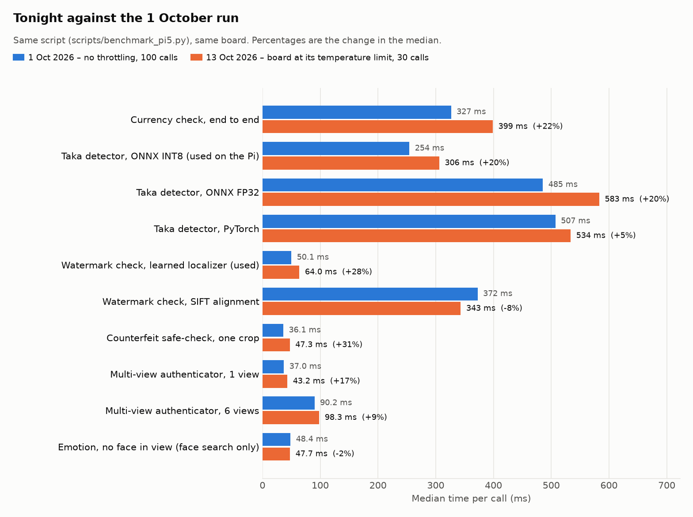

# SARA on the Raspberry Pi 5: benchmark report

Run on 13 October 2026, starting 23:32 local time, on the glass's own board (Raspberry Pi 5 Model B Rev 1.0, 4 cores, Python 3.13.5, torch 2.14.1+cpu, ONNX Runtime 1.30.0, EasyOCR 1.7.2). No GPU; everything runs on the CPU.

## Headline numbers

| What | Median | 95th percentile |
|---|---:|---:|
| Currency check, end to end | 399 ms | 524 ms |
| Taka detector, ONNX INT8 (used on the Pi) | 306 ms | 446 ms |
| Watermark check, learned localizer (used) | 64.0 ms | 109 ms |
| Counterfeit safe-check, one crop | 47.3 ms | 77.7 ms |
| Object scan, as the app runs it (YOLOv8s) | 562 ms | 610 ms |
| Emotion, face in view | 680 ms | 926 ms |
| Text reading, 3-line sign, text found once (the README's measure) | 18.25 s | slowest of 4: 18.49 s |
| Text reading, 3-line sign, as the app runs it | 34.01 s | slowest of 3: 34.70 s |
| Text reading, 12-line page: first line spoken | 16.42 s | – |
| Text reading, 12-line page: whole page | 36.48 s | slowest of 3: 39.89 s |

Peak core temperature 88.7 °C. Memory held by the mode benchmark at its end: 1.44 GB; by the text-reading test: 2.33 GB.

What stands out:

- The board ran at its temperature limit: the CPU was throttled in 76% of the samples during the text-reading test. Every number here is for a hot, throttled board.
- Text reading is the slow mode by far, and in the app a short sign takes 34.01 s where the benchmark path takes 18.25 s, because the text detector runs twice.
- Emotion takes 680 ms when there is a face to classify; the 47.7 ms from the project script is a frame with no face.
- The object scan now uses YOLOv8s at 562 ms; YOLOv8n takes 227 ms.
- On a blank frame the text reader worked for 27.52 s and then returned made-up letters instead of "no text found".

## Read this first: the board was at its temperature limit

The Pi was at 73.2 °C before the first timing call and the firmware flag already read `0x80000` (soft temperature limit has occurred). At the end of the mode benchmark it read `0xe0008`: soft temperature limit active now; CPU clock capping has occurred; throttling has occurred; soft temperature limit has occurred.

- Mode benchmark (2.2 min): mean 81.9 °C, peak 85.9 °C. The soft temperature limit was active in 61% of the 2-second samples and the CPU was throttled or clock-capped in 11%.
- OCR response test (15.0 min): mean 85.1 °C, peak 88.7 °C. Soft limit active in 23% of samples, throttled or clock-capped in 76%.
- Lowest CPU clock seen while it was logged (extra timings and OCR test only): 1.50 GHz; full speed is 2.40 GHz.
- Under-voltage was never reported, so the power supply is not the cause. The fan was running (up to 10,152 rpm).

So these are the speeds of a hot glass, which is the state it was in after tonight's 2 sessions with the app (its own log shows up to 82.6 °C during them). The README figures come from the 1 October run, when the same script ended with the flag at `0x0` and a 77.1 °C peak over 30 minutes. This run cannot say how much of the difference is heat; a repeat with the board cool would.

## Full latency list

Each row is 30 timed calls after 3 warm-up calls, from `scripts/benchmark_pi5.py` unless marked. Frames are 640x480, the glass camera size.

| Group | Benchmark | Median | 95th pct | Mean | Calls/s | Load | Memory after | Temp after |
|---|---|---:|---:|---:|---:|---:|---:|---:|
| Currency | Currency check, end to end | 399 ms | 524 ms | 416 ms | 2.51 | 322 ms | 1.18 GB | 81.5 °C |
| Currency | Taka detector, ONNX INT8 (used on the Pi) | 306 ms | 446 ms | 327 ms | 3.27 | 0.5 ms | 1.35 GB | 82.6 °C |
| Currency | Taka detector, ONNX FP32 | 583 ms | 808 ms | 604 ms | 1.71 | 3.9 ms | 1.26 GB | 82.6 °C |
| Currency | Taka detector, PyTorch | 534 ms | 683 ms | 558 ms | 1.87 | 326 ms | 1.20 GB | 83.2 °C |
| Watermark | Watermark check, learned localizer (used) | 64.0 ms | 109 ms | 68.9 ms | 15.63 | 600 ms | 1.37 GB | 83.2 °C |
| Watermark | Watermark check, SIFT alignment | 343 ms | 381 ms | 347 ms | 2.91 | 627 ms | 1.35 GB | 81.5 °C |
| Counterfeit check | Counterfeit safe-check, one crop | 47.3 ms | 77.7 ms | 48.1 ms | 21.13 | 208 ms | 1.37 GB | 82.6 °C |
| Counterfeit check | Multi-view authenticator, 1 view | 43.2 ms | 146 ms | 58.7 ms | 23.17 | 265 ms | 1.37 GB | 82.6 °C |
| Counterfeit check | Multi-view authenticator, 2 views | 63.1 ms | 129 ms | 73.9 ms | 15.86 | 272 ms | 1.37 GB | 83.2 °C |
| Counterfeit check | Multi-view authenticator, 3 views | 71.9 ms | 110 ms | 74.7 ms | 13.91 | 273 ms | 1.37 GB | 83.2 °C |
| Counterfeit check | Multi-view authenticator, 4 views | 82.9 ms | 118 ms | 87.7 ms | 12.07 | 276 ms | 1.37 GB | 83.7 °C |
| Counterfeit check | Multi-view authenticator, 5 views | 94.2 ms | 137 ms | 98.4 ms | 10.61 | 289 ms | 1.37 GB | 82.0 °C |
| Counterfeit check | Multi-view authenticator, 6 views | 98.3 ms | 121 ms | 103 ms | 10.17 | 284 ms | 1.38 GB | 83.2 °C |
| Objects | Object scan, as the app runs it (YOLOv8s) | 562 ms | 610 ms | 565 ms | 1.78 | 709 ms | 1.41 GB | 83.7 °C |
| Objects | Object detector YOLOv8s alone † | 557 ms | 672 ms | 571 ms | 1.79 | 68.4 ms | 0.78 GB | 83.7 °C |
| Objects | Object detector YOLOv8n alone † | 227 ms | 342 ms | 242 ms | 4.41 | 57.8 ms | 0.71 GB | 82.6 °C |
| Emotion | Emotion, face in view † | 680 ms | 926 ms | 706 ms | 1.47 | 2,212 ms | 0.68 GB | 83.2 °C |
| Emotion | Emotion, no face in view (face search only) | 47.7 ms | 50.4 ms | 48.1 ms | 20.97 | 1,243 ms | 1.44 GB | 82.6 °C |

† from `benchmark_report/scripts/extras_bench.py`, because the datasets the project script reads are not on the Pi. These rows ran in a separate process, so their memory column cannot be compared with the others.

Load is the time to build the model object in that process. The ONNX detectors are only read from disk on their first call, so their load column is near zero, and a row that reuses a library an earlier row imported loads faster. Memory is the whole benchmark process after that row ran, not the size of that one model.

- **Emotion.** The project script has no face pictures on the Pi (RAF-DB is absent), so it times a black frame: 47.7 ms is the face search finding nothing. With a face in view (the astronaut test picture, face found, classifier `rgb_mobilenet_blend`) one answer takes 680 ms, which is 14 times longer.
- **Objects.** The app now loads YOLOv8s (562 ms per scan). YOLOv8n on the same frames takes 227 ms; the README's 207 ms object figure was YOLOv8n. COCO pictures are not on the Pi, so the scan was timed on the note photos; the detector does the same amount of work on any picture.
- **Currency.** Only two note photos are on the Pi (the 500 and 1,000 Taka templates), so every currency, watermark and counterfeit-check row cycles through those two.

## Against the 1 October run

| Benchmark | 1 Oct median | Tonight median | Change |
|---|---:|---:|---:|
| Currency check, end to end | 327 ms | 399 ms | +22% |
| Taka detector, ONNX INT8 (used on the Pi) | 254 ms | 306 ms | +20% |
| Taka detector, ONNX FP32 | 485 ms | 583 ms | +20% |
| Taka detector, PyTorch | 507 ms | 534 ms | +5% |
| Watermark check, learned localizer (used) | 50.1 ms | 64.0 ms | +28% |
| Watermark check, SIFT alignment | 372 ms | 343 ms | -8% |
| Counterfeit safe-check, one crop | 36.1 ms | 47.3 ms | +31% |
| Multi-view authenticator, 1 view | 37.0 ms | 43.2 ms | +17% |
| Multi-view authenticator, 2 views | 56.6 ms | 63.1 ms | +11% |
| Multi-view authenticator, 3 views | 62.9 ms | 71.9 ms | +14% |
| Multi-view authenticator, 4 views | 71.3 ms | 82.9 ms | +16% |
| Multi-view authenticator, 5 views | 81.5 ms | 94.2 ms | +16% |
| Multi-view authenticator, 6 views | 90.2 ms | 98.3 ms | +9% |
| Emotion, no face in view (face search only) | 48.4 ms | 47.7 ms | -2% |

The two runs differ in more than temperature: 1 October used 100 calls per row and tonight 30, and parts of the code have changed since (config.py dates changes on 2 and 13 October). The slowdown is consistent with the throttling shown above, but this run does not prove that heat is the only cause. The object scan was skipped on 1 October (its weights were missing then).

## Text reading (OCR) response time

This times `OCRMode.process_frame()`, the call `main.py` makes when ACTION is pressed in text mode, on rendered signs and pages whose text is known. Settings as shipped: pipeline `v2`, decoder `greedy`, canvas 2560, text detector `OrtDetector`, 4 threads. Each row is the median of 3 to 5 captures.

The firmware reported throttling in 76% of the samples during this test (mean 85.1 °C), and the CPU clock was below 2.0 GHz in 77% of them instead of the full 2.4 GHz. These are the times of a throttled CPU; this was the last and hottest step of the run.

| Capture | Runs | Total | Range | Finding text | Reading letters | Rest | First line spoken | Character errors |
|---|---:|---:|---:|---:|---:|---:|---:|---:|
| English sign, 3 lines (640x480) | 3 | **34.01 s** | 33.76 s – 34.70 s | 30.13 s | 3.95 s | 0.01 s | – | 0.0% |
| Bangla sign, 1 line (640x480) | 3 | **35.40 s** | 27.64 s – 35.76 s | 32.97 s | 1.02 s | 0.01 s | – | 0.0% |
| Bangla sign, 3 lines (640x480) | 3 | **38.55 s** | 36.26 s – 44.46 s | 35.07 s | 3.48 s | 0.01 s | – | 0.0% |
| Label, 6 lines Bangla + English (640x480) | 3 | **21.79 s** | 21.72 s – 22.52 s | 13.33 s | 8.61 s | 0.01 s | 15.07 s | 1.0% |
| Page, 12 lines Bangla + English (640x480) | 3 | **36.48 s** | 35.16 s – 39.89 s | 14.22 s | 22.34 s | 0.01 s | 16.42 s | 0.0% |
| Page, 12 lines Bangla + English (1280x720) | 3 | **28.01 s** | 27.70 s – 29.37 s | 11.28 s | 16.73 s | 0.01 s | 13.08 s | 0.0% |
| No text in view (640x480) | 3 | **27.52 s** | 26.90 s – 28.64 s | 27.34 s | 0.00 s | 0.18 s | – | – |

- **One pass of the text detector takes 11 to 18 s on this board, whatever is in the picture.** That is the floor under every capture, and it is paid before a single letter is read.
- **Short signs pay for the detector twice in the app.** The 3-line English sign takes 18.25 s when the text is found once (the path `benchmark_pi5.py` times; the 1 October run measured 18.73 s on this same frame) and 34.01 s in the app, where the detector runs 2 times: once to count the lines for line-by-line speech (`_read_page_streaming`), then again inside the normal read when there are fewer than 4 lines. All 3 short captures show it (34 to 39 s in the app).
- **Pages are spoken line by line.** On the 12-line page at camera size the first line reaches speech after 16.42 s and the whole page takes 36.48 s. Here reading the letters (22.34 s over 12 lines) costs more than finding them (14.22 s).
- **The same page at 1280x720 is faster (28.01 s) than at 640x480 (36.48 s).** A 640x480 frame is enlarged to 1200x900 before detection, which is more pixels than a 1280x720 frame that is used as it is.
- **With no text in view the glass still works for 27.52 s** (2 detector passes). On the blank grey test frame it did not answer "no text found": the handwritten-letter fallback returned 48 characters (`বববববববববববব…`). Worth checking on a real blank wall.
- Loading the text reader takes 8.72 s; the first capture after loading took 17.36 s.

| Capture | Text found once | As the app runs | Change |
|---|---:|---:|---:|
| English sign, 3 lines (640x480) | 18.25 s | 34.01 s | +86% |
| Bangla sign, 1 line (640x480) | 17.46 s | 35.40 s | +103% |
| Bangla sign, 3 lines (640x480) | 16.56 s | 38.55 s | +133% |

What was read (app path, last run of each capture):

| Capture | Text on the picture | Text the glass read |
|---|---|---|
| English sign, 3 lines (640x480) | EXIT 12 Bus Stop Main Entrance | EXIT 12 Bus Stop Main Entrance |
| Bangla sign, 1 line (640x480) | ধূমপান নিষেধ | ধূমপান নিষেধ |
| Bangla sign, 3 lines (640x480) | ধূমপান নিষেধ ডাকঘর নিরাপদ পানীয় জল | ধূমপান নিষেধ ডাকঘর নিরাপদ পানীয় জল |
| Label, 6 lines Bangla + English (640x480) | Paracetamol 500 mg মেয়াদ উত্তীর্ণের তারিখ Best Before 2027 দাম ৮৫ টাকা Price 120 Taka চিনি এক কেজি | Paracetamol 500 mg মেয়াদ উত্তীর্ণের তারিখ Best Before 2027 দাম ৮৫ টাকা Price 120 Taka চিনি এক কৌজি |
| Page, 12 lines Bangla + English (640x480) | সরকারি প্রাথমিক বিদ্যালয় Emergency Room জুতা খুলে প্রবেশ করুন Closed on Monday ঢাকা মেডিকেল কলেজ Drinking Water রক্ত পরীক্ষা কেন্দ্র Electricity Bill শিশুদের খেলার মাঠ Train Schedule ভাড়া দেওয়া হবে Cash Counter | সরকারি প্রাথমিক বিদ্যালয় Emergency Room জুতা খুলে প্রবেশ করুন Closed on Monday ঢাকা মেডিকেল কলেজ Drinking Water রক্ত পরীক্ষা কেন্দ্র Electricity Bill শিশুদের খেলার মাঠ Train Schedule ভাড়া দেওয়া হবে Cash Counter |
| Page, 12 lines Bangla + English (1280x720) | সরকারি প্রাথমিক বিদ্যালয় Emergency Room জুতা খুলে প্রবেশ করুন Closed on Monday ঢাকা মেডিকেল কলেজ Drinking Water রক্ত পরীক্ষা কেন্দ্র Electricity Bill শিশুদের খেলার মাঠ Train Schedule ভাড়া দেওয়া হবে Cash Counter | সরকারি প্রাথমিক বিদ্যালয় Emergency Room জুতা খুলে প্রবেশ করুন Closed on Monday ঢাকা মেডিকেল কলেজ Drinking Water রক্ত পরীক্ষা কেন্দ্র Electricity Bill শিশুদের খেলার মাঠ Train Schedule ভাড়া দেওয়া হবে Cash Counter |

These are clean rendered pictures, not camera photos, so the error rates say only that the timed captures were real reads. The pictures are saved in `raw/ocr_input_*.png`.

## What the app itself logged tonight

The glass was run twice tonight before this benchmark (`20261013_231246_memo`, `20261013_231716_memo`). These are the latencies its own field log recorded with the real camera.

| What | Times | Median | Range |
|---|---:|---:|---:|
| Text reading: one capture | 1 | 39.90 s | – |
| Object scan and announcement | 10 | 777 ms | 687 ms – 1,065 ms |
| Currency check | 8 | 406 ms | 372 ms – 670 ms |
| Watermark check (guided, several frames) | 1 | 3.56 s | – |
| UV fibre check | 3 | 932 ms | 842 ms – 1,397 ms |

The app's one real text capture took 39.90 s, close to the 34 to 39 s measured above for short captures as the app runs them. The running app reached 2.99 GB of memory (all modes loaded, camera and preview window open). The app logged up to 82.6 °C.

## Loading, speech and camera

| What | Time |
|---|---:|
| Text reader (EasyOCR, Bangla + English) | 8.72 s |
| Currency mode, first switch into it | 2.13 s |
| Currency mode, warm-up pass | 1.53 s |
| Emotion detector | 2.21 s |
| Object mode (YOLOv8s) | 0.71 s |
| Watermark checker | 0.60 s |
| Multi-view authenticator | 0.27 s |
| Camera, open to first frame | 1.43 s |
| Currency mode, first check after switching | 478 ms |
| Currency mode, later checks | 429 ms |
| Currency mode, switching back into it | 0.0 ms |
| Speech: short Bangla sentence (5.93 s of audio) | 17.5 ms |
| Speech: short English sentence (5.57 s of audio) | 14.3 ms |
| Speech: six Bangla lines (16.72 s of audio) | 28.5 ms |
| Camera: time between frames (640x480) | 132 ms (7.6 frames/s) |

Speech is espeak-ng writing the audio to a pipe, not playing it: the voice adds almost nothing to the response time.
The camera delivered 7.6 frames a second with the app's own settings (MJPG, 640x480, 30 frames/s requested). It was measured indoors at midnight; a USB camera usually slows down in dim light, and that was not checked in daylight. The frame rate sets how old the picture is when a button is pressed.

## How this was measured

1. `scripts/pi5_preflight.py`: every model file present, each ONNX model ran one dummy input (passed).
2. `scripts/benchmark_pi5.py --iters 30 --warmup 3` for every mode except text reading (result: `raw/pi5_benchmark_memo_20261013T173438Z.json`, also saved by the script in `savior_glass/results/`).
3. `scripts/measure_mode_switch.py` for the currency mode switch.
4. `benchmark_report/scripts/extras_bench.py`: emotion with a face, both object detectors, speech, camera.
5. `benchmark_report/scripts/ocr_response_bench.py`: the text reader, 3 to 5 captures per picture.
6. `benchmark_report/scripts/sys_sampler.py` logged temperature, throttle flag, CPU and memory every 2 s throughout.

Limits of this run:

- VS Code and its language server were running on the Pi during the run and use some CPU and memory.
- Text reading was left out of step 2 because 33 captures would have added about ten minutes; step 5 times the same call on the same frame.
- The 30-minute sustained run (`--sustained 30`) was not repeated tonight.
- The steps ran one after another on a board that kept heating up; text reading came last and was the hottest.
- The CPU clock was logged only from the extra timings onwards.
- OCR and emotion pictures are rendered or stock pictures, not photos from the glass camera.

To rebuild this report from the raw files: `~/.venvs/savior_glass/bin/python benchmark_report/scripts/make_report.py`.
